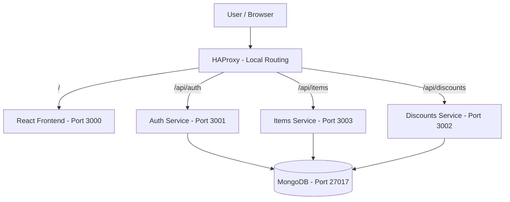
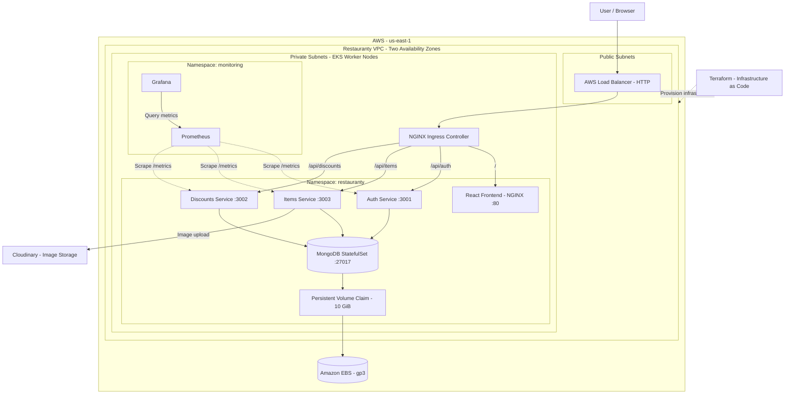
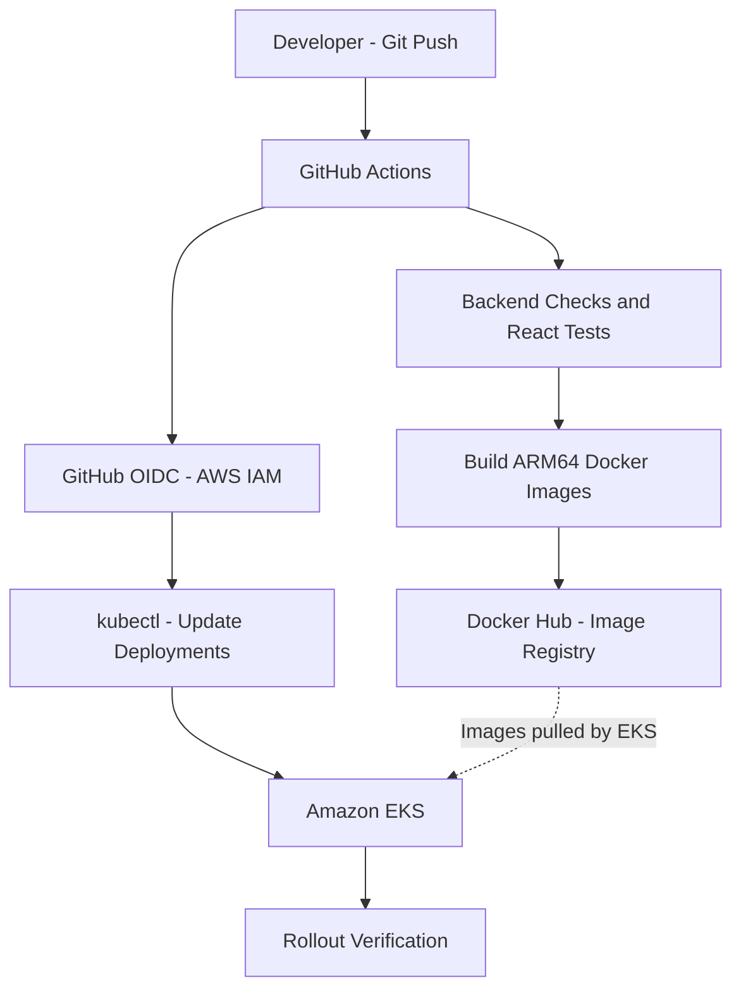
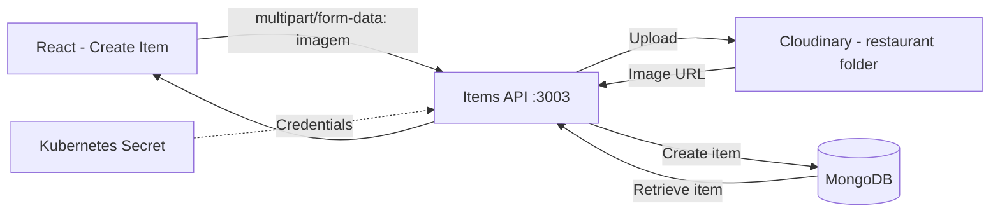
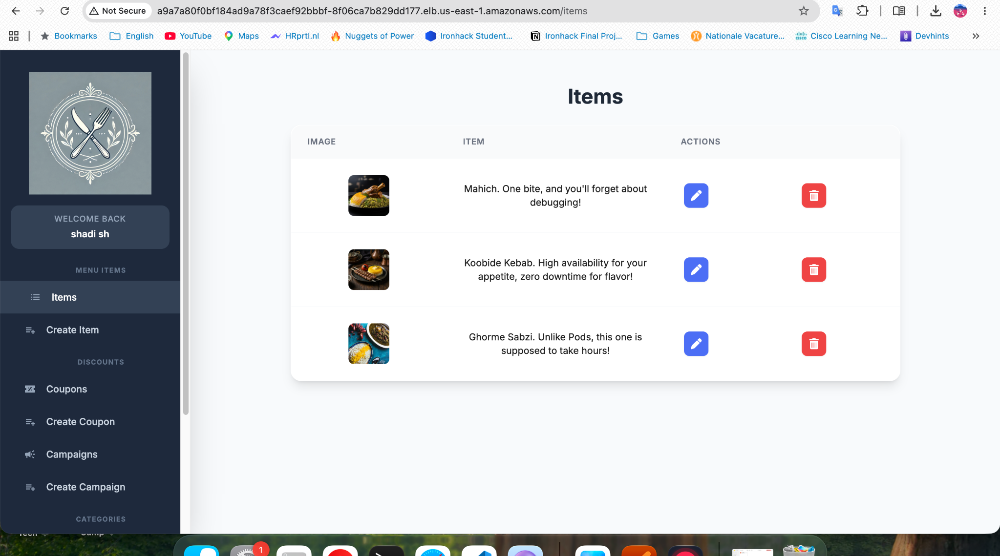

# Restauranty — End-to-End DevOps Deployment

**A microservices-based restaurant management application deployed on AWS EKS using Terraform, Docker, Kubernetes, GitHub Actions, Prometheus, and Grafana.**

Restauranty is a restaurant management platform built with three Node.js/Express backend services, a React frontend, and MongoDB.

The goal of this project was to transform the application into a cloud-deployed, containerized system with automated CI/CD, persistent storage, monitoring, and network security.

## Project Overview

| Component | Technology |
|---|---|
| Frontend | React, NGINX |
| Backend | Node.js, Express |
| Database | MongoDB |
| Image storage | Cloudinary |
| Local Routing | HAProxy |
| Containerization | Docker |
| Cloud Provider | Amazon Web Services |
| Infrastructure as Code | Terraform |
| Container Orchestration | Amazon EKS / Kubernetes |
| Cloud Routing | AWS Load Balancer, NGINX Ingress |
| CI/CD | GitHub Actions |
| Container Registry | Docker Hub |
| Cloud Authentication | AWS IAM, OIDC |
| Monitoring | Prometheus, Grafana |
| Security | JWT, Kubernetes Secrets, Security Groups, NetworkPolicies |
| Persistent Storage | Amazon EBS, gp3 |

## Architecture

The project includes two architectural views:

1. **Baseline Application Architecture:** The original application structure and local routing.
2. **Implemented AWS Architecture:** The cloud infrastructure, Kubernetes workloads, automated delivery, monitoring, and security implemented for the final project.

### 1. Baseline Application Architecture

The baseline application consists of a React frontend, three Node.js/Express microservices, and MongoDB.

HAProxy routes requests to the appropriate application service in the local environment.



### 2. Implemented Architecture — AWS EKS

The final deployment runs in AWS `us-east-1`.

Terraform provisions the VPC and EKS infrastructure. The application runs as Kubernetes workloads on two ARM64 managed worker nodes across two Availability Zones.



**Infrastructure details:**

- AWS Region: `us-east-1`
- EKS Cluster: `restauranty-eks`
- Worker Nodes: 2 managed ARM64 nodes
- Node Operating System: Amazon Linux 2023
- Network: VPC with public and private subnets
- Availability Zones: `us-east-1a` and `us-east-1b`
- Ingress: NGINX Ingress Controller
- Database Storage: 10 GiB encrypted Amazon EBS gp3 volume
- Kubernetes Namespace: `restauranty`
- Monitoring Namespace: `monitoring`

### 3. CI/CD Architecture

GitHub Actions automates validation, image building, publishing, and deployment.



The workflow:

1. Checks out the repository.
2. Installs dependencies and runs available backend checks.
3. Runs React tests and builds the frontend.
4. Builds four ARM64 Docker images.
5. Publishes images to Docker Hub.
6. Uses AWS IAM/OIDC for deployment authentication.
7. Updates Kubernetes Deployments with the new image tags.
8. Verifies deployment rollouts.

The workflow runs CI checks on configured pushes and pull requests. Automatic deployment to EKS is configured for pushes to the `final-project` branch.

Configuration:

[GitHub Actions Workflow](.github/workflows/ci-cd.yaml)

### 4. Architecture Comparison

| Component | Baseline Application | Implemented DevOps Architecture |
|---|---|---|
| Frontend | React application | React served by NGINX in Kubernetes |
| Backend | Three Node.js services | Three containerized microservices |
| Routing | HAProxy locally | AWS Load Balancer and NGINX Ingress |
| Database | MongoDB | MongoDB StatefulSet with persistent storage |
| Infrastructure | Local environment | Terraform-managed AWS VPC and EKS |
| Deployment | Manual startup | Automated GitHub Actions deployment |
| Container Images | Local Docker images | ARM64 images published to Docker Hub |
| Monitoring | Application endpoints | Prometheus and Grafana |
| Logging | Application console logs | Kubernetes application logs |
| Security | JWT authentication | JWT, Kubernetes Secrets, AWS IAM/OIDC, Security Groups, NetworkPolicies |
| Recovery | Manual intervention | Demonstrated Kubernetes rollback |

## Microservices

| Service | Port | Route | Responsibility |
|---|---|---|---|
| Auth | 3001 | `/api/auth/*` | Authentication, signup, login, JWT |
| Discounts | 3002 | `/api/discounts/*` | Coupons and campaigns |
| Items | 3003 | `/api/items/*` | Menu items, dietary categories, orders |
| Frontend | 3000 locally / 80 on EKS | `/` | React user interface |

All three backend services communicate with MongoDB.

The Items and Discounts services use JWT authentication to protect their API routes.

## Local Development

### Prerequisites

- Git
- Node.js 20 or newer
- npm
- Docker and Docker Compose
- HAProxy for direct local routing

### Option A — Run Services Directly

Clone the repository:

```bash
git clone https://github.com/shadishirazi68/devops.restauranty.git
cd devops.restauranty
git checkout final-project
```

Prepare local environment files for the backend services using the provided `.env.example` templates.

Use development-only secrets and a local MongoDB connection string. Do not commit `.env` files.

Start MongoDB locally, then run the services in separate terminals.

Auth:

```bash
cd backend/auth
npm install
npm start
```

Discounts:

```bash
cd backend/discounts
npm install
npm start
```

Items:

```bash
cd backend/items
npm install
npm start
```

Frontend:

```bash
cd client
npm install
npm start
```

From the repository root, start HAProxy using:

```bash
haproxy -f haproxy.cfg
```

The local HAProxy configuration listens on port 80 and forwards requests to the corresponding services.

See the detailed setup:

[Local Deployment Documentation](docs/02-local-deployment.md)

### Option B — Docker Compose

The repository includes a `compose.yaml` file for containerized local development.

Prepare the backend `.env` files first.

Create the external Docker network:

```bash
docker network create restauranty-local-net
```

Start a local MongoDB container on the same network:

```bash
docker run -d --name restauranty-mongo --network restauranty-local-net -v restauranty-local-mongo-data:/data/db mongo:7
```

Start the application containers:

```bash
docker compose up --build -d
```

Check their status:

```bash
docker compose ps
```

The Docker Compose proxy exposes the application at:

```text
http://localhost:8088
```

This option assumes that the required environment files are configured and the local MongoDB container is running.

For the full containerization process, see:

[Docker Documentation](docs/04-docker-containerization.md)

## Environment Variables and Secrets

Application configuration is separated from source code.

| Variable | Purpose |
|---|---|
| `SECRET` | JWT signing secret |
| `MONGODB_URI` | MongoDB connection string |
| `PORT` | Backend application port |
| `CLOUD_NAME` | Cloudinary cloud name |
| `CLOUD_API_KEY` | Cloudinary API key |
| `CLOUD_API_SECRET` | Cloudinary API secret |

The Cloudinary variables are used by the application's existing image-upload code. Image uploads were verified on EKS, with credentials provided by a Kubernetes Secret.

For Kubernetes, the application uses Secrets including:

- `restauranty-backend-secrets`
- `restauranty-mongodb-auth`

Sensitive values must not be committed to the repository or exposed in screenshots.

## AWS Infrastructure — Terraform

Terraform provisions the infrastructure required for the EKS deployment.

Implemented resources and components include:

- AWS VPC
- Public and private subnets
- Internet Gateway
- NAT Gateway
- Security Groups
- Amazon EKS cluster
- Managed worker node group
- Required EKS add-ons

The infrastructure configuration is stored in:

[Terraform Configuration](terraform/)

To inspect the infrastructure configuration:

```bash
cd terraform
terraform init
terraform validate
terraform plan
```

Review the Terraform plan carefully before applying changes to AWS.

The detailed implementation is documented in:

[Terraform Setup](docs/05-terraform-setup.md)

## Kubernetes Deployment

The Restauranty application is deployed on Amazon EKS.

Configure access to the existing cluster:

```bash
aws eks update-kubeconfig --name restauranty-eks --region us-east-1
```

Verify worker nodes:

```bash
kubectl get nodes
```

Check the application resources:

```bash
kubectl -n restauranty get pods
kubectl -n restauranty get deployments
kubectl -n restauranty get services
kubectl -n restauranty get ingress
kubectl -n restauranty get pvc
```

The application includes:

- Four Kubernetes Deployments
- Four application Services
- NGINX Ingress routing
- MongoDB StatefulSet
- Persistent storage
- Kubernetes Secrets
- NetworkPolicies

The Kubernetes manifests are maintained in:

[Kubernetes Configuration](k8s/)

A new environment must have its AWS infrastructure, required controllers, storage driver, namespaces, and Secrets prepared before applying the application manifests.

For the full deployment process:

[Kubernetes Deployment Documentation](docs/06-kubernetes-deployment.md)

## Database Persistence and Migration

MongoDB runs as a Kubernetes StatefulSet.

Persistent storage is provided using:

- Amazon EBS
- Encrypted gp3 StorageClass
- Persistent Volume Claim
- 10 GiB requested storage

The existing user record was migrated from the local Docker MongoDB database to MongoDB on Amazon EKS. The migration was verified through a database record-count check and a successful login using the existing account.

Persistence was also tested across a MongoDB pod restart.

[Database Migration Documentation](docs/07-database-migration.md)

## Monitoring and Logging

Restauranty uses Prometheus and Grafana for application monitoring.

### Prometheus

Prometheus collects metrics from:

- `restauranty-auth`
- `restauranty-discounts`
- `restauranty-items`

The application exposes a `/metrics` endpoint on each backend service.

A Kubernetes ServiceMonitor collects these metrics every 15 seconds.

All three backend targets were verified as healthy.

### Grafana

The application dashboard includes:

1. HTTP Request Rate
2. MongoDB Connection Status

Traffic-generation testing confirmed that the request-rate visualization responded to application requests.

The MongoDB connection status metric reported healthy connections.

### Accessing Monitoring

Port-forward Prometheus:

```bash
kubectl -n monitoring port-forward svc/monitoring-kube-prometheus-prometheus 9090:9090
```

Prometheus:

```text
http://localhost:9090
```

Port-forward Grafana in a separate terminal:

```bash
kubectl -n monitoring port-forward svc/monitoring-grafana 3100:80
```

Grafana:

```text
http://localhost:3100
```

### Application Logs

Inspect backend logs:

```bash
kubectl -n restauranty logs deployment/restauranty-auth --tail=30
kubectl -n restauranty logs deployment/restauranty-discounts --tail=30
kubectl -n restauranty logs deployment/restauranty-items --tail=30
```

Monitoring configuration and the exported dashboard are available in:

[Monitoring Documentation](docs/09-monitoring.md)

## Security Implementation

Security was implemented at both the AWS infrastructure level and Kubernetes workload level.

### Authentication and Secrets

- JWT authentication protects application API routes.
- Missing authorization tokens result in HTTP 401 responses.
- Kubernetes Secrets are used for sensitive runtime configuration.
- GitHub Actions uses AWS IAM/OIDC for cloud deployment authentication.

### Kubernetes NetworkPolicies

Four NetworkPolicies were implemented:

| NetworkPolicy | Purpose |
|---|---|
| `allow-frontend-ingress` | Allows permitted traffic to the frontend |
| `allow-backend-ingress` | Allows required backend and monitoring traffic |
| `allow-mongodb-ingress` | Restricts MongoDB access to authorized backend pods |
| `default-deny-ingress` | Blocks inbound connections not otherwise allowed |

AWS VPC CNI NetworkPolicy support was enabled through Terraform.

### Network Security Verification

The following tests were completed:

| Test | Result |
|---|---|
| Frontend connectivity | HTTP 200 |
| Items API without JWT | HTTP 401 |
| Authorized backend connection to MongoDB | Connected |
| Unauthorized pod connection to MongoDB | Connection blocked |
| Application pods | 5/5 Running |
| MongoDB connection monitoring | Healthy |

The unauthorized connection was also tested against the MongoDB Pod IP to reduce DNS-related ambiguity.

### Container Security

The backend containers run under a non-root user.

| Container | Runtime User |
|---|---|
| Auth | UID 1000 |
| Discounts | UID 1000 |
| Items | UID 1000 |
| Frontend | UID 0 |

Running the frontend as a non-root user is a planned security improvement.

The implemented NetworkPolicies restrict ingress traffic. Additional egress restrictions are not yet implemented.

For security decisions, test results, and future improvements:

[Security Documentation](SECURITY.md)

[Detailed Security Implementation](docs/08-security.md)

## Cloudinary Image Upload Integration

The React **Create Item** form sends an authenticated image upload to the Items API (`POST /api/items/items`). The backend uses Multer and Cloudinary to store the image in the `restaurant` folder. The hosted image URL is associated with the item in MongoDB and later displayed on the Items page.

Credentials are referenced through the Kubernetes Secret `restauranty-cloudinary`, not committed in YAML. The first upload failed with `Invalid cloud_name` (Cloudinary 401); after correcting the Secret value and restarting the Items Deployment, the upload succeeded.



Three images were confirmed in Cloudinary and displayed on the deployed Restauranty Items page. The demo used **Mahicheh, Koobideh Kebab, and Ghormeh Sabzi**, with short descriptions containing DevOps humor.



*Figure — Completed Cloudinary image-upload demo on Amazon EKS.*

For the implementation steps, troubleshooting and verification screenshots, see [Phase 10 — Cloudinary Integration](docs/10-cloudinary-integration.md).

## Rollback and Recovery

Kubernetes deployment rollback was demonstrated and recorded.

The rollback process was used to show how a previous deployment revision can be restored and verified.

Example commands:

```bash
kubectl -n restauranty rollout history deployment/restauranty-items
kubectl -n restauranty rollout undo deployment/restauranty-items
kubectl -n restauranty rollout status deployment/restauranty-items
```

These commands are documentation examples. Rollback should only be performed intentionally against the relevant deployment.

## Project Demonstrations

Three demonstrations were recorded as evidence of the implemented DevOps workflows.

### 1. Kubernetes Rollback

Demonstrates Kubernetes deployment rollback and recovery.

[Watch the Rollback Demo](demos/kubernetes-rollback-demo.mp4)

### 2. CI/CD Pipeline

Demonstrates the automated validation, container image publishing, and deployment workflow.

[Watch the CI/CD Demo](demos/ci-cd-pipeline-demo.mp4)

### 3. Kubernetes Network Security

Demonstrates authorized and unauthorized MongoDB connection attempts.

[Watch the NetworkPolicy Security Test](demos/networkpolicy-security-test.mp4)

## Technical Documentation

The complete implementation process is documented in separate files.

| Document | Description |
|---|---|
| [01 — Git Setup](docs/01-git-setup.md) | Repository setup and version control |
| [02 — Local Deployment](docs/02-local-deployment.md) | Running the original application locally |
| [03 — Security Fixes](docs/03-security-fixes.md) | Authentication and application-level fixes |
| [04 — Docker Containerization](docs/04-docker-containerization.md) | Docker images and local container execution |
| [05 — Terraform Setup](docs/05-terraform-setup.md) | AWS infrastructure provisioning |
| [06 — Kubernetes Deployment](docs/06-kubernetes-deployment.md) | EKS application deployment |
| [07 — Database Migration](docs/07-database-migration.md) | MongoDB migration and persistence |
| [08 — Security](docs/08-security.md) | Kubernetes NetworkPolicies and security verification |
| [Monitoring](docs/09-monitoring.md) | Prometheus, Grafana, metrics, and logs |
| [10 — Cloudinary Integration](docs/10-cloudinary-integration.md) | Image uploads, troubleshooting and evidence |

### Evidence Screenshots

Implementation screenshots are organized by project phase.

[Browse Project Screenshots](docs/screenshots/)

Screenshots document configuration, successful deployments, troubleshooting, and verification results.

## Implementation Highlights

- Provisioned AWS infrastructure using Terraform.
- Deployed four containerized application services to Amazon EKS.
- Configured AWS networking across two Availability Zones.
- Used Kubernetes Ingress for application routing.
- Migrated MongoDB data and implemented persistent storage.
- Built an automated CI/CD pipeline using GitHub Actions.
- Published ARM64 Docker images to Docker Hub.
- Configured GitHub OIDC authentication for AWS deployment.
- Implemented Prometheus and Grafana monitoring.
- Verified application connectivity and JWT authentication.
- Enabled Kubernetes NetworkPolicy enforcement.
- Demonstrated authorized and unauthorized database connections.
- Recorded Kubernetes deployment rollback and recovery.

## Planned Enhancements

The following improvements are outside the verified implementation described above:

- Additional Grafana dashboard panels and service metrics
- Monitoring alerts
- Centralized logging using Grafana Loki and Alloy
- Amazon CloudWatch integration
- HTTPS/TLS and optional custom domain configuration
- Separate staging environment
- Staging-to-production deployment promotion
- Frontend non-root container execution
- Additional network egress restrictions
- Optional AWS CloudFormation demonstration

These enhancements are tracked separately and should not be considered completed until implemented and tested.

## Project Purpose

This project demonstrates an end-to-end DevOps workflow covering:

**Application → Containerization → Infrastructure as Code → Kubernetes → CI/CD → Monitoring → Security → Verification → Recovery**

The focus is not only on deploying the application, but also on making the deployment repeatable, observable, testable, and maintainable.

---

**Project:** Ironhack DevOps & Cloud — Final Project

**Repository:** https://github.com/shadishirazi68/devops.restauranty
