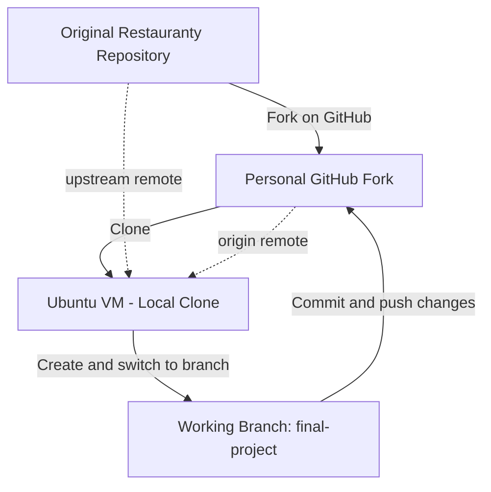

# Phase 1 — Git & Repository Setup

## Objective

Prepare the Restauranty source code for the DevOps final project by creating a personal GitHub fork, configuring a local Ubuntu development environment, and using a dedicated working branch.

## Repository Overview

| Item | Configuration |
|---|---|
| Project | Restauranty — End-to-End DevOps Deployment |
| Personal repository | [shadishirazi68/devops.restauranty](https://github.com/shadishirazi68/devops.restauranty) |
| Development environment | Ubuntu VM |
| `origin` | Personal GitHub fork |
| `upstream` | Original source repository |
| Working branch | `final-project` |

## Git Repository Architecture

The personal fork provides a separate repository for the final project, while the `upstream` remote preserves a reference to the original source. Development takes place locally on the `final-project` branch.



*Figure 1 — Repository relationship and Git workflow used for the final project.*

## Implementation

The following setup steps were completed:

1. Forked the original Restauranty repository into a personal GitHub account.
2. Cloned the personal fork into the Ubuntu development environment.
3. Verified the local Git user configuration.
4. Configured `origin` to reference the personal repository.
5. Added `upstream` to reference the original repository.
6. Created and checked out the dedicated `final-project` branch.

The separate branch was used to organize changes for the final DevOps implementation without treating the original source repository as the deployment repository.

## Verification

The repository configuration can be checked from the project root:

```bash
cd ~/devops.restauranty
git remote -v
git branch --show-current
git status --short
git log -1 --oneline
```

| Check | Expected result |
|---|---|
| `git remote -v` | `origin` points to the personal fork; `upstream` points to the original repository |
| `git branch --show-current` | `final-project` |
| `git status --short` | Lists any staged, modified, or untracked files; empty output means a clean working tree |
| `git log -1 --oneline` | Displays the most recent local commit |

A non-empty `git status --short` output is not necessarily an error: it can also indicate documentation or infrastructure changes that have not yet been committed.

## Evidence


*Figure 2 — Git remote configuration and active project branch.*

## Outcome

The repository was ready for subsequent phases, including local application deployment, Docker containerization, Terraform infrastructure, Kubernetes deployment, CI/CD, monitoring, and security hardening.

**Next phase:** [Local Application Deployment](02-local-deployment.md)

**Project overview:** [README](../README.md)
