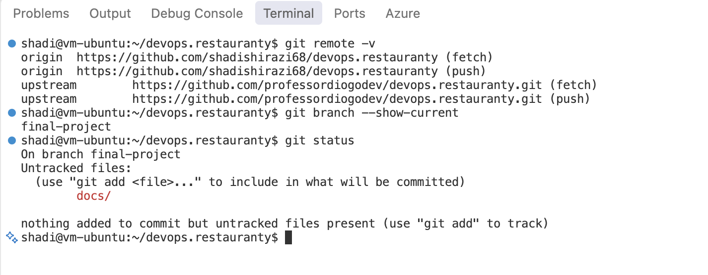

# Phase 1 — Git & Repository Setup

## Objective
The Restauranty repository was prepared for the DevOps final project.

## Implementation
- The original repository was forked into a personal GitHub account.
- The fork was cloned into the Ubuntu development environment.
- Git user configuration was verified.
- The `origin` remote was configured for the personal repository.
- The `upstream` remote was added for the original repository.
- A dedicated `final-project` branch was created.

## Verification
Git remotes, the active branch, and the working tree status were verified.

## Evidence

*Figure 1 — Git remote configuration and active project branch.*
