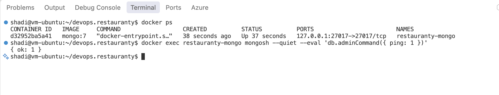
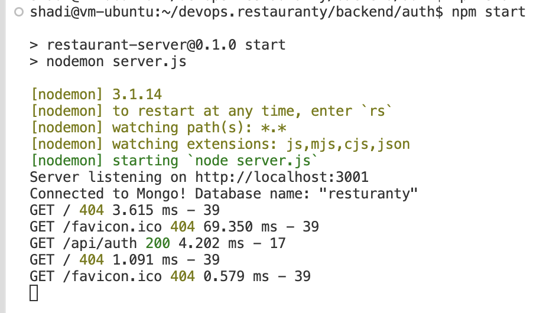
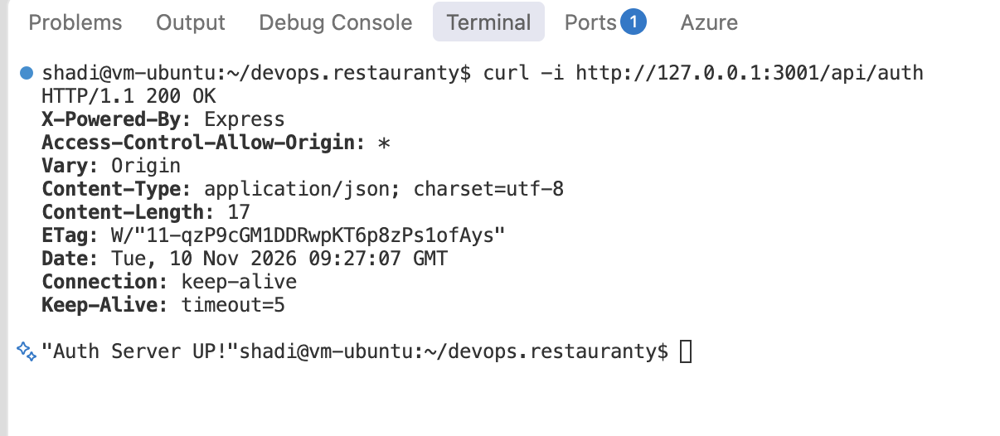

# Phase 2 — Local Deployment of Restauranty

## Objective

The Restauranty application is being prepared for local deployment. The application consists of three backend microservices (Auth, Discounts, and Items), a React frontend, MongoDB, and HAProxy.

The local environment is being configured and verified before containerizing and deploying the application to Kubernetes.

## Step 1 — MongoDB Setup

A MongoDB 7 container was created using Docker to provide the database service required by the Restauranty application.

The following configuration was applied:

- **Container Name:** `restauranty-mongo`
- **Docker Image:** `mongo:7`
- **Database Port:** `27017`
- **Host Binding:** `127.0.0.1`
- **Persistent Volume:** `restauranty-mongo-data`

The database port was bound to the local loopback interface to avoid exposing MongoDB publicly during local development.

### Verification

The running container was verified using `docker ps`.

Database availability was checked using `mongosh` and the MongoDB `ping` command.

The database returned `{ ok: 1 }`, confirming a successful response from MongoDB.

### Evidence

*Figure 3 — MongoDB Container Deployment and Connectivity Verification.*

### Result

**Status: Completed**

The MongoDB container is running and responding successfully to connectivity checks.

Application-level database connections and authentication have not yet been verified.

## Step 2 — Authentication Microservice

### Objective

The Auth microservice was configured and started locally to verify its connection to MongoDB and its HTTP API availability.

### Implementation

The required Node.js dependencies were installed using `npm ci`.

Environment variables were configured locally using the `.env.example` template, without exposing credentials in GitHub.

The Auth service was started using `npm start`, which runs `nodemon server.js`.

The service was configured to listen on port `3001` and connect to the local MongoDB database.

### Verification

The application startup logs confirmed:

- The server was listening on port 3001.
- The MongoDB connection was established successfully.
- The `/api/auth` endpoint returned HTTP 200 OK.
- The response body was `"Auth Server UP!"`.

The following command was used to verify the API:

`curl -i http://127.0.0.1:3001/api/auth`

### Evidence

*Figure 5 — Auth Microservice Startup and MongoDB Connection.*

*Figure 6 — Auth API Endpoint Verification.*

### Result

**Status: Completed — Initial Connectivity Verification**

The Auth microservice was successfully started, connected to MongoDB, and verified through an HTTP request.

Authentication workflows such as user registration and login have not yet been tested.
