# Phase 2 — Local Deployment of Restauranty

## Objective

The Restauranty application was prepared for local deployment. The application consists of three backend microservices (Auth, Discounts, and Items), a React frontend, MongoDB, and HAProxy.

The local environment was configured and verified incrementally before application containerization and Kubernetes deployment.

## Step 1 — MongoDB Setup

A MongoDB 7 container was created using Docker to provide the database service required by Restauranty.

The following configuration was applied:

- **Container Name:** `restauranty-mongo`
- **Docker Image:** `mongo:7`
- **Database Port:** `27017`
- **Host Binding:** `127.0.0.1`
- **Persistent Volume:** `restauranty-mongo-data`

The database port was bound to the local loopback interface to avoid public exposure during local development.

### Verification

The container status was verified using `docker ps`. Database availability was checked using `mongosh` and the MongoDB `ping` command.

The database returned `{ ok: 1 }`, confirming a successful response.

### Evidence

*Figure 3 — MongoDB Container Deployment and Connectivity Verification.*

### Result

**Status: Completed**

The MongoDB container was started successfully and responded to connectivity checks. Backend database connections were subsequently verified during microservice testing.

---

## Step 2 — Authentication Microservice

### Objective

The Auth microservice was configured and started locally to verify MongoDB connectivity and HTTP API availability.

### Implementation

The required dependencies were installed using `npm ci`.

Environment variables were configured locally using the `.env.example` template, without exposing credentials in GitHub.

The service was started using `npm start`, which runs `nodemon server.js`.

Port `3001` was configured for the Auth microservice.

### Verification

The startup logs confirmed that the server was listening on port `3001` and that MongoDB connectivity was established.

The API was tested using:

`curl -i http://127.0.0.1:3001/api/auth`

The endpoint returned HTTP `200 OK` with the response `"Auth Server UP!"`.

### Evidence

*Figure 5 — Auth Microservice Startup and MongoDB Connection.*

*Figure 6 — Auth API Endpoint Verification.*

### Result

**Status: Completed — Initial Connectivity Verification**

The Auth microservice was successfully started and its API availability was verified. Registration and login workflows have not yet been tested.

---

## Step 3 — Discounts Microservice

### Objective

The Discounts microservice was configured and deployed locally to verify its startup, MongoDB connectivity, and API availability.

### Implementation

The required Node.js dependencies were installed using `npm ci`.

Environment variables were configured using the `.env.example` template.

The service was started using `npm start`, which launches `nodemon server.js`.

Port `3002` was used for the Discounts microservice.

### Verification

The server startup logs confirmed that the service was listening on port `3002` and that the MongoDB connection was established successfully.

The API endpoint was tested using:

`curl -i http://127.0.0.1:3002/api/discounts`

The following results were observed:

- HTTP status: `200 OK`
- Response: `"Discounts Server UP!"`
- MongoDB connection: Successful

### Evidence

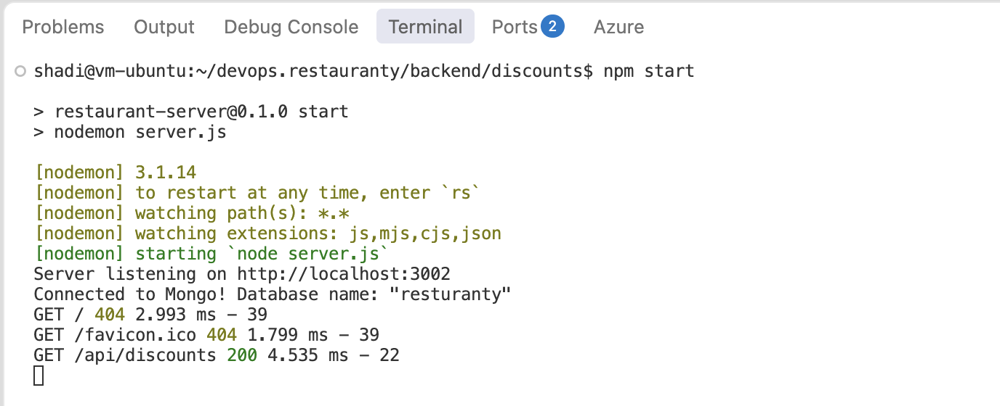

*Figure 7 — Discounts Microservice Startup and MongoDB Connection.*

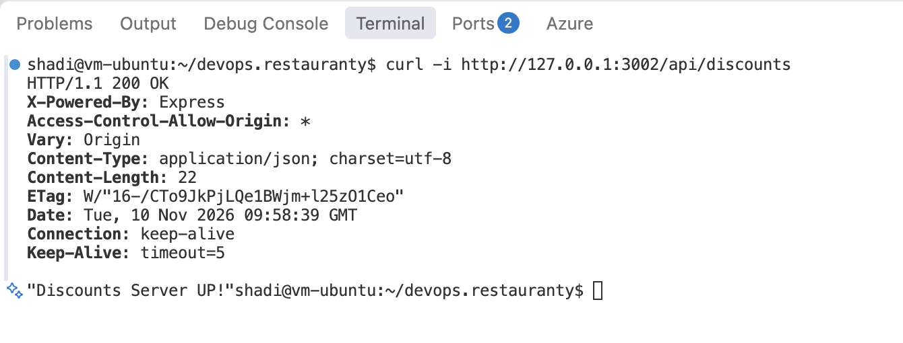

*Figure 8 — Discounts API Endpoint Verification.*

### Result

**Status: Completed — Initial Connectivity Verification**

The Discounts microservice was successfully started and its HTTP endpoint was verified. Individual discount and campaign operations have not yet been tested.

---

## Step 4 — Items Microservice

### Objective

The Items microservice was configured and started locally to verify database connectivity and HTTP API availability.

### Implementation

The required Node.js dependencies were installed using `npm ci`.

Environment variables were prepared using `.env.example`.

The Items microservice was started using `npm start`, which runs `nodemon server.js`.

Port `3003` was used for the service.

### Verification

The startup logs confirmed that the application was listening on port `3003` and was successfully connected to MongoDB.

The following command was used:

`curl -i http://127.0.0.1:3003/api/items`

The following results were observed:

- HTTP status: `200 OK`
- Response: `"Items Server UP!"`
- MongoDB connection: Successful

The dependency installation also reported two moderate-severity vulnerabilities, which will require review during the security assessment. No forced dependency upgrades were applied.

### Evidence

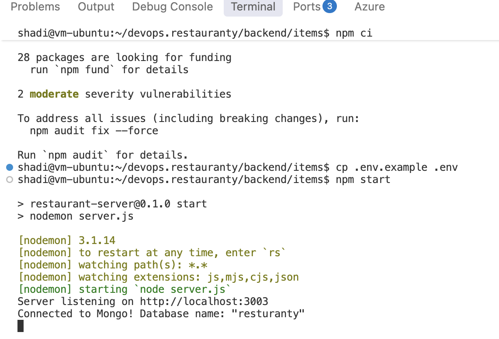

*Figure 9 — Items Microservice Startup and MongoDB Connection.*

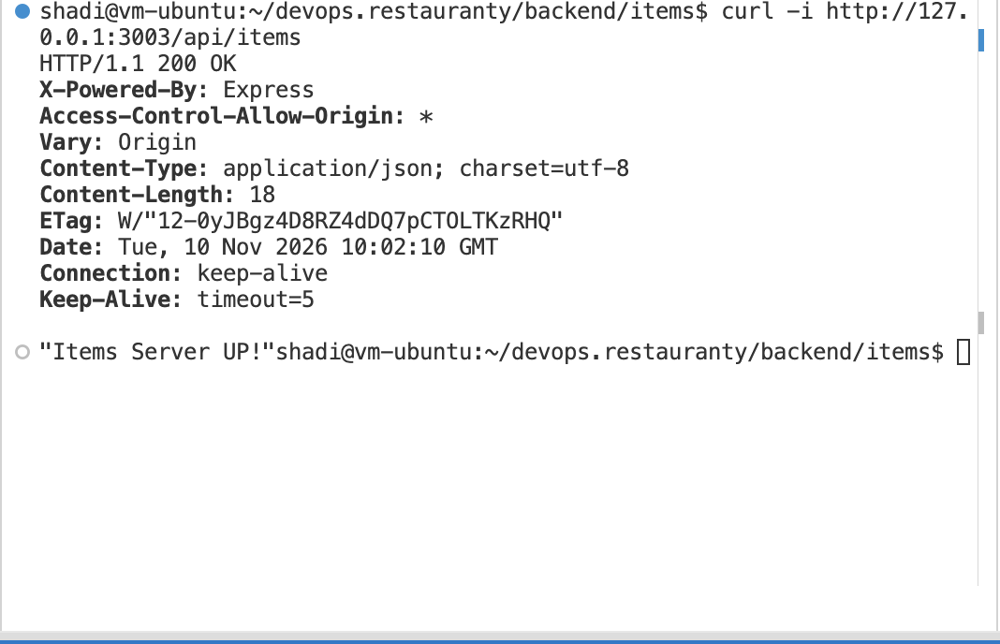

*Figure 10 — Items API Endpoint Verification.*

### Result

**Status: Completed — Initial Connectivity Verification**

The Items microservice was successfully started, connected to MongoDB, and verified through an HTTP request. Item, dietary, and order operations have not yet been tested.

---

## Local Backend Verification Summary

| Component | Port | Verification |
|---|---|---|
| MongoDB | 27017 | Successful ping |
| Auth | 3001 | HTTP 200 OK |
| Discounts | 3002 | HTTP 200 OK |
| Items | 3003 | HTTP 200 OK |

All three backend microservices were independently started and their database connectivity and initial API availability were verified.

## Step 5 — React Frontend Local Deployment

### Objective

The Restauranty React frontend was prepared and started locally to verify the application user interface and development server availability.

### Implementation

The frontend dependencies were installed using npm.

An initial dependency synchronization issue was encountered while running `npm ci`. The `package-lock.json` file was updated using `npm install` to resolve the missing dependency.

The React application was started using `npm start`, which executes `react-scripts start`.

The frontend was served locally on port `3000`.

### Verification

The application was accessed in a web browser at:

`http://localhost:3000`

The Restauranty dashboard was successfully displayed, including the Items, Coupons, Campaigns, and Categories sections.

Webpack compilation completed with non-blocking ESLint warnings. These warnings were noted for future code-quality review.

Frontend-to-backend API communication has not yet been verified because HAProxy routing is still pending.

### Evidence

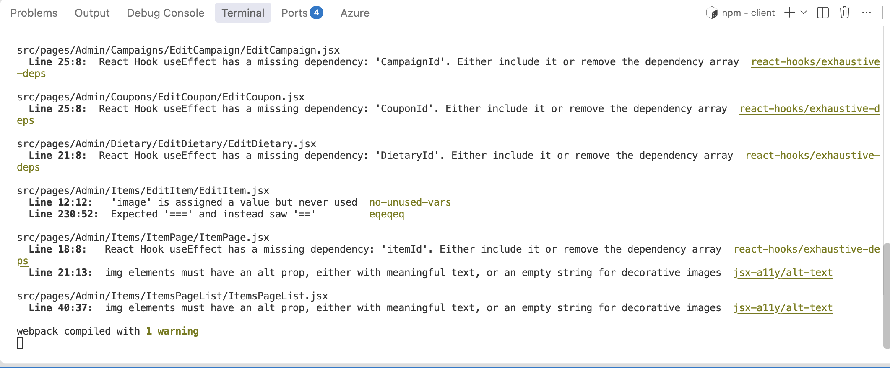

*Figure 11 — React Frontend Local Startup and Compilation.*

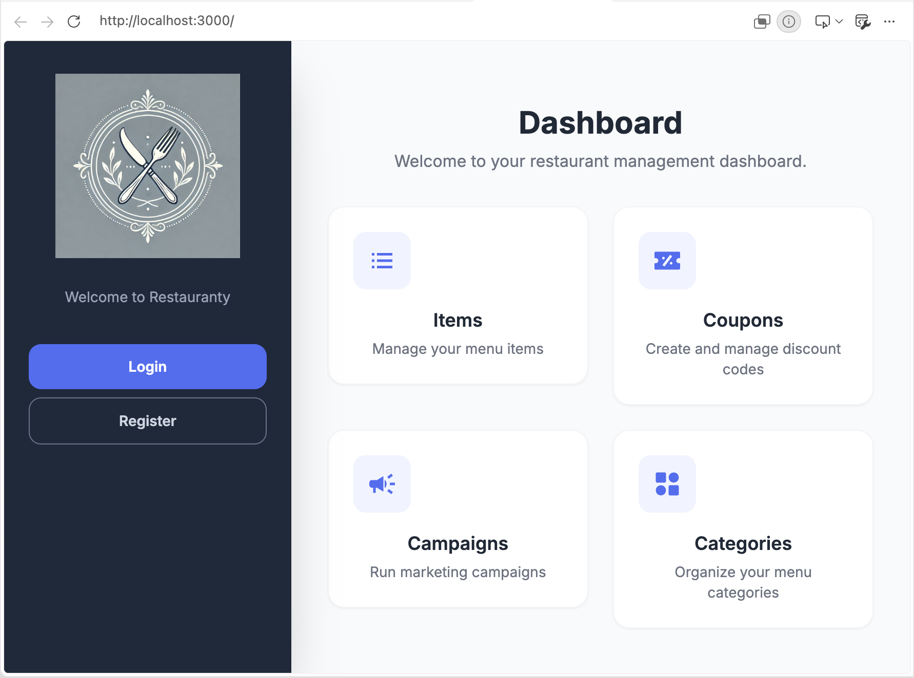

*Figure 12 — Restauranty Dashboard Displayed in the Browser.*

### Result

**Status: Completed — Initial Frontend Verification**

The React frontend was successfully started and displayed locally.

Full application functionality and API integration will be verified after HAProxy configuration.

---

## Step 6 — HAProxy Configuration and Routing Verification

### Objective

HAProxy was configured as a reverse proxy to provide a single entry point for the Restauranty application and route HTTP requests to the appropriate microservices.

### Implementation

The HAProxy configuration provided in the repository was reviewed and validated.

The following routing configuration was used:

| Request Path | Destination | Port |
|---|---|---|
| `/` | React Frontend | 3000 |
| `/api/auth` | Authentication Service | 3001 |
| `/api/discounts` | Discounts Service | 3002 |
| `/api/items` | Items Service | 3003 |

The configuration was validated using:

`haproxy -c -f haproxy.cfg`

The system configuration was backed up before the Restauranty configuration was applied to `/etc/haproxy/haproxy.cfg`.

HAProxy was restarted using systemd.

The service status and listening port were verified using:

`sudo systemctl status haproxy --no-pager`

`sudo ss -ltnp | grep ':80'`

### Troubleshooting — Port 80 Conflict

During the configuration process, port 80 was found to be occupied by the Apache web server.

As a result, requests sent to `/api/auth`, `/api/discounts`, and `/api/items` initially returned Apache HTTP 404 responses.

The port conflict was identified using:

`sudo ss -ltnp | grep ':80'`

Port 80 was subsequently freed, and the Restauranty HAProxy configuration was activated.

The listening process was verified to be HAProxy rather than Apache.

### Evidence — Port Conflict

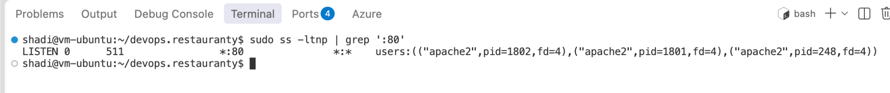

*Figure 13 — Port 80 Conflict Identified with Apache.*

### Verification — HAProxy Startup

The HAProxy service was confirmed to be active and running.

The service successfully listened on port 80.

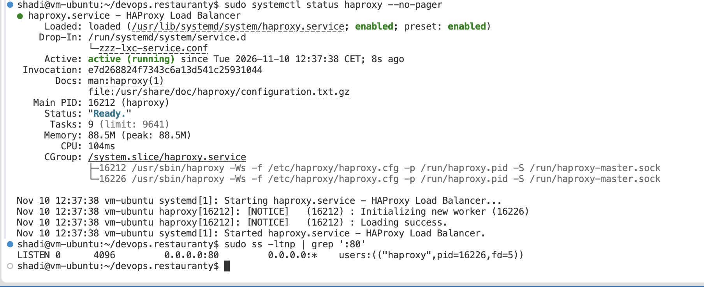

*Figure 14 — HAProxy Running and Listening on Port 80.*

### Verification — Backend Routing

The following commands were used to verify path-based routing:

`curl -i http://127.0.0.1/api/auth`

`curl -i http://127.0.0.1/api/discounts`

`curl -i http://127.0.0.1/api/items`

All three endpoints returned HTTP 200 OK with their corresponding service responses.

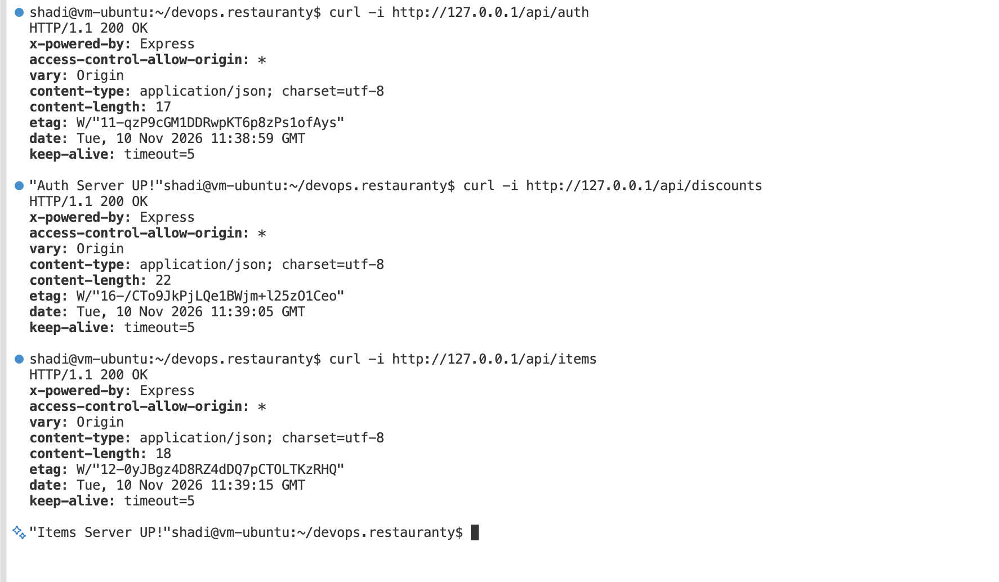

*Figure 15 — Successful HAProxy Routing to All Three Backend Microservices.*

---

## Step 7 — Frontend-to-Backend Integration Testing

### Objective

The communication between the React frontend, HAProxy, and the Authentication backend was tested using the application interface.

### Implementation

The Restauranty application was accessed through:

`http://localhost/`

The dashboard was successfully displayed through HAProxy on port 80.

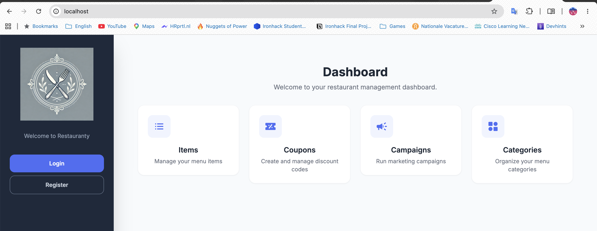

*Figure 16 — Restauranty Dashboard Accessed Through HAProxy.*

### Integration Verification

Chrome Developer Tools was used to inspect HTTP requests in the Network panel.

A user registration request was initiated through the React frontend.

The following results were observed:

- Initial signup attempts returned HTTP 400 due to password validation requirements.
- A subsequent signup request returned HTTP 201 Created.
- The Auth API was reached through the application's configured routing.

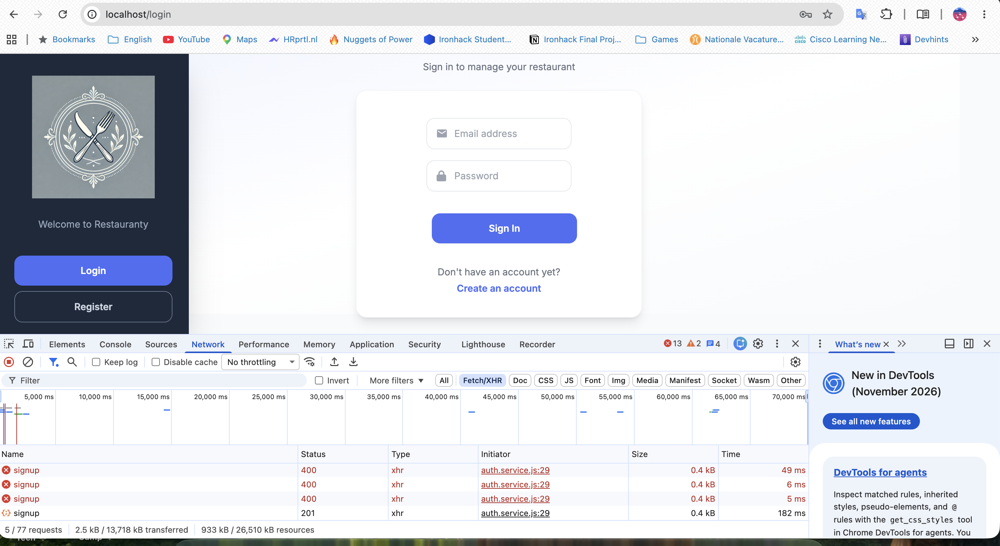

*Figure 17 — Frontend-to-Backend Signup Request Verification.*

### Result

**Status: Completed — Initial Integration Verification**

The frontend was successfully accessed through HAProxy.

Path-based routing to all three backend microservices was verified.

An initial user registration request was successfully processed, returning HTTP 201 Created.

Full login verification and additional application functionality tests remain pending.

---

## Local Deployment Summary

| Component | Port | Result |
|---|---|---|
| MongoDB | 27017 | Verified |
| Auth | 3001 | Verified |
| Discounts | 3002 | Verified |
| Items | 3003 | Verified |
| React Frontend | 3000 | Verified |
| HAProxy | 80 | Routing verified |
| Signup API | Via HAProxy | HTTP 201 Created |

### Conclusion

The Restauranty application components were successfully started and tested in the local Ubuntu development environment.

MongoDB connectivity, backend API availability, frontend rendering, HAProxy routing, and initial signup integration were verified.

The application is ready to proceed to the containerization phase, while full functional and security testing will continue in later stages.

## Next Phase

Phase 3 — Docker Containerization

- Create Dockerfiles for the frontend and three backend microservices.
- Configure Docker Compose.
- Configure container networking and environment variables.
- Integrate MongoDB and HAProxy.
- Test the containerized application.
- Build and publish application images to Docker Hub.
