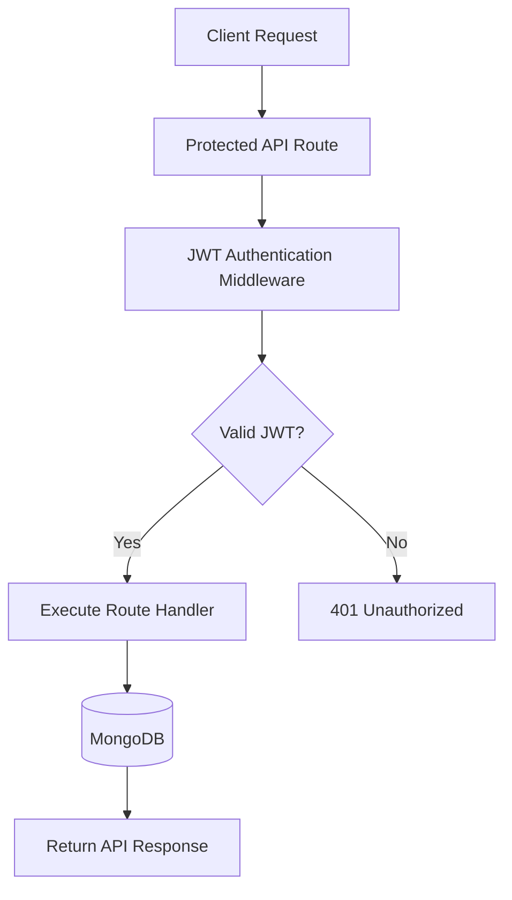
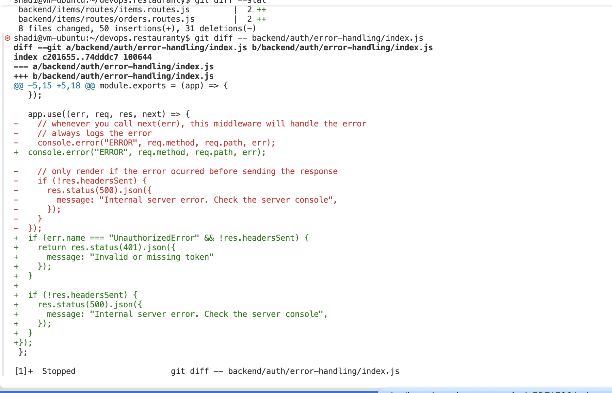
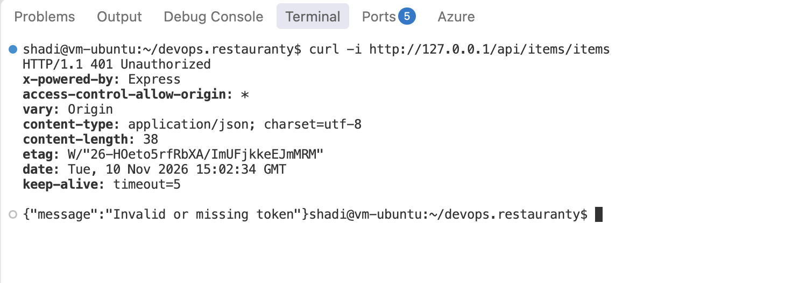
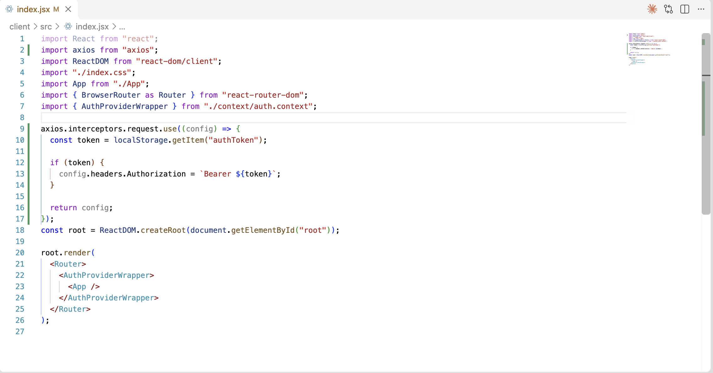
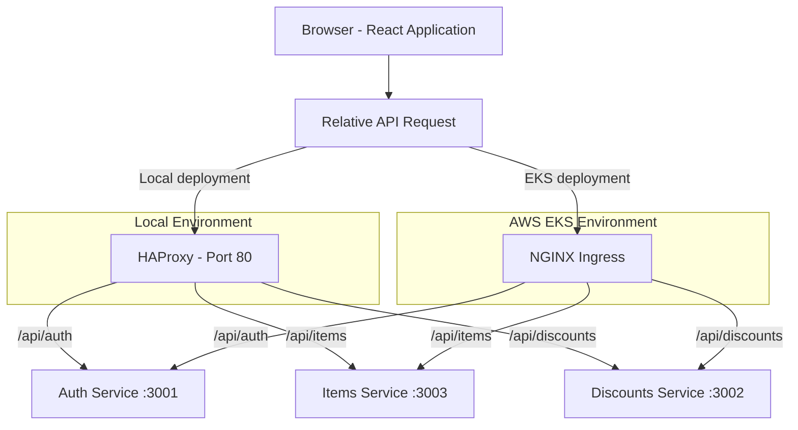
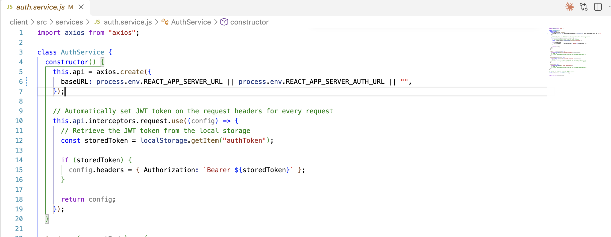
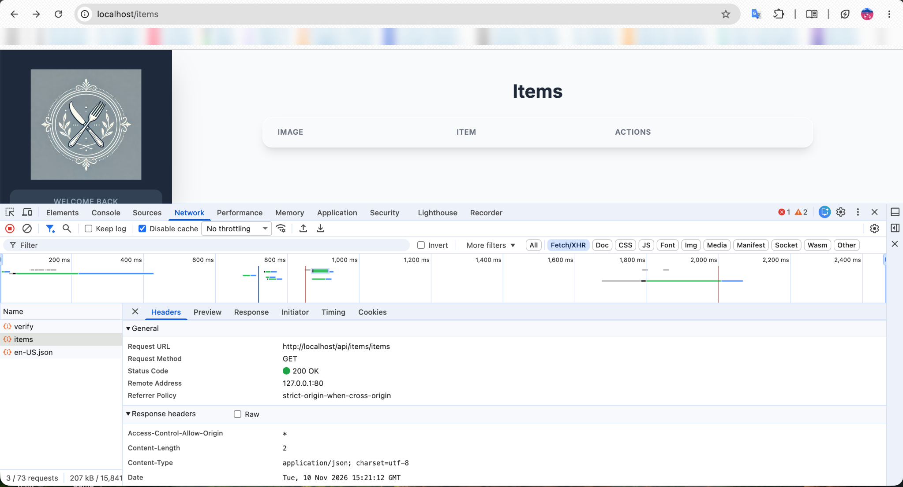
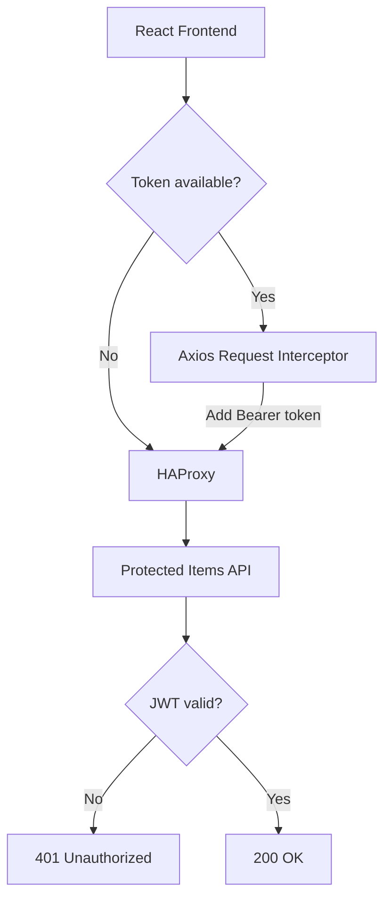

# Phase 3 — Application Security and API Routing

## Objective

This phase focused on improving authentication and API communication in the Restauranty application before containerization.

The main changes included protecting backend routes with JWT authentication, handling unauthorized requests correctly, and updating the React frontend to communicate with the backend through HAProxy.

## Overview

The following changes were implemented:

| Area | Implementation |
|---|---|
| Backend authentication | JWT middleware added to five routers |
| Error handling | HTTP 401 responses for invalid or missing tokens |
| Frontend authentication | Axios interceptor for Bearer tokens |
| API routing | Relative API URLs for same-origin requests |
| Verification | Unauthorized and authenticated requests tested |

## Step 1 — Protecting Backend Routes

### Implementation

JWT authentication middleware was enabled on five routers across the Items and Discounts microservices.

The following files were modified:

| Microservice | File |
|---|---|
| Items | `backend/items/routes/items.routes.js` |
| Items | `backend/items/routes/dietary.routes.js` |
| Items | `backend/items/routes/orders.routes.js` |
| Discounts | `backend/discounts/routes/coupons.routes.js` |
| Discounts | `backend/discounts/routes/campaigns.routes.js` |

The `isAuthenticated` middleware was added to each router.

This middleware checks the JWT provided with incoming requests before allowing access to the router's endpoints.

The existing route handlers and database operations remained in place.

### JWT Authentication Flow

The diagram shows how a request is handled when it reaches a protected API route.



*Figure 16 — JWT authentication flow for protected backend routes.*

The middleware provides an authentication check before the route handler runs. It does not replace the need for additional authorization checks where different users require different permissions.

## Step 2 — HTTP 401 Error Handling

### Problem

During the initial tests, some authentication failures were handled as internal server errors.

As a result, requests with missing or invalid JWT tokens could return HTTP 500 instead of HTTP 401.

This made it harder to distinguish authentication problems from application errors.

### Implementation

The error-handling logic was updated in all three backend services:

- `backend/auth/error-handling/index.js`
- `backend/discounts/error-handling/index.js`
- `backend/items/error-handling/index.js`

The updated handlers check for an `UnauthorizedError`.

When this error is detected, the service returns:

```http
HTTP/1.1 401 Unauthorized
Content-Type: application/json
```

```json
{
  "message": "Invalid or missing token"
}
```

Other unhandled application errors continue to use the standard HTTP 500 response.

### Evidence



*Figure 17 — Updated error handling for unauthorized JWT requests.*

## Step 3 — Unauthorized Request Verification

### Test

A request was sent to the protected Items API without an Authorization header.

The test was performed through the local HAProxy entry point.

```bash
curl -i http://127.0.0.1/api/items/items
```

### Observed Result

| Check | Result |
|---|---|
| Request | GET `/api/items/items` |
| Authorization header | Not provided |
| HTTP status | 401 Unauthorized |
| Response message | `Invalid or missing token` |
| Access to protected resource | Rejected |

The response confirmed that an unauthenticated request could not access the protected Items endpoint.

### Evidence



*Figure 18 — Items API returning HTTP 401 without an authentication token.*

## Step 4 — Frontend JWT Integration

### Implementation

An Axios request interceptor was added to the React application.

**Modified file:**

`client/src/index.jsx`

The interceptor reads the JWT from the browser's local storage using the key `authToken`.

When a token is available, it is added to the outgoing request as a Bearer token.

The relevant implementation is:

```javascript
axios.interceptors.request.use((config) => {
  const token = localStorage.getItem("authToken");

  if (token) {
    config.headers.Authorization = `Bearer ${token}`;
  }

  return config;
});
```

This allows the frontend to include the JWT automatically when making requests through Axios.

The interceptor does not generate or validate tokens itself. Token validation remains the responsibility of the backend.

### Evidence



*Figure 19 — Axios interceptor attaching the JWT to outgoing requests.*

## Step 5 — Same-Origin API Routing

### Problem

Some frontend API configuration used hardcoded fallback addresses pointing to:

```text
http://localhost:80
```

This was suitable for parts of the original local setup but could cause problems after deploying the application in containers or Kubernetes.

From a browser, `localhost` refers to the machine running the browser, not automatically to the Kubernetes application or its backend services.

### Implementation

The hardcoded localhost fallbacks were replaced with empty-string fallbacks.

This allows the frontend to make relative API requests through the same host that serves the application.

For example:

```text
/api/auth
/api/items
/api/discounts
```

In the local environment, HAProxy receives these requests and forwards them to the appropriate backend.

In the AWS deployment, NGINX Ingress performs the equivalent routing inside Kubernetes.

### Request Routing Diagram



*Figure 20 — Same-origin API routing in local and Kubernetes environments.*

The routing approach lets the frontend use the same relative API paths in both environments.

Only the reverse proxy or Ingress configuration needs to route those requests to the correct services.

### Evidence



*Figure 21 — React API configuration updated to use relative request paths.*

## Step 6 — Authorized Request Verification

### Test

After testing an unauthorized request, the Items API was tested again using an authenticated browser session.

The application was opened at:

```text
http://localhost/items
```

A user logged in through the frontend.

The React application then sent an authenticated GET request to the protected Items endpoint through HAProxy.

Chrome Developer Tools was used to inspect the request in the Network panel.

### Observed Result

| Check | Result |
|---|---|
| Request URL | `http://localhost/api/items/items` |
| Request method | GET |
| Authorization | Bearer JWT |
| HTTP status | 200 OK |
| Result | Authenticated request accepted |

This confirmed that the Axios interceptor was attaching the token and that the backend accepted the authenticated request.

### Evidence



*Figure 22 — Successful authenticated request to the protected Items API.*

## Authentication Request Summary

The following diagram summarizes the unauthorized and authenticated request tests.



*Figure 23 — Request outcomes based on JWT authentication.*

This diagram describes the request handling tested in this phase. A missing token is sent without an Authorization header and rejected by the backend.

## Troubleshooting and Verification

The following checks were performed during this phase:

- Reviewed source-code changes using `git diff`.
- Checked whitespace and formatting issues using `git diff --check`.
- Verified that hardcoded localhost API fallbacks were removed.
- Tested unauthorized requests using `curl`.
- Inspected authenticated requests in Chrome Developer Tools.
- Confirmed that protected Items requests returned the expected HTTP status codes.

### Verification Summary

| Test | Expected Result | Observed Result |
|---|---|---|
| Items API without JWT | 401 Unauthorized | Passed |
| Items API with valid JWT | 200 OK | Passed |
| Axios Authorization header | Bearer token included | Passed |
| Same-origin API request | Routed through HAProxy | Passed |
| JWT error handling | Unauthorized errors return 401 | Passed |

These checks covered the initial JWT integration. They did not include a complete security test of every endpoint and user permission.

## Result

**Status: Completed — Initial JWT Integration**

JWT authentication was enabled on the selected Items and Discounts routers.

Unauthorized requests to the protected Items API were rejected with HTTP 401, while a request carrying a valid JWT returned HTTP 200.

The React frontend was also updated to attach authentication tokens automatically and use relative API paths through HAProxy.

These changes prepared the application for Docker containerization and later Kubernetes deployment.

## Remaining Security Considerations

Further improvements may include:

- Testing all protected endpoints and HTTP methods.
- Checking authorization rules for different user permissions.
- Reviewing CORS settings.
- Reviewing browser token storage and expiration handling.
- Adding further automated security tests.
- Rechecking authentication behavior after deployment changes.

JWT authentication protects access to selected API routes, but it is only one part of the application's overall security.

Kubernetes NetworkPolicies, AWS IAM/OIDC, and container security are documented separately in the later security phase.

## Next Phase — Docker Containerization

The next phase covers:

1. Creating Dockerfiles for the three backend services.
2. Creating a multi-stage Dockerfile for the React frontend.
3. Building and testing container images.
4. Configuring Docker Compose and container networking.
5. Preparing application images for Docker Hub and Kubernetes.

**Next:** [Docker Containerization](04-docker-containerization.md)

**Later security work:** [Kubernetes Security](08-security.md)

**Project overview:** [README](../README.md)
