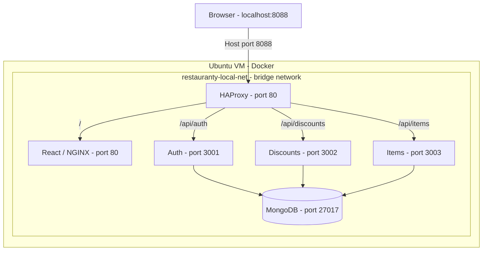
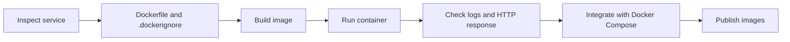
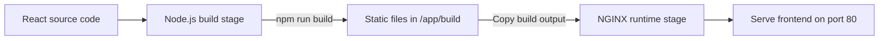
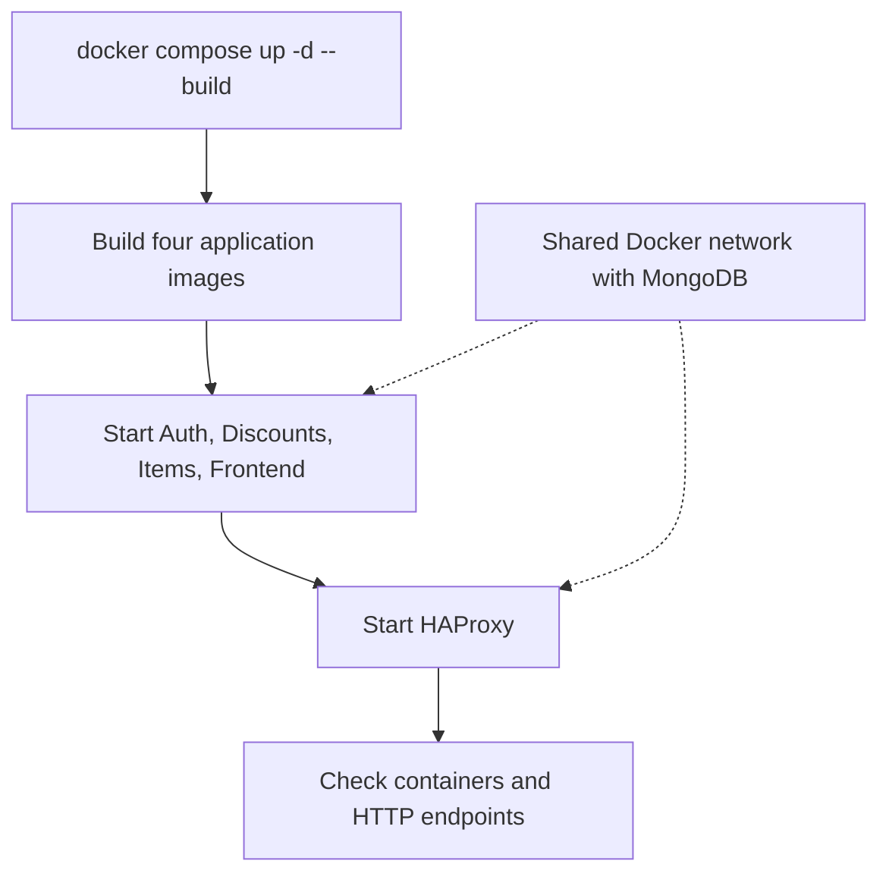
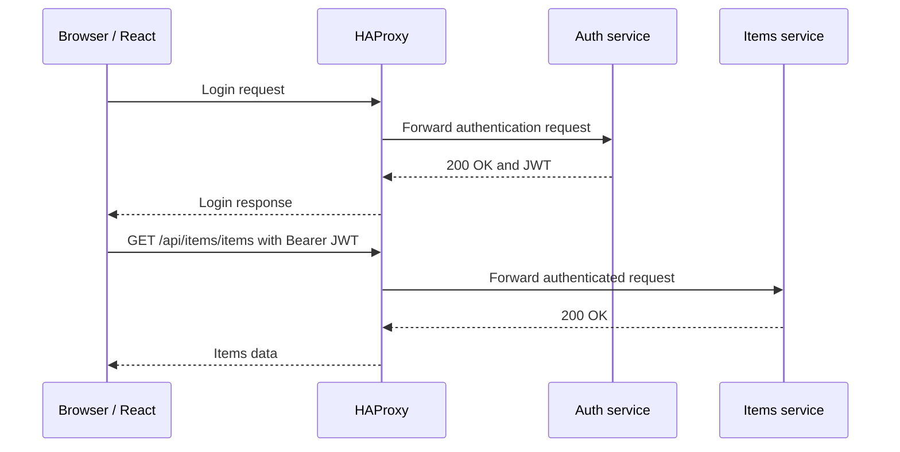
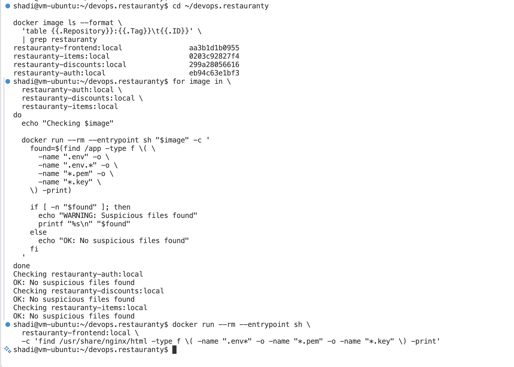
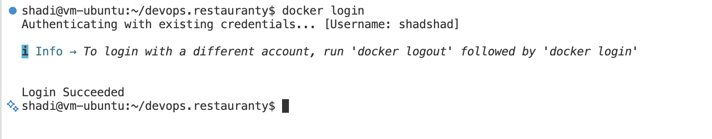
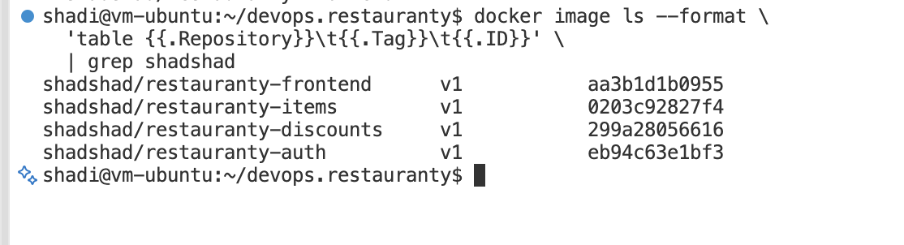
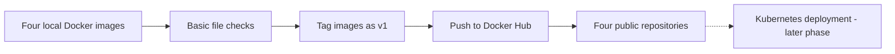
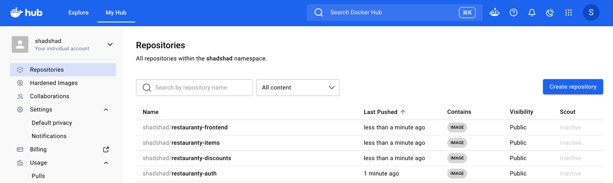

# Phase 4 — Docker Containerization

## Objective

The goal of this phase was to run the Restauranty application in Docker containers, check each service separately, and then connect the services using Docker Compose and HAProxy.

The application includes three Node.js/Express backends (Auth, Discounts, Items), a React frontend, and MongoDB. MongoDB was already running in a separate container from the local-deployment phase.

## Docker Architecture

The final local container setup uses one Docker network. HAProxy routes browser requests to the correct service, while the three backends connect to MongoDB by its container name.



*Diagram 4.1 — Local Docker Compose architecture and service communication.*

The database container is connected to the external Docker network but is not defined in `compose.yaml`.

### Dockerization Workflow



*Diagram 4.2 — Workflow followed during containerization.*

Environment variables were supplied when containers started, rather than embedded in their Dockerfiles.

## Step 1 — Authentication Service Dockerfile

The first image was created for the Auth microservice in `backend/auth/Dockerfile`.

```dockerfile
FROM node:22-alpine
WORKDIR /app
COPY package.json package-lock.json ./
RUN npm ci --omit=dev
COPY --chown=node:node . .
ENV NODE_ENV=production
USER node
EXPOSE 3001
CMD ["node", "server.js"]
```

This uses Node.js 22 Alpine, installs production dependencies, and starts the application as the non-root `node` user. Unlike local development, the container starts with `node server.js` instead of `nodemon`.

## Step 2 — Docker Build Context

A `.dockerignore` file was added at `backend/auth/.dockerignore` to exclude local dependencies, environment files, Git metadata, logs, and operating-system files from the build context.

This reduces unnecessary build content and helps prevent local `.env` files from being copied into the image. Runtime credentials are provided separately.

## Step 3 — Building the Authentication Image

```bash
docker build -t restauranty-auth:local ./backend/auth
docker image ls restauranty-auth
```

The image was built and listed successfully.


*Figure 4.1 — Authentication Docker image build and verification.*

## Step 4 — Inspecting Runtime Configuration

The Auth service configuration was reviewed before running the container. The variables identified included `CLOUD_API_KEY`, `CLOUD_API_SECRET`, `CLOUD_NAME`, `MONGODB_URI`, `ORIGIN`, `PORT`, and `SECRET`.

The existing MongoDB container's network configuration was also inspected.


*Figure 4.2 — Checking environment-variable references and MongoDB networking.*

## Step 5 — Creating a Dedicated Docker Network

A bridge network was created to let the containers communicate using Docker's internal name resolution.

```bash
docker network create restauranty-local-net
docker network connect restauranty-local-net restauranty-mongo
```

The existing MongoDB container was attached to the new network without being recreated. Network membership was checked with:

```bash
docker inspect restauranty-mongo --format '{{range $name, $_ := .NetworkSettings.Networks}}{{println $name}}{{end}}'
```

The observed networks were `bridge` and `restauranty-local-net`.


*Figure 4.3 — MongoDB connected to the dedicated Docker network.*

## Step 6 — Configuring MongoDB Connectivity

Inside a container, `localhost` refers to that container, not to the MongoDB container. The backend database URI was therefore changed at runtime to:

```text
mongodb://restauranty-mongo:27017/Restauranty
```

This kept the original local application configuration separate from the container-specific connection setting.

## Step 7 — Running the Authentication Container

The Auth container was started on the shared network, using a localhost host port that did not conflict with the earlier Node.js process on port `3001`.

```bash
docker run -d \
  --name restauranty-auth-test \
  --network restauranty-local-net \
  --env-file backend/auth/.env \
  -e MONGODB_URI=mongodb://restauranty-mongo:27017/Restauranty \
  -e PORT=3001 \
  -p 127.0.0.1:3101:3001 \
  restauranty-auth:local
```

The `.env` file was loaded at runtime and was not committed to Git.

## Step 8 — Authentication Container and Database Verification

```bash
docker ps
docker logs --tail 30 restauranty-auth-test
```

The logs showed the service listening on port `3001` and connecting successfully to the `Restauranty` database.

```text
Server listening on http://localhost:3001
Connected to Mongo! Database name: "Restauranty"
```

## Step 9 — Authentication HTTP Test

```bash
curl -i http://127.0.0.1:3101/api/auth
```

**Observed:** HTTP `200 OK` with the response `"Auth Server UP!"`.


*Figure 4.4 — Auth container running with MongoDB connectivity and HTTP 200 response.*

## Step 10 — Initial Authentication Containerization Result

The Auth image built successfully, the container started, the database connection worked, and the API responded through host port `3101`.

At this checkpoint, the other three application services had not yet been containerized. The following sections record their implementation.

## Step 11 — Authentication Image Rebuild and Security Check

A `.dockerignore` filename issue was corrected, and the Auth image was rebuilt. The container was recreated without removing MongoDB or the shared Docker network.

```bash
docker ps
docker logs --tail 15 restauranty-auth-test
curl -i http://127.0.0.1:3101/api/auth
```

The rebuilt container was running, connected to MongoDB, and returned HTTP `200 OK`. The corrected image was also checked to confirm the local `.env` file was not included.


*Figure 4.5 — Rebuilt Auth container and environment-file exclusion check.*

## Step 12 — Discounts Microservice Dockerization

### 12.1 — Dockerfile

The Discounts Dockerfile was created at `backend/discounts/Dockerfile` using the same backend pattern as Auth: Node.js 22 Alpine, `npm ci --omit=dev`, a non-root user, and `node server.js`.

The container exposes port `3002`.

### 12.2 — Building the Image

```bash
docker build -t restauranty-discounts:local ./backend/discounts
docker image ls restauranty-discounts
```


*Figure 4.6 — Discounts image build and verification.*

### 12.3 — Build Context and Security Check

The file `backend/discounts/.dockerignore` was created to exclude environment files, `node_modules`, and other local files.

The built image was checked for `/app/.env`:

```bash
docker run --rm --entrypoint sh restauranty-discounts:local -c 'if test -f /app/.env; then echo "WARNING: .env found"; else echo "OK: .env not found"; fi'
```

**Observed:** `OK: .env not found`.


*Figure 4.7 — Discounts image check for a local `.env` file.*

### 12.4 — Running the Container

```bash
docker run -d \
  --name restauranty-discounts-test \
  --network restauranty-local-net \
  --env-file backend/discounts/.env \
  -e MONGODB_URI=mongodb://restauranty-mongo:27017/Restauranty \
  -e PORT=3002 \
  -p 127.0.0.1:3102:3002 \
  restauranty-discounts:local
```

### 12.5 — Verification

```bash
docker ps --filter "name=restauranty-discounts-test"
docker logs --tail 15 restauranty-discounts-test
curl -i http://127.0.0.1:3102/api/discounts
```

The container started successfully, connected to MongoDB, and returned HTTP `200 OK` with `"Discounts Server UP!"`.


*Figure 4.8 — Discounts container, MongoDB connection, and HTTP test.*

**Result:** Initial Discounts container verification passed. Full integration testing was continued after Docker Compose was configured.

## Step 13 — Items Microservice Dockerization

### 13.1 — Service Requirements

The Items service was checked for its dependency lockfile and local environment file.

```bash
test -f backend/items/package-lock.json && echo "LOCK OK"
test -f backend/items/.env && echo "ENV OK"
```

Both checks passed. The service runs on port `3003`.

### 13.2 — Items Dockerfile

The file `backend/items/Dockerfile` uses:

```dockerfile
FROM node:22-alpine
WORKDIR /app
COPY package.json package-lock.json ./
RUN npm ci --omit=dev
COPY --chown=node:node . .
ENV NODE_ENV=production
USER node
EXPOSE 3003
CMD ["node", "server.js"]
```

The container runs as a non-root user and installs only production dependencies.

### 13.3 — Docker Ignore File

The file `backend/items/.dockerignore` contains:

```text
node_modules
**/node_modules
.env
.env.*
**/.env
**/.env.*
.git
.DS_Store
npm-debug.log*
coverage
```

### 13.4 — Building the Image

```bash
docker build -t restauranty-items:local ./backend/items
docker image ls restauranty-items
```

The image was built successfully. The recorded local image size at this point was approximately `286 MB`.


*Figure 4.9 — Items Docker image build.*

### 13.5 — Image File Check

```bash
docker run --rm --entrypoint sh restauranty-items:local -c 'if test -f /app/.env; then echo "WARNING: .env found"; else echo "OK: .env not found"; fi'
```

**Observed:** `OK: .env not found`.


*Figure 4.10 — Items image check for `/app/.env`.*

### 13.6 — Running the Container

```bash
docker run -d \
  --name restauranty-items-test \
  --network restauranty-local-net \
  --env-file backend/items/.env \
  -e MONGODB_URI=mongodb://restauranty-mongo:27017/Restauranty \
  -e PORT=3003 \
  -p 127.0.0.1:3103:3003 \
  restauranty-items:local
```

The Items container started on the shared network. Port `3103` was used on the host to avoid a conflict with the earlier local service on port `3003`.

```bash
docker ps --filter "name=restauranty-items-test"
```

The container status was `Up` with the mapping `127.0.0.1:3103->3003/tcp`.


*Figure 4.11 — Items container running with its localhost port mapping.*

### 13.7 — HTTP Endpoint Test

```bash
curl -i http://127.0.0.1:3103/api/items
```

**Observed:** HTTP `200 OK` with `"Items Server UP!"`.


*Figure 4.12 — Items API availability test.*

### 13.8 — Result

The Items image and container were created successfully, the local `.env` file was not present at `/app/.env`, and the API responded on port `3103`.

This was an initial HTTP availability test. The original record did not include a separate Items database log check at this checkpoint. Later Docker Compose tests covered frontend integration and protected API requests.

### Independent Container Test Ports

| Service | Internal Port | Host Test Port | Initial Test |
|---|---:|---:|---|
| Auth | 3001 | 3101 | Passed |
| Discounts | 3002 | 3102 | Passed |
| Items | 3003 | 3103 | Passed |
| React / NGINX | 80 | 3100 | Tested next |

## Step 14 — React Frontend Dockerization

### 14.1 — Multi-Stage Dockerfile

The React frontend was built into static files and served by NGINX rather than running the development server in the final container.

**File:** `client/Dockerfile`

```dockerfile
FROM node:22-alpine AS builder
WORKDIR /app
COPY package.json package-lock.json ./
RUN npm ci
COPY . .
ENV REACT_APP_SERVER_URL=""
RUN npm run build
FROM nginx:alpine
COPY nginx.conf /etc/nginx/conf.d/default.conf
COPY --from=builder /app/build /usr/share/nginx/html
EXPOSE 80
CMD ["nginx", "-g", "daemon off;"]
```



*Diagram 4.3 — React multi-stage image build.*

The image uses the default `nginx:alpine` runtime user. Changing the frontend to run as a non-root user is a later security improvement.

### 14.2 — NGINX Configuration

The configuration at `client/nginx.conf` listens on port `80` and serves files from `/usr/share/nginx/html`.

It uses the following fallback for React Router paths:

```nginx
location / {
    try_files $uri $uri/ /index.html;
}
```

A frontend `.dockerignore` file was also created to exclude local build and development files.

### 14.3 — Building the Frontend Image

```bash
docker build -t restauranty-frontend:local ./client
docker image ls restauranty-frontend
```

The image built successfully. The recorded local image size was approximately `105 MB`.


*Figure 4.13 — React multi-stage Docker build.*


*Figure 4.14 — Frontend image listed locally.*

### 14.4 — Running the Frontend Container

```bash
docker run -d \
  --name restauranty-frontend-test \
  --network restauranty-local-net \
  -p 127.0.0.1:3100:80 \
  restauranty-frontend:local
```

The frontend listens on port `80` inside the container and was made available at port `3100` on the Ubuntu host.

### 14.5 — Container and HTTP Verification

```bash
docker ps --filter "name=restauranty-frontend-test"
docker logs --tail 15 restauranty-frontend-test
curl -I http://127.0.0.1:3100/
curl -I http://127.0.0.1:3100/login
```

The container was running and NGINX started successfully. Both HTTP header checks returned status `200 OK`. The `curl -I` command sends a HEAD request, not a GET request.


*Figure 4.15 — NGINX container and HTTP status checks.*

### 14.6 — Browser Verification

The frontend was opened at `http://localhost:3100`. The Restauranty dashboard appeared with Items, Coupons, Campaigns, Categories, and Login/Registration sections.


*Figure 4.16 — React dashboard served by the NGINX container.*

### 14.7 — Result

All four application images passed their initial container checks. At this point, frontend-to-backend communication inside the containerized setup had not yet been tested. The next step was to connect the services through Docker Compose and HAProxy.

## Step 15 — Docker Compose Integration

### 15.1 — Compose Configuration

The root file `compose.yaml` defines five services:

- `auth`
- `discounts`
- `items`
- `frontend`
- `proxy`

All five services use the external `restauranty-local-net` network. The existing MongoDB container remains separate and is reused by the backends.

The backend services load their local `.env` files at runtime and override `MONGODB_URI` and `PORT` for container networking.

### 15.2 — HAProxy Routing

The file `haproxy.docker.cfg` routes requests by path:

| Request Path | Compose Service | Container Port |
|---|---|---:|
| `/api/auth` | `auth` | 3001 |
| `/api/discounts` | `discounts` | 3002 |
| `/api/items` | `items` | 3003 |
| `/` | `frontend` | 80 |

The proxy container listens on port `80` internally. Docker publishes it on the host loopback interface as `127.0.0.1:8088:80`.

### 15.3 — Compose Startup and Verification



*Diagram 4.4 — Docker Compose startup and verification.*

`depends_on` sets a startup order; it does not by itself confirm application readiness. For that reason, container status and HTTP responses were checked separately.

The Compose configuration was validated with:

```bash
docker compose config --quiet
```

**Observed:** Validation passed without configuration errors.

The stack was then started:

```bash
docker compose up -d --build
docker compose ps
```

All five Compose services were reported as running.


*Figure 4.17 — Five Restauranty services running under Docker Compose.*

### 15.4 — API Routing Tests

```bash
curl -i http://127.0.0.1:8088/api/auth
curl -i http://127.0.0.1:8088/api/discounts
curl -i http://127.0.0.1:8088/api/items
curl -i http://127.0.0.1:8088/
```

| Endpoint | Observed Status | Response |
|---|---|---|
| `/api/auth` | 200 OK | `Auth Server UP!` |
| `/api/discounts` | 200 OK | `Discounts Server UP!` |
| `/api/items` | 200 OK | `Items Server UP!` |
| `/` | 200 OK | HTML response |

These results showed that HAProxy reached each container through the Docker network.


*Figure 4.18 — API routes responding through HAProxy.*

### 15.5 — Browser Test

The containerized application was opened at `http://localhost:8088`. The dashboard loaded through HAProxy and the NGINX frontend container.


*Figure 4.19 — Restauranty dashboard through Docker Compose and HAProxy.*

The first checks confirmed service availability and routing. Login, protected API calls, and database operations required separate integration testing.

## Step 16 — Frontend and Backend Integration Verification

### 16.1 — Login and Items Requests

The application was accessed through `http://localhost:8088`, and Chrome Developer Tools was used to inspect the authentication requests.

The following responses were observed:

| Request | Status | Result |
|---|---|---|
| Login | 200 OK | Passed |
| Token verification | 200 OK | Passed |
| Items retrieval | 200 OK | Passed |

The Items page displayed after login. This confirmed initial communication between the React frontend and backend services through HAProxy.



*Diagram 4.5 — Authentication and Items requests through Docker Compose.*


*Figure 4.20 — Successful login, token verification, and Items request.*

### 16.2 — Unauthorized API Test

The protected Items API was also called without an Authorization header:

```bash
curl -i http://127.0.0.1:8088/api/items/items
```

**Observed:** HTTP `401 Unauthorized`.

```json
{
  "message": "Invalid or missing token"
}
```


*Figure 4.21 — Protected Items endpoint rejecting a request without a JWT.*

### 16.3 — Result

Login, token verification, authenticated Items retrieval, and an unauthorized Items request behaved as expected in Docker Compose.

This was an initial integration test. It did not cover every route, user permission, database write operation, or end-to-end application workflow.

## Step 17 — Publishing Docker Images to Docker Hub

### 17.1 — Image File Checks

Before publication, the four images were inspected for files matching sensitive extensions such as `.env`, `.pem`, and `.key` within the checked application locations.

No matching files were identified in those checks. This was a basic file-pattern inspection, not a complete secrets or vulnerability scan.



*Figure 4.22 — Image file checks before publication.*

### 17.2 — Docker Hub Login

The Docker CLI was authenticated with the account `shadshad`:

```bash
docker login -u shadshad
```

**Observed:** `Login Succeeded`.



*Figure 4.23 — Successful Docker Hub authentication.*

### 17.3 — Tagging the Images

```bash
docker tag restauranty-auth:local shadshad/restauranty-auth:v1
docker tag restauranty-discounts:local shadshad/restauranty-discounts:v1
docker tag restauranty-items:local shadshad/restauranty-items:v1
docker tag restauranty-frontend:local shadshad/restauranty-frontend:v1
```



*Figure 4.24 — Four local images tagged for Docker Hub.*

### 17.4 — Publishing the Images

```bash
docker push shadshad/restauranty-auth:v1
docker push shadshad/restauranty-discounts:v1
docker push shadshad/restauranty-items:v1
docker push shadshad/restauranty-frontend:v1
```

All four repositories were visible under the `shadshad` Docker Hub namespace after publication. Their repository visibility was public.



*Diagram 4.6 — Manual publication of the initial application images.*



*Figure 4.25 — Four published Restauranty image repositories.*

### 17.5 — Result

The four initial `v1` application images were tagged, pushed, and verified in Docker Hub.

These manually published images belong to the initial containerization phase. The ARM64 image builds used by the EKS deployment and the automated GitHub Actions pipeline are covered in later project phases.

## Phase Summary

| Area | Verified Result |
|---|---|
| Backend images | Auth, Discounts, and Items built and tested |
| Frontend image | React built and served with NGINX |
| Docker network | Services communicated through `restauranty-local-net` |
| Database | Existing MongoDB container reused |
| Docker Compose | Five Compose services running |
| HAProxy | Routes returned HTTP 200 |
| Browser integration | Login, token verification, and Items retrieval returned HTTP 200 |
| JWT protection | Missing-token Items request returned HTTP 401 |
| Docker Hub | Four initial `v1` images published |

The containerized application was running locally with working routing and initial authentication integration. The Docker Hub images were available for the next deployment steps.

## Next Phase — Terraform and AWS Infrastructure

The next phase covers creating AWS networking and EKS infrastructure with Terraform. Kubernetes deployment, database persistence, and CI/CD are documented in the later phases.

**Next:** [Terraform Setup](05-terraform-setup.md)

**Related:** [Kubernetes Deployment](06-kubernetes-deployment.md) | [Security Implementation](08-security.md) | [Project README](../README.md)
