# Phase 3 — Docker Containerization

## Objective

Containerizing the Restauranty application to ensure consistent deployment, service isolation, and portability across development and production environments.

The application consists of four services:
- Authentication Service (Node.js / Express)
- Discounts Service (Node.js / Express)
- Items Service (Node.js / Express)
- React Frontend

MongoDB is used as the database.

## Dockerization Workflow

The following workflow will be applied to each application service, with adjustments based on its runtime and dependencies.

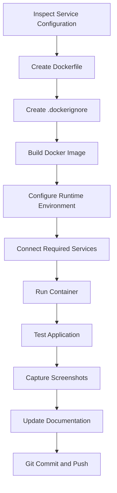

The environment variables are provided at container runtime rather than embedded in the image.

## Step 1 — Authentication Service Dockerfile

**Service directory:**

`backend/auth/`

A Dockerfile was created to package the Authentication Service into a Docker image.

**Dockerfile:**

```dockerfile
FROM node:22-alpine

WORKDIR /app

COPY package.json package-lock.json ./

RUN npm ci --omit=dev

COPY --chown=node:node . .

ENV NODE_ENV=production

USER node

EXPOSE 3001

CMD ["node", "server.js"]
```

The configuration uses Node.js 22 Alpine, installs production dependencies, runs the application as a non-root user, and starts the service using Node.js instead of nodemon.

## Step 2 — Docker Build Context Optimization

A `.dockerignore` file was created to exclude unnecessary and sensitive files from the Docker build context.

**File:**

`backend/auth/.dockerignore`

The excluded files include:
- Local node_modules
- Environment files
- Git metadata
- Debug logs
- Local system files

This reduces unnecessary build content and prevents local environment files from being copied into the image.

## Step 3 — Building the Authentication Image

**Command:**

```bash
docker build -t restauranty-auth:local ./backend/auth
```

The image was successfully built and verified.

**Verification command:**

```bash
docker image ls restauranty-auth
```

**Image name:**

`restauranty-auth:local`


*Figure 21 — Authentication Docker Image Successfully Built and Verified.*

## Step 4 — Inspecting Runtime Configuration

The Authentication Service environment-variable references were inspected to identify its runtime requirements.

The identified variables included:
- CLOUD_API_KEY
- CLOUD_API_SECRET
- CLOUD_NAME
- MONGODB_URI
- ORIGIN
- PORT
- SECRET

The existing MongoDB container was also inspected to identify its Docker network configuration.


*Figure 22 — Inspecting Authentication Environment Variables and MongoDB Network Configuration.*

## Step 5 — Creating a Dedicated Docker Network

A dedicated Docker bridge network was created to enable communication between the application containers.

**Command:**

```bash
docker network create restauranty-local-net
```

The existing MongoDB container was connected to the new network.

```bash
docker network connect restauranty-local-net restauranty-mongo
```

This operation connected the existing MongoDB container to an additional network without recreating or removing it.

**Network verification:**

```bash
docker inspect restauranty-mongo \
  --format '{{range $name, $_ := .NetworkSettings.Networks}}{{println $name}}{{end}}'
```

**Verified networks:**

```text
bridge
restauranty-local-net
```


*Figure 23 — MongoDB Container Successfully Connected to the Dedicated Docker Network.*

## Step 6 — Configuring MongoDB Connectivity

The original local MongoDB connection referenced the loopback address.

Inside Docker, localhost refers to the current container rather than the MongoDB container.

The runtime MongoDB connection was therefore configured using Docker's internal container-name resolution.

**Docker network MongoDB URI:**

```text
mongodb://restauranty-mongo:27017/Restauranty
```

The MongoDB URI was supplied at container startup, preserving the existing local development configuration.

## Step 7 — Running the Authentication Container

The container was launched on the dedicated Docker network.

**Command:**

```bash
docker run -d \
  --name restauranty-auth-test \
  --network restauranty-local-net \
  --env-file backend/auth/.env \
  -e MONGODB_URI=mongodb://restauranty-mongo:27017/Restauranty \
  -e PORT=3001 \
  -p 127.0.0.1:3101:3001 \
  restauranty-auth:local
```

**Container configuration:**

- Container name: restauranty-auth-test
- Docker network: restauranty-local-net
- Internal application port: 3001
- Local host port: 3101
- Database: Restauranty
- Runtime environment: backend/auth/.env

Using port 3101 on the host prevented interference with the existing local Authentication Service running on port 3001.

The environment file was used only at runtime and was not added to Git.

## Step 8 — Container and Database Verification

**Container status:**

```bash
docker ps
```

**Application logs:**

```bash
docker logs --tail 30 restauranty-auth-test
```

The logs confirmed that the application started and connected to MongoDB.

**Observed messages:**

```text
Server listening on http://localhost:3001
Connected to Mongo! Database name: "Restauranty"
```

## Step 9 — HTTP Endpoint Testing

The Authentication Service endpoint was tested through the mapped host port.

**Command:**

```bash
curl -i http://127.0.0.1:3101/api/auth
```

**Observed response:**

```http
HTTP/1.1 200 OK
```

```text
"Auth Server UP!"
```

The successful response confirmed that the Authentication Service was reachable through its Docker container.


*Figure 24 — Authentication Container Running Successfully with MongoDB Connectivity and HTTP 200 Verification.*

## Step 10 — Authentication Containerization Result

**Status: Completed — Initial Authentication Container Verification**

The following objectives were achieved:

- Created a production-oriented Dockerfile.
- Configured the Docker build context.
- Successfully built the Authentication Docker image.
- Created a dedicated Docker network.
- Connected the existing MongoDB container.
- Configured the container-specific MongoDB URI.
- Started the Authentication container.
- Verified MongoDB connectivity through application logs.
- Confirmed HTTP 200 OK from the Authentication endpoint.

The HTTP test verifies service availability. Full authentication and authorization regression tests remain necessary after integrating all services through Docker Compose.

## Remaining Services

| Service | Containerization Status |
|---|---|
| Authentication | Completed — Initial Test |
| Discounts | Pending |
| Items | Pending |
| React Frontend | Pending |


### Step 12 — Verifying the Rebuilt Authentication Container

After correcting the `.dockerignore` filename and rebuilding the Docker image, the Authentication container was recreated using the updated image.

The existing MongoDB container and Docker network were preserved.

**Verification commands:**

```bash
docker ps
docker logs --tail 15 restauranty-auth-test
curl -i http://127.0.0.1:3101/api/auth
```

**Observed results:**

- Authentication container: Running
- MongoDB connection: Successful
- HTTP response: 200 OK
- API response: `"Auth Server UP!"`


*Figure 25 — Authentication Container Successfully Rebuilt and Verified After Security Correction.*

**Result: Passed**

The corrected Authentication Docker image was verified to exclude the `.env` file, and the recreated container successfully connected to MongoDB and responded to HTTP requests.


## Step 13 — Discounts Microservice Dockerization

### Objective

Containerizing the Discounts microservice using the same Dockerization workflow established for the Authentication service.

### 13.1 — Preparing the Dockerfile

A Dockerfile was created in:

`backend/discounts/Dockerfile`

The Dockerfile was configured to:

- Use the Node.js 22 Alpine base image.
- Set `/app` as the working directory.
- Install production dependencies using `npm ci --omit=dev`.
- Copy application files into the image.
- Set the production environment.
- Run the application as a non-root user.
- Expose port 3002.
- Start the application using `node server.js`.

### 13.2 — Building the Docker Image

The Discounts Docker image was built using:

```bash
docker build -t restauranty-discounts:local ./backend/discounts
```

The image was verified using:

```bash
docker image ls restauranty-discounts
```

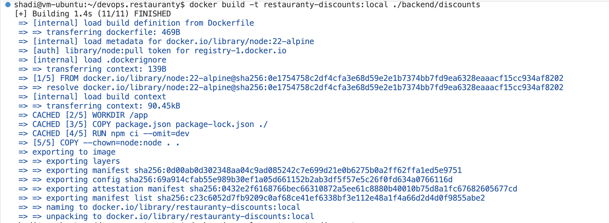

*Figure 26 — Building and Verifying the Discounts Docker Image.*

### 13.3 — Docker Image Security

A `.dockerignore` file was created to exclude environment files, local dependencies, and unnecessary development files from the build context.

File location:

`backend/discounts/.dockerignore`

The image was checked for the presence of a local `.env` file using:

```bash
docker run --rm --entrypoint sh restauranty-discounts:local \
  -c 'if test -f /app/.env; then echo "WARNING: .env found"; else echo "OK: .env not found"; fi'
```

Expected successful result:

`OK: .env not found`

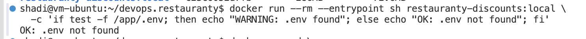

*Figure 27 — Verification of Environment File Exclusion from the Discounts Docker Image.*

### 13.4 — Running the Discounts Container

The Discounts container was started using the existing Docker network and MongoDB container.

```bash
docker run -d \
  --name restauranty-discounts-test \
  --network restauranty-local-net \
  --env-file backend/discounts/.env \
  -e MONGODB_URI=mongodb://restauranty-mongo:27017/Restauranty \
  -e PORT=3002 \
  -p 127.0.0.1:3102:3002 \
  restauranty-discounts:local
```

**Container configuration:**

- Container name: `restauranty-discounts-test`
- Docker network: `restauranty-local-net`
- Internal port: `3002`
- Host port: `3102`
- Database: `Restauranty`

### 13.5 — Container Verification

The following commands were executed:

```bash
docker ps --filter "name=restauranty-discounts-test"

docker logs --tail 15 restauranty-discounts-test

curl -i http://127.0.0.1:3102/api/discounts
```

**Observed results:**

```text
Server listening on http://localhost:3002
Connected to Mongo! Database name: "Restauranty"
HTTP/1.1 200 OK
"Discounts Server UP!"
```

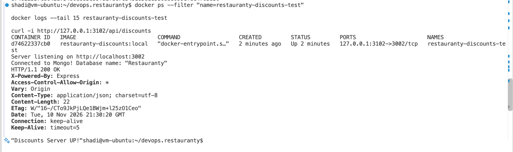

*Figure 28 — Successful Discounts Container Startup, MongoDB Connectivity, and HTTP 200 Verification.*

### 13.6 — Result

**Status: Completed — Initial Container Verification**

The Discounts microservice was successfully containerized and connected to the existing MongoDB container through the dedicated Docker network.

The API endpoint was verified to return HTTP 200 OK.

Full integration and authorization testing will be completed after configuring Docker Compose.


## Step 14 — Items Microservice Dockerization

### Objective

Containerizing the Items microservice using the same Dockerization workflow established for the Authentication and Discounts services.

The objective was to build a secure Docker image, deploy the Items service as an independent container, and verify its HTTP availability.

### 14.1 — Verifying Service Requirements

Before containerization, the necessary dependency and environment files were checked.

**Service directory:**

`backend/items/`

**Verification commands:**

```bash
test -f backend/items/package-lock.json && echo "LOCK OK"
test -f backend/items/.env && echo "ENV OK"
```

**Observed results:**

```text
LOCK OK
ENV OK
```

The `package.json` file was inspected to identify application dependencies and startup requirements.

The application uses Node.js and Express and was configured to run on port 3003.

### 14.2 — Creating the Dockerfile

A Dockerfile was created in:

`backend/items/Dockerfile`

**Dockerfile configuration:**

```dockerfile
FROM node:22-alpine

WORKDIR /app

COPY package.json package-lock.json ./

RUN npm ci --omit=dev

COPY --chown=node:node . .

ENV NODE_ENV=production

USER node

EXPOSE 3003

CMD ["node", "server.js"]
```

The Dockerfile was configured to:

- Use the Node.js 22 Alpine base image.
- Set `/app` as the working directory.
- Copy dependency manifests before application source code.
- Install production dependencies using `npm ci --omit=dev`.
- Copy the application source files.
- Configure the production environment.
- Execute the application as a non-root user.
- Expose port 3003.
- Start the application using `node server.js`.

### 14.3 — Creating the Docker Ignore File

A `.dockerignore` file was created to exclude sensitive and unnecessary files from the Docker build context.

**File location:**

`backend/items/.dockerignore`

**Configuration:**

```text
node_modules
**/node_modules
.env
.env.*
**/.env
**/.env.*
.git
.DS_Store
npm-debug.log*
coverage
```

This configuration prevents local environment files and development dependencies from being copied into the image.

### 14.4 — Building the Items Docker Image

The Items Docker image was built using the following command:

```bash
docker build -t restauranty-items:local ./backend/items
```

The image was successfully built.

**Image verification command:**

```bash
docker image ls restauranty-items
```

**Observed result:**

```text
IMAGE                    IMAGE ID       DISK USAGE
restauranty-items:local  956f64e08b0f   286MB
```

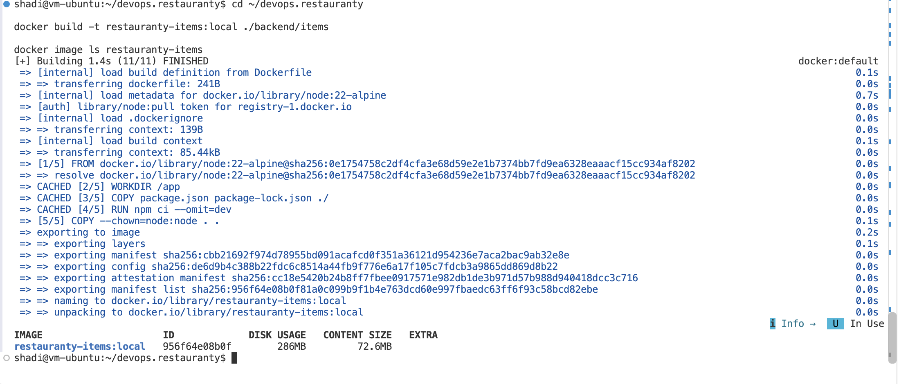

*Figure 29 — Successful Build and Verification of the Items Docker Image.*

### 14.5 — Docker Image Security Verification

The Docker image was inspected to verify that the local `.env` file was not included.

**Verification command:**

```bash
docker run --rm --entrypoint sh restauranty-items:local \
  -c 'if test -f /app/.env; then echo "WARNING: .env found"; else echo "OK: .env not found"; fi'
```

**Observed result:**

```text
OK: .env not found
```

The verification confirmed that the `.env` file was not present at `/app/.env` in the built image.

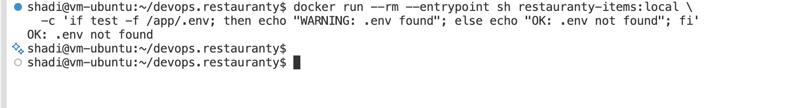

*Figure 30 — Verification That the Items Docker Image Does Not Contain the .env File.*

### 14.6 — Running the Items Container

The Items container was started on the existing dedicated Docker network.

The existing MongoDB container was reused.

**Docker network:**

`restauranty-local-net`

**MongoDB connection URI:**

```text
mongodb://restauranty-mongo:27017/Restauranty
```

**Container execution command:**

```bash
docker run -d \
  --name restauranty-items-test \
  --network restauranty-local-net \
  --env-file backend/items/.env \
  -e MONGODB_URI=mongodb://restauranty-mongo:27017/Restauranty \
  -e PORT=3003 \
  -p 127.0.0.1:3103:3003 \
  restauranty-items:local
```

**Container configuration:**

- Container name: `restauranty-items-test`
- Docker image: `restauranty-items:local`
- Docker network: `restauranty-local-net`
- Internal port: `3003`
- Host port: `3103`
- Database name: `Restauranty`
- Runtime environment: `backend/items/.env`

Port 3103 was selected on the host to avoid conflicts with the existing local Items service running on port 3003.

The container was started successfully.

**Verification command:**

```bash
docker ps --filter "name=restauranty-items-test"
```

**Observed result:**

```text
STATUS: Up
PORTS: 127.0.0.1:3103->3003/tcp
NAME: restauranty-items-test
```

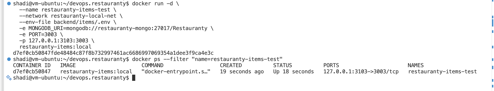

*Figure 31 — Items Microservice Container Successfully Running on the Dedicated Docker Network.*

### 14.7 — HTTP Endpoint Verification

The Items service endpoint was tested through the mapped host port.

**Test command:**

```bash
curl -i http://127.0.0.1:3103/api/items
```

**Observed HTTP response:**

```http
HTTP/1.1 200 OK
Content-Type: application/json; charset=utf-8
```

**Response body:**

```text
"Items Server UP!"
```

The successful HTTP response confirmed that the Items service was reachable through the Docker container.

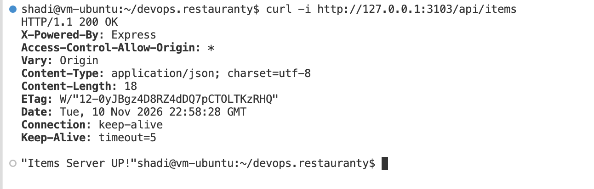

*Figure 32 — Successful Items API Health Check Returning HTTP 200 OK.*

### 14.8 — Result

**Status: Completed — Initial Container Verification**

The following objectives were achieved:

- Created a production-oriented Dockerfile for the Items service.
- Created a `.dockerignore` file.
- Successfully built the Items Docker image.
- Verified that the `.env` file was excluded from the image.
- Started the Items container on the dedicated Docker network.
- Configured the MongoDB connection URI at runtime.
- Verified that the container was running.
- Confirmed HTTP 200 OK from the Items API endpoint.

The initial container availability test was successful.

MongoDB connectivity should also be confirmed through the Items container logs before marking database integration as fully verified.

Full communication, authentication, and authorization tests will be performed after integrating all application services using Docker Compose.

### 14.9 — Updated Containerization Progress

| Service | Status | Internal Port | Test Host Port |
|---|---|---|---|
| Authentication | Completed — Initial Test | 3001 | 3101 |
| Discounts | Completed — Initial Test | 3002 | 3102 |
| Items | Completed — Initial Test | 3003 | 3103 |
| React Frontend | Pending | 3000 (Development) | TBD |


## Step 15 — React Frontend Dockerization

### Objective

Containerizing the Restauranty React frontend using a multi-stage Docker build to create a production-ready application image.

The goal was to build the React application, serve its static files through Nginx, and verify that the application was accessible through a Docker container.

### 15.1 — Creating the Frontend Dockerfile

A multi-stage Dockerfile was created at:

`client/Dockerfile`

The first stage used Node.js 22 Alpine to install dependencies and build the React application.

The second stage used Nginx Alpine to serve the compiled frontend.

**Dockerfile configuration:**

```dockerfile
FROM node:22-alpine AS builder

WORKDIR /app

COPY package.json package-lock.json ./

RUN npm ci

COPY . .

ENV REACT_APP_SERVER_URL=""

RUN npm run build

FROM nginx:alpine

COPY nginx.conf /etc/nginx/conf.d/default.conf

COPY --from=builder /app/build /usr/share/nginx/html

EXPOSE 80

CMD ["nginx", "-g", "daemon off;"]
```

This multi-stage approach separates the build environment from the final runtime image.

### 15.2 — Configuring Nginx

An Nginx configuration file was created at:

`client/nginx.conf`

The configuration listens on port 80 and serves the React application from the Nginx HTML directory.

The `try_files` directive provides fallback routing to `index.html`, allowing React Router paths to work when pages are refreshed.

A `.dockerignore` file was also created to exclude unnecessary development files, dependencies, and local environment files.

### 15.3 — Building the Frontend Image

The frontend Docker image was built using:

```bash
docker build -t restauranty-frontend:local ./client
```

The build completed successfully.

**Verification command:**

```bash
docker image ls restauranty-frontend
```

**Observed image details:**

```text
IMAGE: restauranty-frontend:local
IMAGE ID: 36beb2a9b056
DISK USAGE: 105MB
```

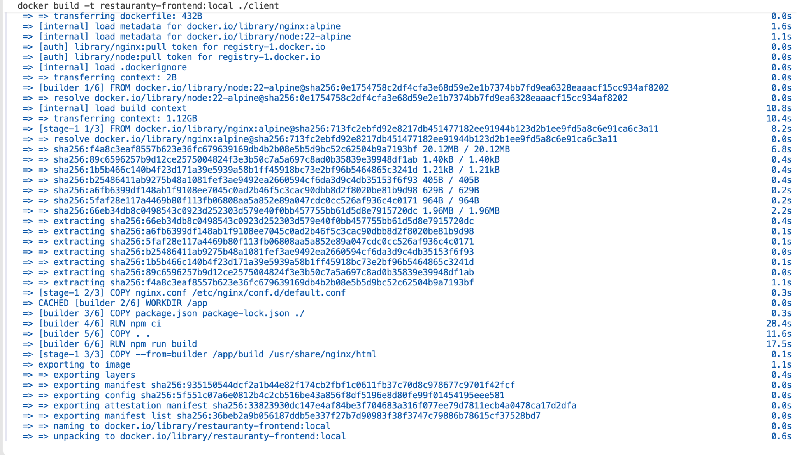

*Figure 33 — Successful Multi-Stage Docker Build of the React Frontend.*

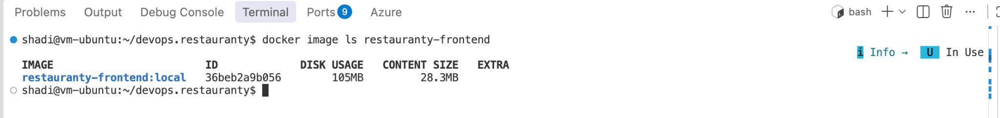

*Figure 34 — Verification of the Restauranty Frontend Docker Image.*

### 15.4 — Running the Frontend Container

The frontend container was started using the existing Docker network.

**Command:**

```bash
docker run -d \
  --name restauranty-frontend-test \
  --network restauranty-local-net \
  -p 127.0.0.1:3100:80 \
  restauranty-frontend:local
```

**Container configuration:**

- Container name: `restauranty-frontend-test`
- Docker image: `restauranty-frontend:local`
- Docker network: `restauranty-local-net`
- Internal port: `80`
- Host port: `3100`
- Web server: Nginx

The container started successfully.

### 15.5 — Verifying the Container

The following commands were executed:

```bash
docker ps --filter "name=restauranty-frontend-test"

docker logs --tail 15 restauranty-frontend-test

curl -I http://127.0.0.1:3100/

curl -I http://127.0.0.1:3100/login
```

**Observed results:**

```text
Container Status: Up
Nginx: Started successfully

GET /       → HTTP 200 OK
GET /login  → HTTP 200 OK
```

Both routes returned successful HTTP responses.

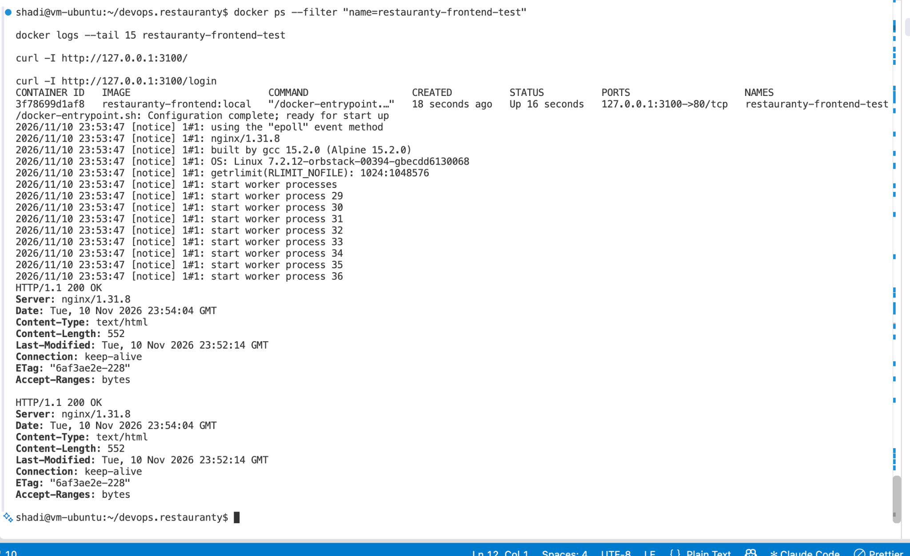

*Figure 35 — Successful Frontend Container Startup and HTTP Endpoint Verification.*

### 15.6 — Browser Verification

The containerized frontend was accessed through the browser using:

`http://localhost:3100`

The Restauranty dashboard was displayed successfully.

The page contained the following sections:

- Items
- Coupons
- Campaigns
- Categories
- Login and Registration

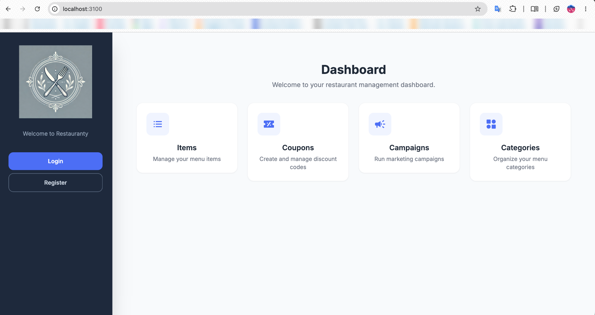

*Figure 36 — Restauranty React Dashboard Successfully Served from the Nginx Container.*

### 15.7 — Result

**Status: Completed — Initial Frontend Container Verification**

The following objectives were achieved:

- Created a multi-stage Dockerfile.
- Built the React application using Node.js.
- Created a lightweight Nginx runtime image.
- Configured React Router fallback routing.
- Started the frontend container.
- Verified the container was running.
- Confirmed HTTP 200 responses.
- Successfully displayed the dashboard in the browser.

The frontend was successfully containerized.

Frontend-to-backend API communication has not yet been verified in the containerized environment.

The next phase will configure Docker Compose and reverse-proxy routing to enable communication between the frontend and backend services.

### 15.8 — Containerization Progress

| Service | Image | Status |
|---|---|---|
| Authentication | restauranty-auth:local | Initial Test Passed |
| Discounts | restauranty-discounts:local | Initial Test Passed |
| Items | restauranty-items:local | Initial Test Passed |
| React Frontend | restauranty-frontend:local | Initial Test Passed |
| MongoDB | mongo:7 | Existing Container |


## Step 16 — Docker Compose Integration

### Objective

Integrating the containerized Restauranty microservices using Docker Compose and HAProxy to enable communication between the frontend and backend services.

### 16.1 — Docker Compose Configuration

A Docker Compose configuration file was created in the project root.

**File:** `compose.yaml`

The configuration defines five services:

- Authentication microservice
- Discounts microservice
- Items microservice
- React frontend
- HAProxy reverse proxy

All services were connected to the existing `restauranty-local-net` Docker network.

The existing MongoDB container was reused without recreating the database.

Environment variables were loaded from local environment files at runtime.

### 16.2 — HAProxy Configuration

A separate HAProxy configuration file was created for the containerized environment.

**File:** `haproxy.docker.cfg`

The reverse proxy was configured to forward requests based on URL paths.

| Request Path | Target Service | Internal Port |
|---|---|---|
| `/api/auth` | auth | 3001 |
| `/api/discounts` | discounts | 3002 |
| `/api/items` | items | 3003 |
| `/` | frontend | 80 |

The HAProxy container was exposed locally through port 8088.

### 16.3 — Docker Compose Validation

The configuration was validated using:

```bash
docker compose config --quiet
```

**Result:** Passed

No configuration errors were reported.

### 16.4 — Building and Starting the Services

The application stack was started using:

```bash
docker compose up -d --build
```

All application images were successfully built.

**Verification command:**

```bash
docker compose ps
```

**Observed results:**

| Service | Status |
|---|---|
| auth | Running |
| discounts | Running |
| items | Running |
| frontend | Running |
| proxy | Running |

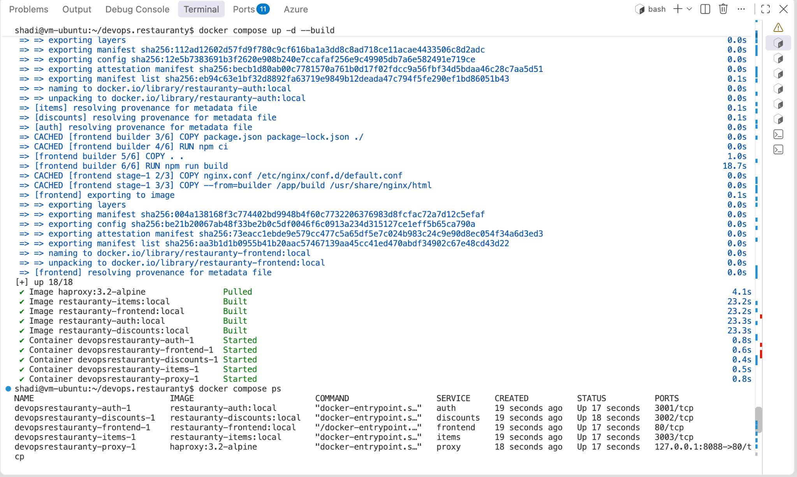

*Figure 37 — All Five Restauranty Services Successfully Started Using Docker Compose.*

### 16.5 — API Routing Verification

The backend API endpoints were tested through the HAProxy entry point.

**Verification commands:**

```bash
curl -i http://127.0.0.1:8088/api/auth

curl -i http://127.0.0.1:8088/api/discounts

curl -i http://127.0.0.1:8088/api/items

curl -i http://127.0.0.1:8088/
```

**Observed results:**

| Endpoint | HTTP Status | Response |
|---|---|---|
| `/api/auth` | 200 OK | Auth Server UP! |
| `/api/discounts` | 200 OK | Discounts Server UP! |
| `/api/items` | 200 OK | Items Server UP! |
| `/` | 200 OK | HTML response |

The results confirmed that HAProxy successfully routed HTTP requests to the corresponding application containers.

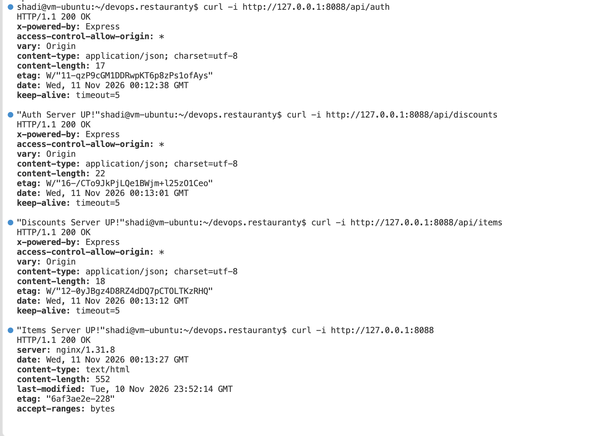

*Figure 38 — Successful API Routing Through HAProxy with HTTP 200 Responses.*

### 16.6 — Frontend Browser Verification

The containerized application was accessed through:

`http://localhost:8088`

The Restauranty dashboard was displayed successfully.

The frontend was served by Nginx through the HAProxy reverse proxy.

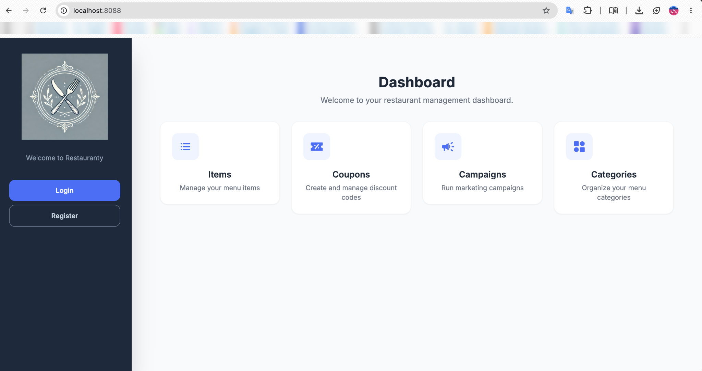

*Figure 39 — Restauranty Dashboard Successfully Accessed Through the Docker Compose Stack.*

### 16.7 — Results

**Status: Initial Integration Tests Passed**

The following objectives were achieved:

- Created the Docker Compose configuration.
- Connected all application services to the existing Docker network.
- Reused the existing MongoDB container.
- Configured HAProxy routing.
- Built and started five application containers.
- Verified the three backend API health endpoints.
- Confirmed HTTP 200 responses.
- Successfully displayed the frontend dashboard.

### 16.8 — Remaining Integration Tests

The initial availability and routing tests were successful.

However, full end-to-end functionality has not yet been verified.

The remaining checks include:

- User login and registration.
- JWT authentication and authorization.
- Protected API requests.
- Frontend-to-backend data retrieval.
- Database operations through the application.

These tests will be completed before marking full application integration as verified.


## Step 17 — Frontend and Backend Integration Verification

### Objective

Verifying frontend-to-backend communication through the Docker Compose deployment and HAProxy reverse proxy.

### 17.1 — Authentication and API Testing

The containerized Restauranty application was accessed through:

`http://localhost:8088`

Chrome Developer Tools was used to inspect network requests during authentication and navigation.

The following requests were observed:

| Request | HTTP Status | Result |
|---|---|---|
| Login | 200 OK | Passed |
| Token Verification | 200 OK | Passed |
| Items Retrieval | 200 OK | Passed |

After authentication, the Items page was displayed successfully.

The results demonstrated successful communication between the React frontend and backend services through the Docker Compose deployment.

### 17.2 — Network Verification

The Network tab in Chrome Developer Tools was used to inspect the application requests.

All three relevant application requests returned successful HTTP responses.

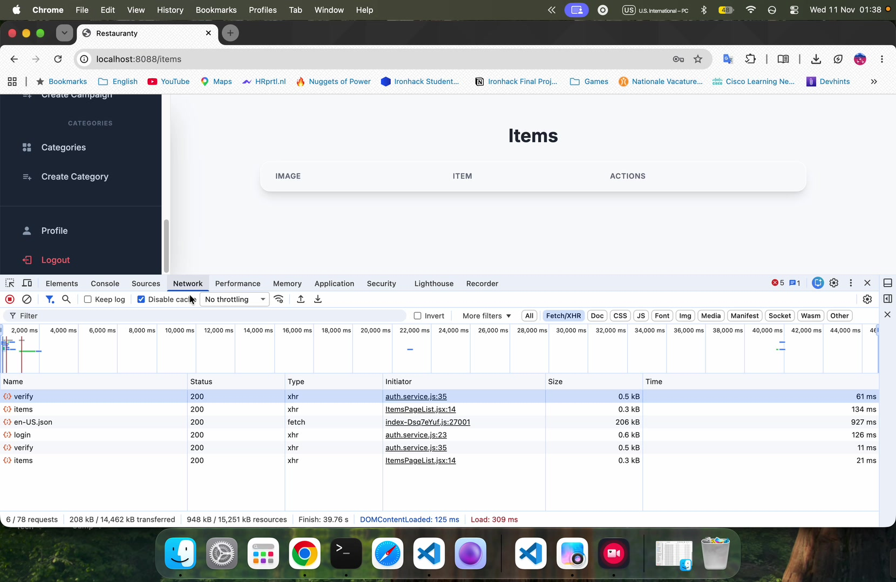

*Figure 40 — Successful Login, Authentication Verification, and Items API Requests Through Docker Compose.*

### 17.3 — Result

**Status: Passed — Login and Items Retrieval**

The following functionality was verified:

- Successful login request.
- Successful authentication verification request.
- Successful Items API request.
- Successful navigation to the authenticated Items page.
- Communication through the HAProxy reverse proxy.

The test confirms initial frontend-to-backend integration.

Further tests are required to verify JWT authorization headers, unauthorized access rejection, and database write operations.


### 17.4 — Unauthorized API Access Verification

**Objective**

Verifying that the Items microservice rejects requests to protected endpoints when no JWT authentication token is provided.

**Test command:**

```bash
curl -i http://127.0.0.1:8088/api/items/items
```

**Observed response:**

```http
HTTP/1.1 401 Unauthorized
```

```json
{
  "message": "Invalid or missing token"
}
```

The request was sent through the HAProxy reverse proxy without an Authorization header.

The Items microservice rejected the request with HTTP 401 Unauthorized.

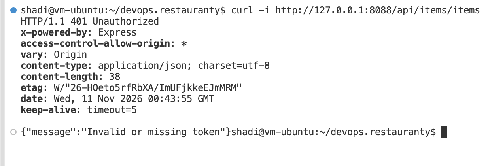

*Figure 41 — Protected Items API Rejecting a Request Without a JWT Token.*

**Result: Passed**

The test confirmed that the protected Items API endpoint rejects unauthenticated requests in the Docker Compose environment.

Together with the previously verified successful login, token verification, and Items retrieval requests, this provides evidence of the initial authentication integration.

Additional authorization and database operation tests remain outside the scope of this verification.