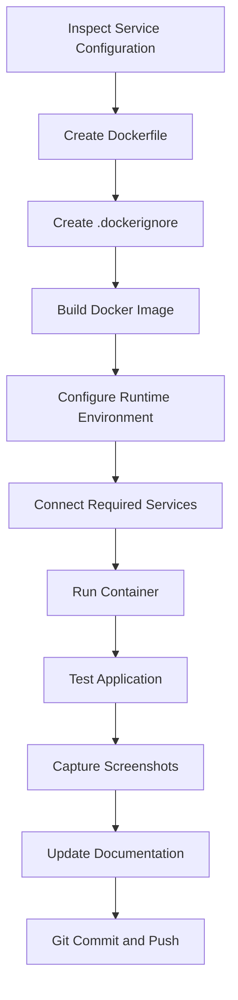
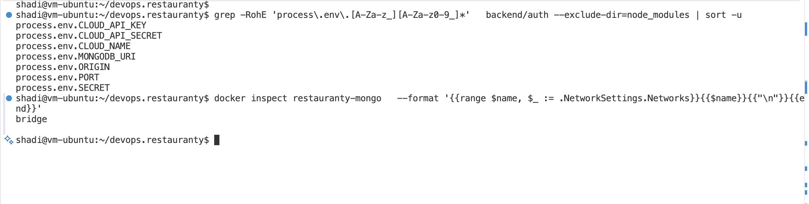
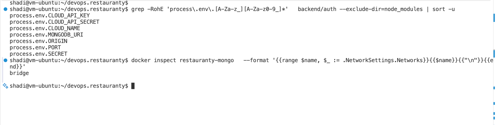
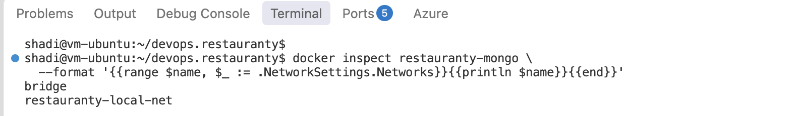
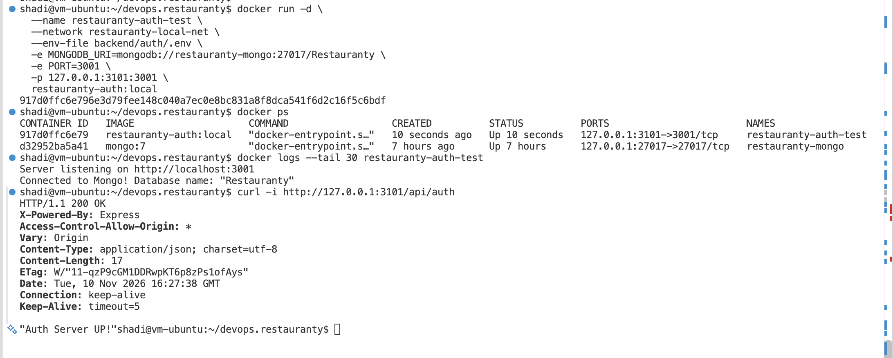
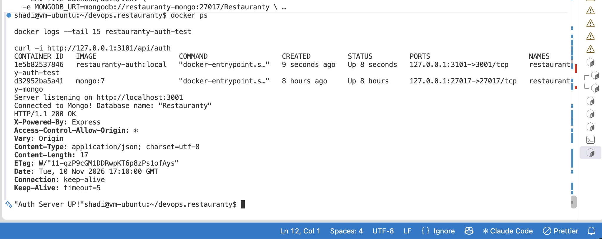

# Phase 3 — Docker Containerization

## Objective

Containerizing the Restauranty application to ensure consistent deployment, service isolation, and portability across development and production environments.

The application consists of four services:
- Authentication Service (Node.js / Express)
- Discounts Service (Node.js / Express)
- Items Service (Node.js / Express)
- React Frontend

MongoDB is used as the database.

## Dockerization Workflow

The following workflow will be applied to each application service, with adjustments based on its runtime and dependencies.



The environment variables are provided at container runtime rather than embedded in the image.

## Step 1 — Authentication Service Dockerfile

**Service directory:**

`backend/auth/`

A Dockerfile was created to package the Authentication Service into a Docker image.

**Dockerfile:**

```dockerfile
FROM node:22-alpine

WORKDIR /app

COPY package.json package-lock.json ./

RUN npm ci --omit=dev

COPY --chown=node:node . .

ENV NODE_ENV=production

USER node

EXPOSE 3001

CMD ["node", "server.js"]
```

The configuration uses Node.js 22 Alpine, installs production dependencies, runs the application as a non-root user, and starts the service using Node.js instead of nodemon.

## Step 2 — Docker Build Context Optimization

A `.dockerignore` file was created to exclude unnecessary and sensitive files from the Docker build context.

**File:**

`backend/auth/.dockerignore`

The excluded files include:
- Local node_modules
- Environment files
- Git metadata
- Debug logs
- Local system files

This reduces unnecessary build content and prevents local environment files from being copied into the image.

## Step 3 — Building the Authentication Image

**Command:**

```bash
docker build -t restauranty-auth:local ./backend/auth
```

The image was successfully built and verified.

**Verification command:**

```bash
docker image ls restauranty-auth
```

**Image name:**

`restauranty-auth:local`



*Figure 21 — Authentication Docker Image Successfully Built and Verified.*

## Step 4 — Inspecting Runtime Configuration

The Authentication Service environment-variable references were inspected to identify its runtime requirements.

The identified variables included:
- CLOUD_API_KEY
- CLOUD_API_SECRET
- CLOUD_NAME
- MONGODB_URI
- ORIGIN
- PORT
- SECRET

The existing MongoDB container was also inspected to identify its Docker network configuration.



*Figure 22 — Inspecting Authentication Environment Variables and MongoDB Network Configuration.*

## Step 5 — Creating a Dedicated Docker Network

A dedicated Docker bridge network was created to enable communication between the application containers.

**Command:**

```bash
docker network create restauranty-local-net
```

The existing MongoDB container was connected to the new network.

```bash
docker network connect restauranty-local-net restauranty-mongo
```

This operation connected the existing MongoDB container to an additional network without recreating or removing it.

**Network verification:**

```bash
docker inspect restauranty-mongo \
  --format '{{range $name, $_ := .NetworkSettings.Networks}}{{println $name}}{{end}}'
```

**Verified networks:**

```text
bridge
restauranty-local-net
```



*Figure 23 — MongoDB Container Successfully Connected to the Dedicated Docker Network.*

## Step 6 — Configuring MongoDB Connectivity

The original local MongoDB connection referenced the loopback address.

Inside Docker, localhost refers to the current container rather than the MongoDB container.

The runtime MongoDB connection was therefore configured using Docker's internal container-name resolution.

**Docker network MongoDB URI:**

```text
mongodb://restauranty-mongo:27017/Restauranty
```

The MongoDB URI was supplied at container startup, preserving the existing local development configuration.

## Step 7 — Running the Authentication Container

The container was launched on the dedicated Docker network.

**Command:**

```bash
docker run -d \
  --name restauranty-auth-test \
  --network restauranty-local-net \
  --env-file backend/auth/.env \
  -e MONGODB_URI=mongodb://restauranty-mongo:27017/Restauranty \
  -e PORT=3001 \
  -p 127.0.0.1:3101:3001 \
  restauranty-auth:local
```

**Container configuration:**

- Container name: restauranty-auth-test
- Docker network: restauranty-local-net
- Internal application port: 3001
- Local host port: 3101
- Database: Restauranty
- Runtime environment: backend/auth/.env

Using port 3101 on the host prevented interference with the existing local Authentication Service running on port 3001.

The environment file was used only at runtime and was not added to Git.

## Step 8 — Container and Database Verification

**Container status:**

```bash
docker ps
```

**Application logs:**

```bash
docker logs --tail 30 restauranty-auth-test
```

The logs confirmed that the application started and connected to MongoDB.

**Observed messages:**

```text
Server listening on http://localhost:3001
Connected to Mongo! Database name: "Restauranty"
```

## Step 9 — HTTP Endpoint Testing

The Authentication Service endpoint was tested through the mapped host port.

**Command:**

```bash
curl -i http://127.0.0.1:3101/api/auth
```

**Observed response:**

```http
HTTP/1.1 200 OK
```

```text
"Auth Server UP!"
```

The successful response confirmed that the Authentication Service was reachable through its Docker container.



*Figure 24 — Authentication Container Running Successfully with MongoDB Connectivity and HTTP 200 Verification.*

## Step 10 — Authentication Containerization Result

**Status: Completed — Initial Authentication Container Verification**

The following objectives were achieved:

- Created a production-oriented Dockerfile.
- Configured the Docker build context.
- Successfully built the Authentication Docker image.
- Created a dedicated Docker network.
- Connected the existing MongoDB container.
- Configured the container-specific MongoDB URI.
- Started the Authentication container.
- Verified MongoDB connectivity through application logs.
- Confirmed HTTP 200 OK from the Authentication endpoint.

The HTTP test verifies service availability. Full authentication and authorization regression tests remain necessary after integrating all services through Docker Compose.

## Remaining Services

| Service | Containerization Status |
|---|---|
| Authentication | Completed — Initial Test |
| Discounts | Pending |
| Items | Pending |
| React Frontend | Pending |


### Step 12 — Verifying the Rebuilt Authentication Container

After correcting the `.dockerignore` filename and rebuilding the Docker image, the Authentication container was recreated using the updated image.

The existing MongoDB container and Docker network were preserved.

**Verification commands:**

```bash
docker ps
docker logs --tail 15 restauranty-auth-test
curl -i http://127.0.0.1:3101/api/auth
```

**Observed results:**

- Authentication container: Running
- MongoDB connection: Successful
- HTTP response: 200 OK
- API response: `"Auth Server UP!"`



*Figure 25 — Authentication Container Successfully Rebuilt and Verified After Security Correction.*

**Result: Passed**

The corrected Authentication Docker image was verified to exclude the `.env` file, and the recreated container successfully connected to MongoDB and responded to HTTP requests.

## Next Steps

1. Containerize the Discounts Service.
2. Containerize the Items Service.
3. Build the React frontend image.
4. Configure Docker Compose.
5. Test communication between all containers.
6. Update the documentation with the remaining implementation steps and screenshots.
7. Commit and push the verified changes.

## Final Deployment Goal

The completed containerized application will support deployment through Docker Compose and later Kubernetes, using consistent images and runtime configuration.
