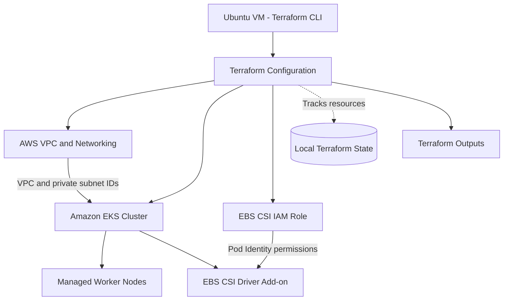
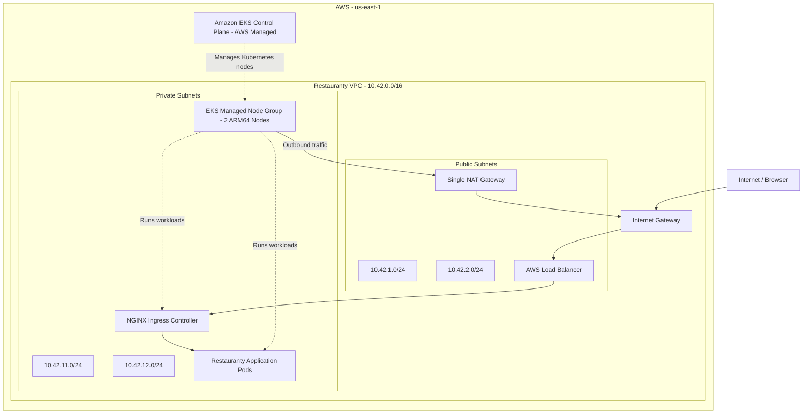
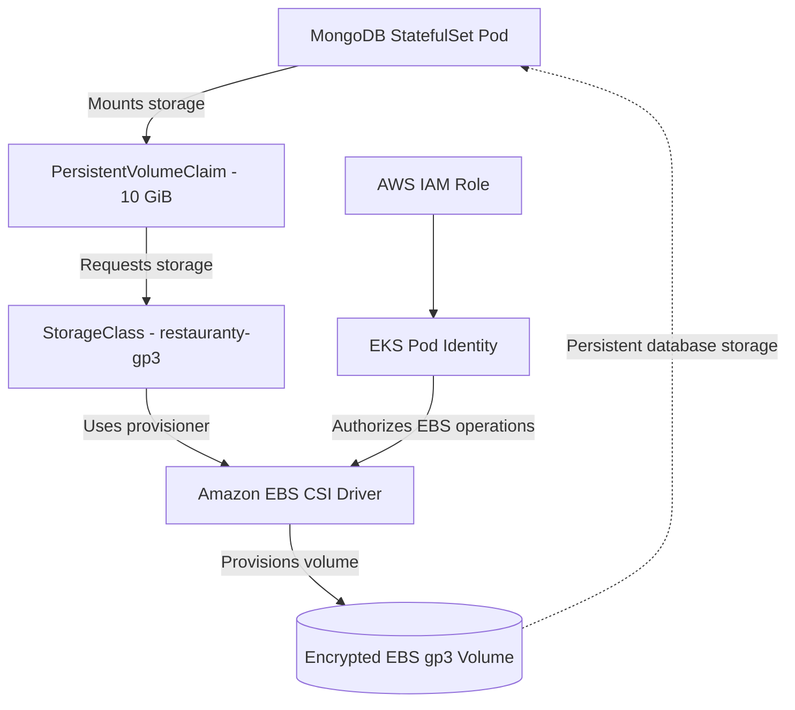
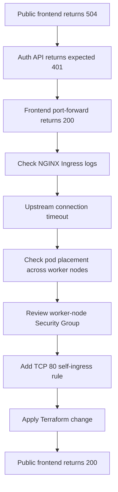

# Phase 5 — AWS Infrastructure and Terraform Setup

## Objective

The goal of this phase was to prepare the AWS infrastructure needed to run Restauranty on Kubernetes.

Terraform was used to create the network, EKS cluster, managed worker nodes, and storage-related AWS resources. The application was previously running locally with Docker Compose and was prepared for deployment to Amazon EKS.

The infrastructure was deployed in the `us-east-1` (N. Virginia) region.

## Infrastructure Overview

| Component | Configuration |
|---|---|
| AWS Region | `us-east-1` |
| VPC | `restauranty-vpc` |
| VPC CIDR | `10.42.0.0/16` |
| Availability Zones | `us-east-1a`, `us-east-1b` |
| Public Subnets | `10.42.1.0/24`, `10.42.2.0/24` |
| Private Subnets | `10.42.11.0/24`, `10.42.12.0/24` |
| NAT Gateway | 1 |
| EKS Cluster | `restauranty-eks` |
| Kubernetes Version | `1.36` |
| Worker Nodes | 2 managed nodes |
| EC2 Instance Type | `t4g.large` |
| Node Architecture | ARM64 |
| Node Operating System | Amazon Linux 2023 |
| EBS CSI Driver | AWS EKS add-on |
| MongoDB Storage | Encrypted gp3, 10 GiB |

The EKS worker nodes were placed in private subnets. Public subnets were used for internet-facing infrastructure, while a NAT Gateway provided outbound connectivity for private resources.

## 5.1 Terraform Project Structure

The Terraform configuration was organized into separate files under the `terraform/` directory.

| File | Purpose |
|---|---|
| `versions.tf` | Terraform and provider version requirements |
| `providers.tf` | AWS provider configuration and default tags |
| `variables.tf` | Infrastructure input variables |
| `terraform.tfvars` | Deployment-specific variable values |
| `vpc.tf` | VPC, subnets, routing, and gateways |
| `eks.tf` | EKS cluster, add-ons, and managed worker nodes |
| `ebs-csi.tf` | EBS CSI IAM role and add-on |
| `outputs.tf` | Infrastructure outputs |
| `.terraform.lock.hcl` | Provider dependency lockfile |

The `terraform.tfvars` file is excluded from Git.

Terraform state and local provider files are also excluded, while `.terraform.lock.hcl` is kept in version control.

### Terraform Provisioning Flow



*Diagram 5.1 — Main infrastructure components managed through Terraform.*

Terraform was executed from the Ubuntu development environment. AWS CLI authentication was checked before provisioning the resources.

## 5.2 Provisioning the AWS Network

### Network Design

A dedicated VPC with the CIDR block `10.42.0.0/16` was created.

The network uses two Availability Zones, with one public and one private subnet configured for each zone.

| Subnet | CIDR | Purpose |
|---|---|---|
| Public Subnet 1 | `10.42.1.0/24` | Public networking |
| Public Subnet 2 | `10.42.2.0/24` | Public networking |
| Private Subnet 1 | `10.42.11.0/24` | EKS worker nodes |
| Private Subnet 2 | `10.42.12.0/24` | EKS worker nodes |

The VPC configuration also created:

- An Internet Gateway
- One NAT Gateway
- Route tables
- Route table associations
- Public and private subnet tags for Kubernetes Load Balancers

The NAT Gateway allows resources in private subnets to access external services without assigning public IP addresses directly to the worker nodes.

### AWS Network Architecture



*Diagram 5.2 — AWS VPC networking, private worker nodes, and public application access.*

The diagram shows the main traffic paths rather than the exact placement of every pod or AWS network interface.

The EKS control plane is managed by AWS. The application workloads run on EC2 worker nodes in the private subnets.

### Terraform Network Deployment

The network configuration was initialized, formatted, and validated before applying changes.

The initial Terraform plan showed:

```text id="rdnu9q"
Plan: 19 to add, 0 to change, 0 to destroy
```

After reviewing the plan, Terraform successfully provisioned the 19 planned resources.

These numbers refer to the initial VPC provisioning step, not the current resource count of the complete project.

### Evidence


*Figure 47 — Terraform plan showing 19 networking resources to add.*


*Figure 48 — Successful application of the initial networking configuration.*


*Figure 49 — AWS VPC resource map showing subnets, routing components, and gateways.*

### Result

The dedicated VPC and its networking resources were created successfully.

The public and private subnet layout was ready for the Amazon EKS deployment.

## 5.3 Creating the Amazon EKS Cluster

### EKS Configuration

The `restauranty-eks` cluster was created in the Restauranty VPC using the Terraform EKS module.

The configuration included:

- Kubernetes version `1.36`
- Public and private Kubernetes API endpoints
- A managed node group
- Two `t4g.large` EC2 worker nodes
- ARM64 architecture
- Amazon Linux 2023
- Private subnets for worker nodes
- CoreDNS, kube-proxy, VPC CNI, and EKS Pod Identity Agent add-ons

The worker node group was configured with the following capacity settings:

| Setting | Value |
|---|---|
| Minimum nodes | 2 |
| Desired nodes | 2 |
| Maximum nodes | 3 |
| Capacity type | On-Demand |
| Instance type | `t4g.large` |

### Why ARM64?

The `t4g.large` instance type uses an ARM-based processor.

For this reason, Docker images deployed to the cluster must support the ARM64 architecture.

The initial images published during the Docker phase were later adapted for the EKS deployment through the CI/CD workflow.

### EKS Deployment

The Terraform plan for the EKS stage showed:

```text id="phlftb"
Plan: 40 to add, 0 to change, 0 to destroy
```

After provisioning:

- The EKS cluster reached `ACTIVE`.
- The managed node group reached `ACTIVE`.
- The Kubernetes context was configured.
- Both worker nodes were confirmed `Ready`.

### Evidence


*Figure 50 — Reviewing the EKS Terraform plan before deployment.*


*Figure 51 — Amazon EKS cluster in ACTIVE status.*


*Figure 52 — Managed node group configuration and active status.*


*Figure 53 — Two EKS worker nodes confirmed Ready through kubectl.*

### Verification Commands

The Kubernetes configuration was updated using:

```bash id="2kgqhl"
aws eks update-kubeconfig --name restauranty-eks --region us-east-1
```

The cluster was then checked using:

```bash id="8dqqzc"
kubectl config current-context
kubectl get nodes -o wide
kubectl get pods -n kube-system
```

### Result

The EKS cluster and managed node group were successfully provisioned.

Both nodes were ready for Kubernetes workloads.

## 5.4 Configuring Persistent Storage

### EBS CSI Driver

The Amazon EBS CSI Driver was installed as an EKS add-on using Terraform.

The configuration in `ebs-csi.tf` includes:

- An AWS IAM role for the EBS CSI Driver
- The `AmazonEBSCSIDriverPolicyV2` managed policy
- An EKS Pod Identity association
- The `aws-ebs-csi-driver` add-on

The Pod Identity association allows the EBS CSI controller to use the IAM role required for managing EBS volumes.

After deployment, the add-on reached `ACTIVE`, and its controller and node pods were running.

### StorageClass Configuration

A Kubernetes StorageClass named `restauranty-gp3` was created.

**File:** `k8s/storageclass.yaml`

The configuration specifies:

```yaml id="em6ncm"
apiVersion: storage.k8s.io/v1
kind: StorageClass
metadata:
  name: restauranty-gp3
provisioner: ebs.csi.aws.com
parameters:
  type: gp3
  encrypted: "true"
reclaimPolicy: Delete
volumeBindingMode: WaitForFirstConsumer
allowVolumeExpansion: true
```

The StorageClass uses encrypted gp3 EBS volumes.

`WaitForFirstConsumer` delays volume provisioning until Kubernetes has enough scheduling information to select an appropriate Availability Zone.

The `Delete` reclaim policy means the underlying storage can be deleted when its associated PersistentVolume is released and removed. Database backups must therefore be considered before deleting storage resources.

### MongoDB Persistent Storage

MongoDB was deployed as a Kubernetes StatefulSet.

A 10 GiB PersistentVolumeClaim was created using the `restauranty-gp3` StorageClass.

The PVC reached the `Bound` state, confirming that persistent storage had been provisioned.

### Persistent Storage Architecture



*Diagram 5.3 — MongoDB persistent storage using PVC, EBS CSI, and Amazon EBS.*

The actual creation, binding, and attachment of the volume are handled by Kubernetes and the EBS CSI Driver.

### Evidence


*Figure 54 — EBS CSI add-on active with its controller and node components running.*

### Verification Commands

```bash id="5dmz22"
kubectl get storageclass
kubectl -n restauranty get pvc
kubectl -n restauranty get statefulset
```

The detailed MongoDB deployment, data migration, and persistence tests are documented in the later Kubernetes and database phases.

### Result

The EBS CSI Driver was installed successfully, and the cluster was ready to provide persistent EBS storage for MongoDB.

## 5.5 Resolving Cross-Node HTTP Connectivity

### Problem

After the application was deployed, the public NGINX Ingress returned:

```text id="meko6p"
504 Gateway Timeout
```

The error occurred when accessing the frontend.

At the same time:

- The Auth API returned the expected HTTP `401 Unauthorized` response.
- Direct port forwarding to the frontend returned HTTP `200 OK`.
- The NGINX Ingress logs showed an upstream connection timeout.
- The Ingress controller and frontend pod were running on different worker nodes.

These results indicated that the frontend application itself was responding, but the path from the Ingress controller to the frontend pod needed further investigation.

### Troubleshooting Process



*Diagram 5.4 — Troubleshooting the frontend timeout between Kubernetes worker nodes.*

### Security Group Fix

The existing Terraform EKS configuration was updated to allow TCP port `80` between nodes that share the EKS worker-node Security Group.

The following rule was added to the EKS module:

```hcl id="o5jrqr"
node_security_group_additional_rules = {
  ingress_self_frontend_http = {
    description = "Allow frontend HTTP between EKS worker nodes"
    type        = "ingress"
    protocol    = "tcp"
    from_port   = 80
    to_port     = 80
    self        = true
  }
}
```

The `self = true` setting restricts the source to the same Security Group.

This rule does not allow the entire internet to connect directly to worker-node port `80`.

### Terraform Plan

The updated plan showed:

```text id="1q3ooq"
Plan: 1 to add, 0 to change, 0 to destroy
```

The change was applied without replacing the existing cluster or worker nodes.

### Verification

After the Security Group update:

| Test | Observed Result |
|---|---|
| Public frontend | HTTP 200 OK |
| Protected Auth endpoint without JWT | HTTP 401 Unauthorized |
| Ingress routing | Working |

The frontend became accessible through the AWS Load Balancer and NGINX Ingress.

### Evidence


*Figure 55 — Terraform plan for the additional internal TCP/80 Security Group rule.*


*Figure 56 — Terraform outputs reviewed after applying the networking change.*

### Result

The internal Security Group update resolved the observed frontend connectivity issue.

The deployment could serve the frontend through the public Ingress while keeping the worker nodes in private subnets.

## 5.6 Infrastructure Verification

The following commands were used during infrastructure verification.

### Terraform Checks

```bash id="4gitpr"
cd ~/devops.restauranty/terraform
terraform fmt
terraform validate
terraform plan
```

The `terraform plan` command should always be reviewed before applying changes, especially when an existing cluster and persistent database storage are already running.

The resource counts shown earlier in this document were captured during the original provisioning steps. Running a new plan may produce different results.

### AWS Cluster Status

```bash id="nqa2t0"
aws eks describe-cluster --name restauranty-eks --region us-east-1 --query 'cluster.{Name:name,Status:status,Version:version}' --output table
```

### Kubernetes Checks

```bash id="xlex29"
kubectl config current-context
kubectl get nodes -o wide
kubectl get pods -n kube-system
kubectl get storageclass
kubectl -n restauranty get pvc
```

### Terraform Outputs

```bash id="3bljqp"
terraform output
```

The project's `outputs.tf` exposes:

- VPC ID
- Public subnet IDs
- Private subnet IDs
- Availability Zones
- NAT Gateway public IP information

These outputs help verify the networking resources created by Terraform.

## 5.7 Security and Operational Considerations

### Private Worker Nodes

The EKS worker nodes run in private subnets.

Outbound internet connectivity is provided through the NAT Gateway, while public application traffic is handled through the AWS Load Balancer and NGINX Ingress.

The additional TCP/80 Security Group rule is restricted to traffic from the same worker-node Security Group.

### AWS IAM and Storage

IAM roles are used for EKS components, worker nodes, and EBS CSI operations.

The EBS CSI Driver uses an IAM role through EKS Pod Identity.

The MongoDB StorageClass requests encrypted EBS gp3 storage.

### Kubernetes NetworkPolicies

Kubernetes NetworkPolicy enforcement was configured later as part of the security-hardening phase.

That work included enabling AWS VPC CNI NetworkPolicy support and applying ingress restrictions to application workloads.

The implementation and verification are recorded separately in:

[Security Documentation](08-security.md)

### Terraform State

Terraform state is currently managed locally.

A remote state backend was not configured or verified as part of this phase.

The following files and directories should remain outside version control:

```text id="0pqny1"
terraform.tfstate
terraform.tfstate.backup
*.tfstate*
*.tfvars
*.tfplan
.terraform/
```

The Terraform provider dependency lockfile should be committed:

```text id="u0fejl"
.terraform.lock.hcl
```

State files may contain sensitive infrastructure details and must not be uploaded to the public repository.

### Infrastructure Costs

The EKS control plane, EC2 worker nodes, NAT Gateway, Load Balancer, and EBS storage can generate AWS charges while the infrastructure exists.

Destroying the environment also requires care because deleting storage resources may result in permanent data loss.

Database backups should be checked before removing persistent storage.

### Remaining Improvements

The following items were not part of the verified infrastructure provisioning in this phase:

- HTTPS/TLS configuration
- Custom domain configuration
- Remote Terraform state backend
- Additional infrastructure monitoring
- Automated database backup and recovery procedures

These are possible future improvements and are not presented as completed work.

## Phase Summary

| Area | Result |
|---|---|
| AWS CLI authentication | Verified |
| VPC networking | Provisioned |
| Public and private subnets | Provisioned |
| Internet Gateway and NAT Gateway | Provisioned |
| EKS cluster | ACTIVE |
| Managed node group | ACTIVE |
| ARM64 worker nodes | 2 Ready |
| EBS CSI Driver | ACTIVE |
| MongoDB persistent storage | PVC Bound |
| Cross-node frontend connectivity | Fixed and verified |
| Public frontend access | HTTP 200 OK |

The dedicated AWS infrastructure was successfully provisioned using Terraform.

The EKS cluster was running with two managed ARM64 worker nodes, and the EBS CSI Driver provided the storage integration required for MongoDB.

The networking issue affecting frontend access was also resolved through a Terraform-managed Security Group change.

This infrastructure became the foundation for the Restauranty Kubernetes deployment.

## Next Phase — Kubernetes Application Deployment

The next phase covers deploying and verifying the Restauranty workloads on the EKS cluster, including:

1. Creating the application namespace.
2. Configuring Kubernetes Secrets.
3. Deploying backend services and the React frontend.
4. Deploying MongoDB with persistent storage.
5. Configuring NGINX Ingress.
6. Verifying application connectivity and deployment status.

**Next:** [Kubernetes Deployment](06-kubernetes-deployment.md)

**Related:** [Database Migration](07-database-migration.md) | [Security Implementation](08-security.md) | [Project README](../README.md)
