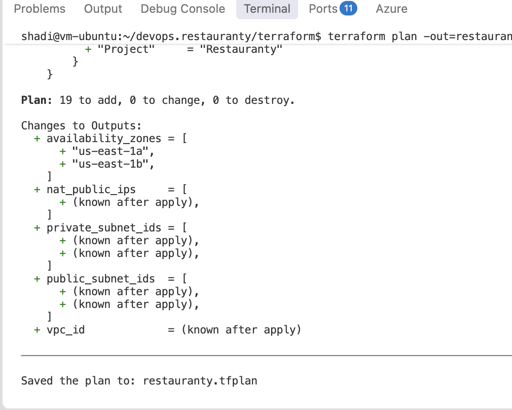
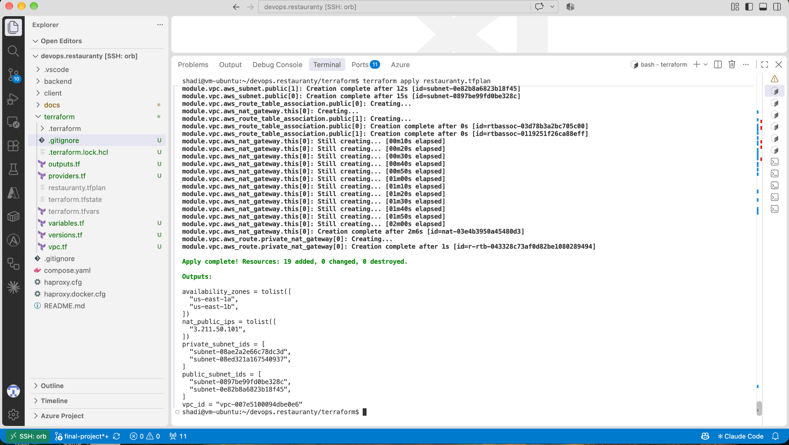
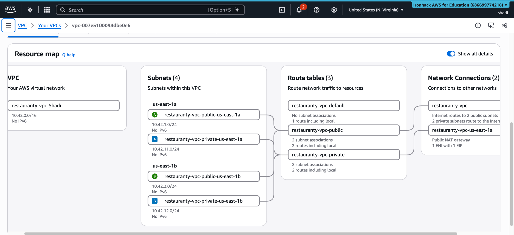
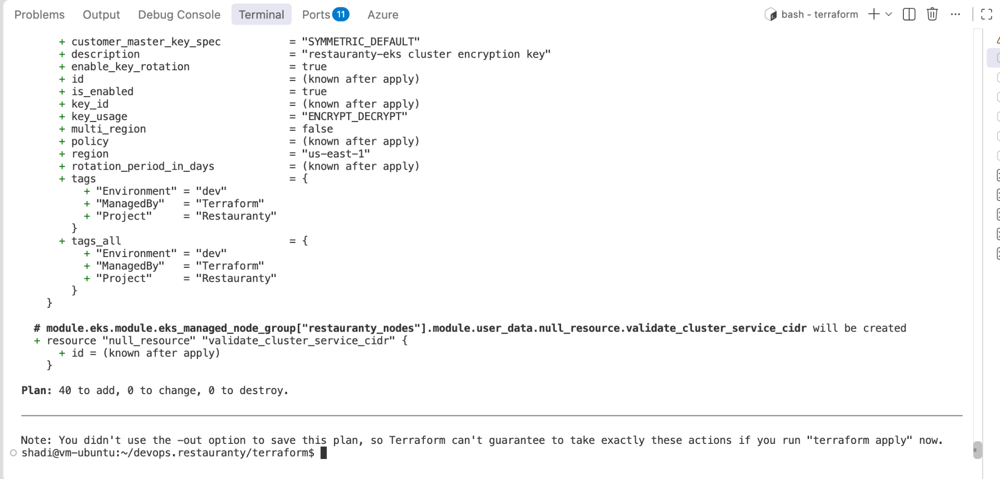
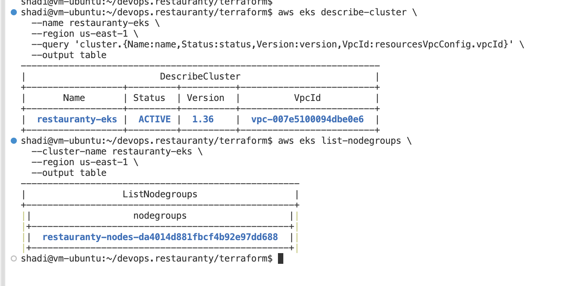
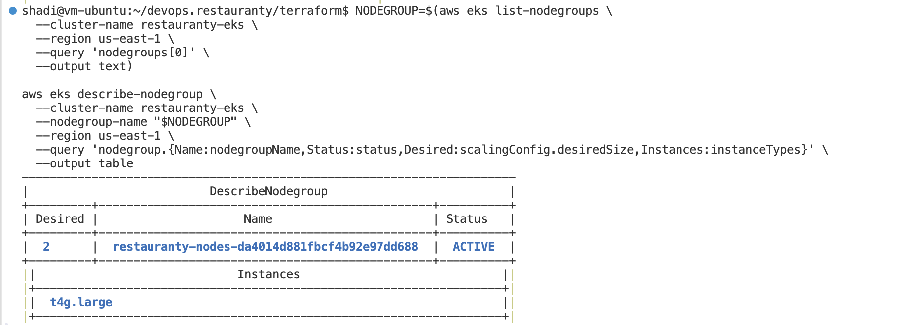
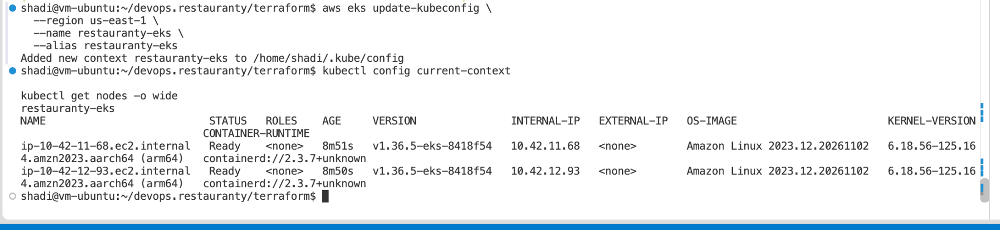
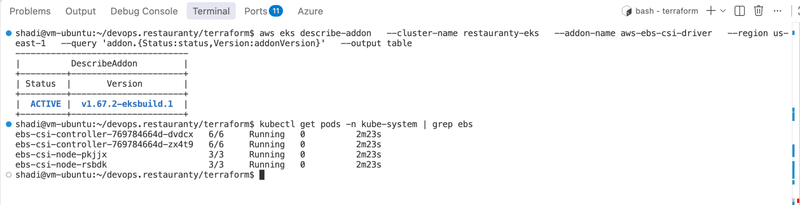
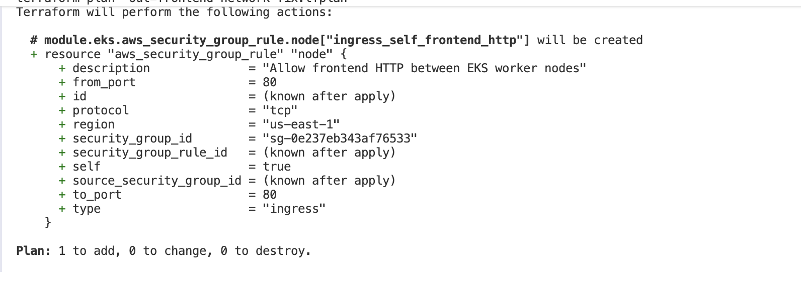
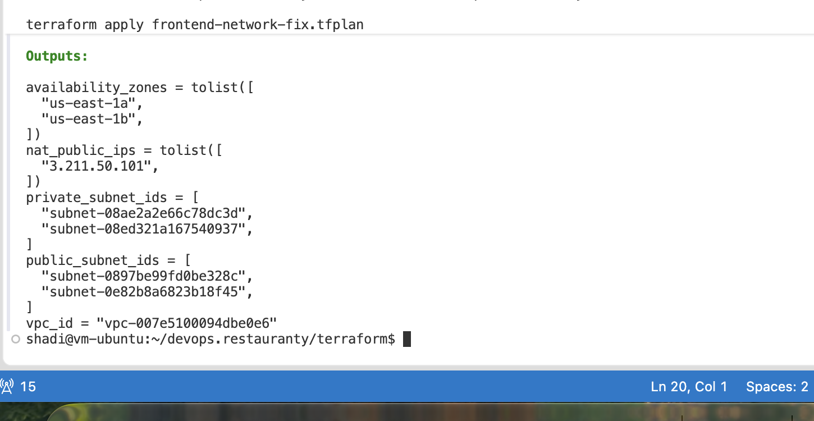

# 5. AWS Infrastructure and Terraform Setup

## Objective

The Restauranty application was migrated from a local Docker deployment to Amazon EKS. Terraform was used to provision the AWS networking, Kubernetes infrastructure, permissions, and persistent storage integration. The resources were deployed in **`us-east-1` (N. Virginia)**, with a dedicated EKS cluster named **`restauranty-eks`**.

## 5.1 Terraform Project Structure

The following files were created under `terraform/`:

| File | Purpose |
|---|---|
| `versions.tf` | Setting Terraform and AWS provider version requirements |
| `providers.tf` | Configuring the AWS region and default resource tags |
| `variables.tf` | Defining infrastructure input variables |
| `terraform.tfvars` | Providing deployment-specific values (excluded from Git) |
| `vpc.tf` | Provisioning the VPC and networking components |
| `eks.tf` | Provisioning the EKS cluster and managed worker nodes |
| `ebs-csi.tf` | Creating the EBS CSI IAM role and Kubernetes add-on |
| `outputs.tf` | Exposing selected infrastructure identifiers and networking outputs |
| `.terraform.lock.hcl` | Locking provider dependencies for reproducible runs |

AWS CLI authentication was checked successfully before provisioning. Terraform commands were executed from the Ubuntu development environment.

## 5.2 Provisioning the AWS Network

A dedicated VPC (`10.42.0.0/16`) was provisioned across two Availability Zones: `us-east-1a` and `us-east-1b`. Two public subnets (`10.42.1.0/24` and `10.42.2.0/24`) and two private subnets (`10.42.11.0/24` and `10.42.12.0/24`) were configured. An Internet Gateway, one NAT Gateway, route tables, and subnet associations were created to support public ingress and private worker-node access to external services.

The infrastructure configuration was initialized, formatted, and validated. The network Terraform plan showed **19 resources to add**, followed by a successful apply of **19 resources**.



*Figure 47 — Reviewing the Terraform plan before AWS networking deployment.*



*Figure 48 — Provisioning 19 networking resources successfully using Terraform.*



*Figure 49 — Verifying the VPC, subnets, route tables, Internet Gateway, and NAT Gateway in AWS Console.*

## 5.3 Creating the Amazon EKS Cluster

A new EKS cluster, `restauranty-eks`, was provisioned in the existing Restauranty VPC rather than reusing an earlier laboratory cluster. Kubernetes **1.36** was selected. An EKS Managed Node Group was configured with two `t4g.large` **ARM64** EC2 worker nodes, deployed in private subnets across two Availability Zones.

The EKS Terraform plan proposed **40 new resources** and no changes or deletions. The cluster reached `ACTIVE` and the Managed Node Group became `ACTIVE`. `kubectl` was connected using `aws eks update-kubeconfig`, and both nodes were confirmed `Ready`.



*Figure 50 — Reviewing the planned EKS resources before deployment.*



*Figure 51 — Verifying the EKS cluster status, Kubernetes version, and VPC association.*



*Figure 52 — Verifying the managed node group and its desired EC2 instance capacity.*



*Figure 53 — Confirming two Ready ARM64 worker nodes through kubectl.*

## 5.4 Configuring Persistent Storage

The **Amazon EBS CSI Driver** was provisioned using Terraform, with an IAM role and a policy attachment for EBS operations. The add-on became `ACTIVE`, and its controller and node pods were confirmed `Running`.

A Kubernetes StorageClass called `restauranty-gp3` was created with `ebs.csi.aws.com`, GP3 volumes, encryption enabled, and `WaitForFirstConsumer`. A MongoDB StatefulSet subsequently obtained a **10 GiB** PersistentVolumeClaim in `Bound` state. The MongoDB deployment and database migration are described in the Kubernetes and database documentation.



*Figure 54 — Verifying the EBS CSI add-on and its running controller and node pods.*

## 5.5 Resolving Cross-Node HTTP Connectivity

During public application testing, the NGINX Ingress returned `504 Gateway Timeout` for the frontend, while Auth API routing returned the expected `401 Unauthorized`. Direct port forwarding to the frontend returned `200 OK`. NGINX logs identified an upstream connection timeout to the frontend pod on port 80, and the controller and frontend were running on different worker nodes.

A Terraform-managed **security-group self-ingress rule for TCP port 80** was added to allow communication between worker nodes that share the EKS node security group. The updated plan showed **1 to add, 0 to change, and 0 to destroy**. After application, the public frontend returned `200`, and the protected Auth endpoint returned `401` without a token.



*Figure 55 — Planning a restricted internal TCP/80 rule without replacing existing infrastructure.*



*Figure 56 — Reviewing Terraform infrastructure outputs after the networking update. The successful public HTTP tests are documented separately in the Kubernetes section.*

## 5.6 Verification Commands

The following commands were used to verify provisioning and cluster access:

```bash
cd ~/devops.restauranty/terraform
terraform fmt
terraform validate
terraform plan

aws eks describe-cluster --name restauranty-eks --region us-east-1 \
  --query 'cluster.{Name:name,Status:status,Version:version}' \
  --output table

kubectl config current-context
kubectl get nodes -o wide
kubectl get pods -n kube-system
kubectl get storageclass
```

## 5.7 Security and Operational Considerations

- Worker nodes were placed in **private subnets**, with NAT-based outbound access.
- AWS IAM roles were used for EKS, worker nodes, and the EBS CSI Driver.
- The additional TCP/80 rule is restricted to the worker-node security group itself; it does **not** open port 80 from the public internet directly to the nodes.
- The database service was configured as internal-only; its persistent storage uses an encrypted GP3 EBS volume configuration.
- Terraform state (`*.tfstate*`), variable values (`*.tfvars`), plan files (`*.tfplan`), and local provider caches (`.terraform/`) must not be committed to Git. The `.terraform.lock.hcl` file **should** be committed.
- The Terraform state is currently managed locally; no remote backend is documented or claimed.
- Public HTTPS/TLS, complete application-level testing, and the final operational automation scripts were not part of this verified infrastructure stage and are tracked as follow-up work.
- Destroying the infrastructure can remove billable resources and, depending on volume lifecycle and PVC deletion, may permanently remove database data. Backups should be verified before destruction.

## Outcome

The dedicated AWS VPC, Amazon EKS control plane, two ARM64 EC2 worker nodes, EBS CSI storage integration, and required internal network access were provisioned successfully with Terraform. The infrastructure supports the Restauranty Kubernetes application deployment and public NGINX Ingress routing.
