# Phase 6 — Kubernetes Deployment and Ingress on Amazon EKS

## Objective

The goal of this phase was to deploy Restauranty on Amazon EKS and make the application accessible through a public entry point.

The deployment includes four application components, MongoDB, internal Kubernetes Services, persistent storage, and NGINX Ingress.

The work was completed on the `restauranty-eks` cluster in AWS `us-east-1`.

This chapter describes the initial Kubernetes deployment and the problems solved during setup. CI/CD, monitoring, database persistence testing, and additional network security were completed or documented in later phases.

## 6.1 Kubernetes Architecture

### Cluster Overview

| Component | Configuration |
|---|---|
| AWS Region | `us-east-1` |
| EKS Cluster | `restauranty-eks` |
| Worker Nodes | 2 managed nodes |
| Instance Type | `t4g.large` |
| Architecture | ARM64 |
| Application Namespace | `restauranty` |
| Ingress Namespace | `restauranty-ingress` |
| Ingress Controller | F5 NGINX Ingress Controller |
| Ingress Replicas | 2 |
| Ingress Class | `restauranty-nginx` |
| Public Load Balancer | AWS Network Load Balancer |
| Public Protocol | HTTP |
| MongoDB | StatefulSet, MongoDB 7 |
| Database Storage | Encrypted EBS gp3, 10 GiB |

The EKS worker nodes run in private subnets. Public application traffic reaches the cluster through an AWS Network Load Balancer and the NGINX Ingress Controller.

The four application images were checked for `linux/arm64` compatibility before the initial deployment.

### Application Architecture

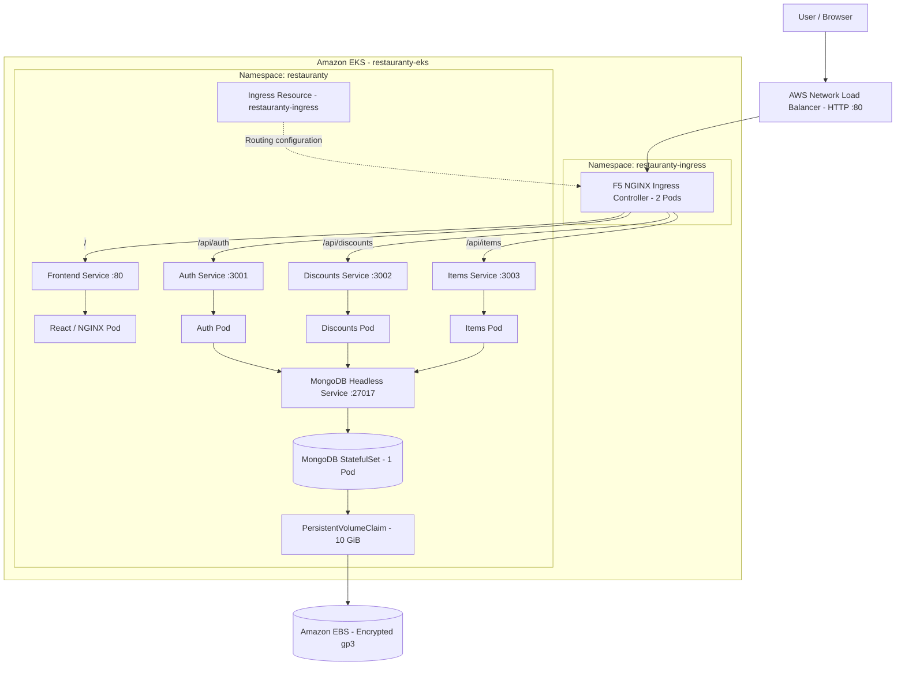

*Diagram 6.1 — Restauranty deployment on Amazon EKS.*

The Ingress resource defines the routing rules used by the NGINX controller. The four application Services provide stable internal access to their Pods.

MongoDB is not exposed through the public Ingress. The backend services connect to it using its internal Kubernetes Service.

## 6.2 Kubernetes Manifest Inventory

The Kubernetes manifests are stored under `k8s/`.

| Manifest | Purpose |
|---|---|
| `namespace.yaml` | Creates the `restauranty` namespace |
| `storageclass.yaml` | Defines encrypted gp3 storage |
| `mongodb-statefulset.yaml` | Defines MongoDB, its headless Service, and persistent storage |
| `auth-deployment.yaml` | Deploys the Auth microservice |
| `auth-service.yaml` | Creates the Auth ClusterIP Service |
| `discounts-deployment.yaml` | Deploys the Discounts microservice |
| `discounts-service.yaml` | Creates the Discounts ClusterIP Service |
| `items-deployment.yaml` | Deploys the Items microservice |
| `items-service.yaml` | Creates the Items ClusterIP Service |
| `frontend-deployment.yaml` | Deploys the React frontend |
| `frontend-service.yaml` | Creates the frontend ClusterIP Service |
| `nginx-ingress-values.yaml` | Configures NGINX Ingress through Helm |
| `ingress.yaml` | Defines application routing rules |
| `network-policies.yaml` | Adds ingress restrictions in the later security phase |

The NGINX Ingress Controller was installed separately using Helm. Applying the application manifests alone does not install the controller.

The NetworkPolicies were also implemented after the initial deployment and are explained in the security documentation.

## 6.3 Namespace, Storage, and MongoDB

### Application Namespace

A dedicated Kubernetes namespace was created for Restauranty.

```bash
kubectl apply -f k8s/namespace.yaml
kubectl get namespace restauranty
```

The namespace keeps application resources separate from system components and monitoring workloads.

### StorageClass

The `restauranty-gp3` StorageClass was configured using the Amazon EBS CSI Driver.

The configuration includes:

- EBS CSI provisioner: `ebs.csi.aws.com`
- Volume type: `gp3`
- Encryption enabled
- `WaitForFirstConsumer`
- Volume expansion enabled

**Manifest:** `k8s/storageclass.yaml`

### MongoDB StatefulSet

MongoDB 7 was deployed as a StatefulSet named `restauranty-mongodb`.

The StatefulSet runs one MongoDB Pod and uses a PersistentVolumeClaim to store data outside the container filesystem.

| Setting | Value |
|---|---|
| StatefulSet | `restauranty-mongodb` |
| Replicas | 1 |
| Container Image | `mongo:7` |
| Port | `27017` |
| Service Type | Headless |
| Service Name | `restauranty-mongodb` |
| StorageClass | `restauranty-gp3` |
| Requested Storage | 10 GiB |
| Mount Path | `/data/db` |

MongoDB credentials are supplied through the Kubernetes Secret `restauranty-mongodb-auth`.

The username and password are referenced by the StatefulSet using `secretKeyRef`, rather than being included directly in the committed YAML file.

### MongoDB Storage Architecture

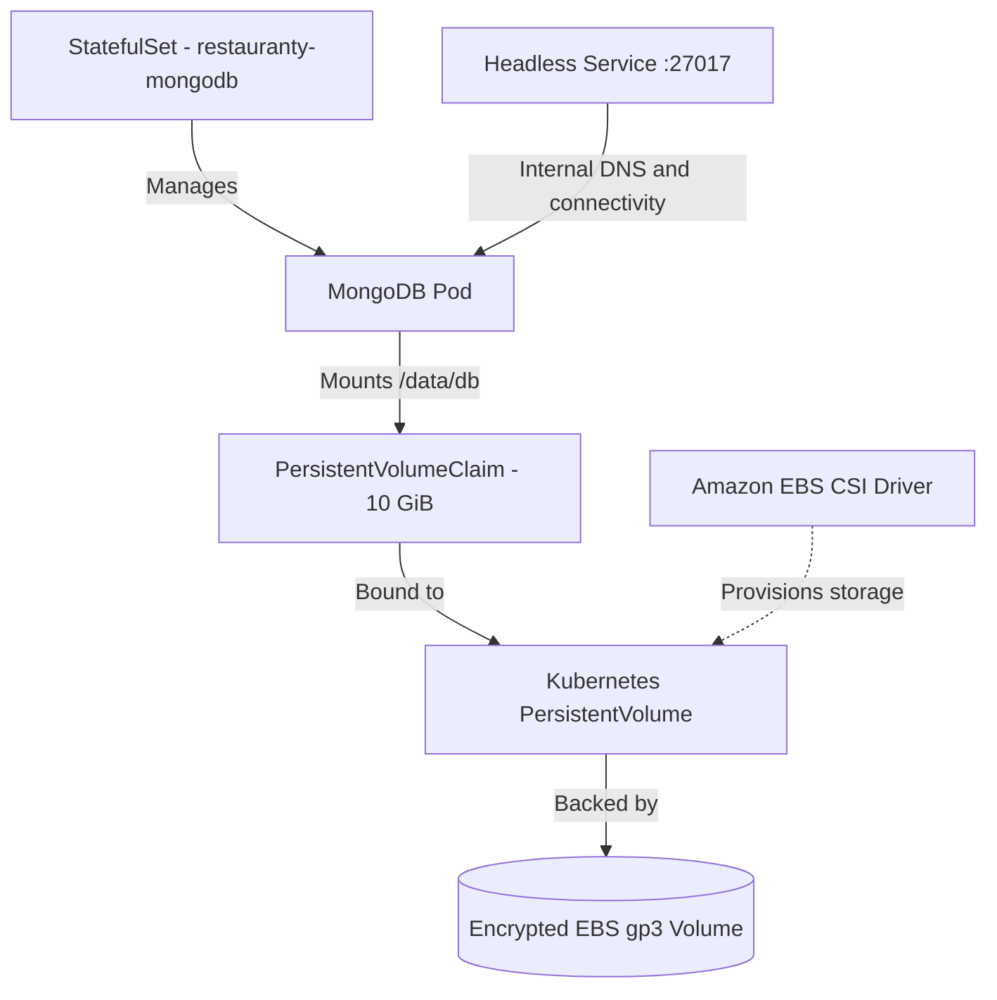

*Diagram 6.2 — MongoDB persistent storage on Amazon EBS.*

### Verification

```bash
kubectl get namespace restauranty
kubectl get storageclass
kubectl get statefulset,pods,pvc -n restauranty
kubectl get svc restauranty-mongodb -n restauranty
```

The following results were observed:

| Check | Result |
|---|---|
| MongoDB Pod | `1/1 Running` |
| MongoDB StatefulSet | `1/1 Ready` |
| PersistentVolumeClaim | `Bound` |
| EBS CSI Controller and Node Pods | Running |
| Authenticated MongoDB ping | Returned `1` |

### Evidence

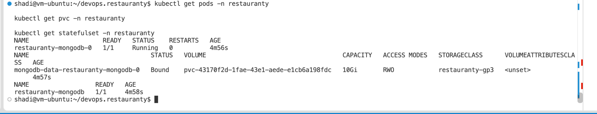

*Figure 57 — MongoDB StatefulSet running with a bound 10 GiB PersistentVolumeClaim.*

### Result

MongoDB was running on EKS with persistent EBS-backed storage.

At this checkpoint, a bound PVC confirmed that storage had been provisioned. The separate test confirming that data survived a MongoDB Pod restart was completed later and is documented in [Database Migration and Persistence](07-database-migration.md).

The StorageClass uses `reclaimPolicy: Delete`. Deleting the relevant PVC or PersistentVolume may result in deletion of the underlying EBS volume, so persistent storage must be handled carefully.

## 6.4 Kubernetes Secrets and Backend Configuration

Two runtime Secrets were created in the `restauranty` namespace.

| Secret | Contents |
|---|---|
| `restauranty-mongodb-auth` | MongoDB root username and password |
| `restauranty-backend-secrets` | MongoDB connection URI and JWT signing secret |

The backend Deployments reference `restauranty-backend-secrets` for the following environment variables:

```text
MONGODB_URI
SECRET
```

The MongoDB StatefulSet references `restauranty-mongodb-auth`.

These Secrets were created in the cluster, not stored as plaintext values in the committed Kubernetes manifests.

### Secret Usage

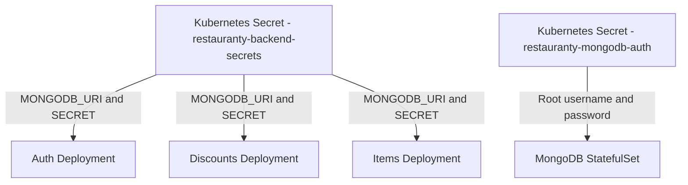

*Diagram 6.3 — Runtime configuration supplied through Kubernetes Secrets.*

The application also contains references to `ORIGIN` and Cloudinary environment variables. Full Cloudinary functionality in EKS was not verified during this phase.

Kubernetes Secrets help separate sensitive values from application manifests, but creating a Secret alone does not guarantee secure storage, rotation, or access control.

Additional security details are documented in [Phase 8 — Security](08-security.md).

## 6.5 Auth Microservice Deployment

The Auth microservice was deployed using:

**Deployment:** `restauranty-auth`

**Service:** `restauranty-auth`

The initial Kubernetes manifest used the image:

```text
shadshad/restauranty-auth:v1
```

The Deployment configuration included:

- One replica
- Container port `3001`
- Environment variables from `restauranty-backend-secrets`
- TCP readiness probe
- CPU and memory requests and limits
- Restricted Linux capabilities
- Privilege escalation disabled

The Service uses type `ClusterIP` and forwards traffic to the Auth Pod on port `3001`.

### Verification

```bash
kubectl rollout status deployment/restauranty-auth -n restauranty
kubectl get pods -n restauranty -l app=restauranty-auth
kubectl get svc restauranty-auth -n restauranty
kubectl logs deployment/restauranty-auth -n restauranty --tail=20
```

The following results were recorded:

- Auth Pod: `1/1 Running`
- Container restarts: `0`
- MongoDB connection: Successful
- Deployment rollout: Completed

### Evidence

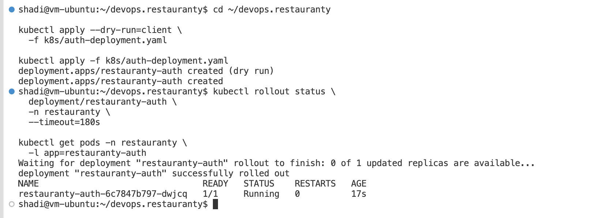

*Figure 58 — Auth Deployment running and connected to MongoDB.*

## 6.6 Discounts Microservice Deployment

The Discounts microservice was deployed using:

**Deployment:** `restauranty-discounts`

**Service:** `restauranty-discounts`

The initial Kubernetes manifest used:

```text
shadshad/restauranty-discounts:v1
```

The Deployment uses port `3002` and references the backend Secret for MongoDB and JWT configuration.

A `ClusterIP` Service exposes the application internally on port `3002`.

### Verification

```bash
kubectl rollout status deployment/restauranty-discounts -n restauranty
kubectl get pods -n restauranty -l app=restauranty-discounts
kubectl logs deployment/restauranty-discounts -n restauranty --tail=20
```

The Discounts Pod reached `1/1 Running`, with zero restarts. Logs confirmed that the service connected to MongoDB.

### Evidence

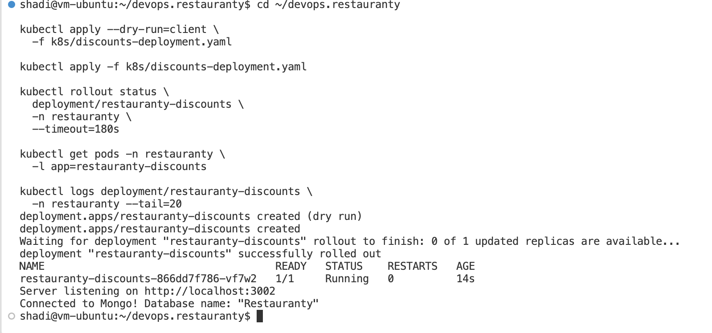

*Figure 59 — Discounts microservice running with MongoDB connectivity.*

## 6.7 Items Microservice Deployment

The Items microservice was deployed using:

**Deployment:** `restauranty-items`

**Service:** `restauranty-items`

The initial image was:

```text
shadshad/restauranty-items:v1
```

The Deployment uses port `3003` and receives the backend Secret values through environment-variable references.

Its `ClusterIP` Service forwards traffic to the Items Pod on port `3003`.

### Verification

```bash
kubectl rollout status deployment/restauranty-items -n restauranty
kubectl get pods -n restauranty -l app=restauranty-items
kubectl logs deployment/restauranty-items -n restauranty --tail=20
```

The Items Pod reached `1/1 Running`, with zero restarts, and logs confirmed a successful MongoDB connection.

### Evidence

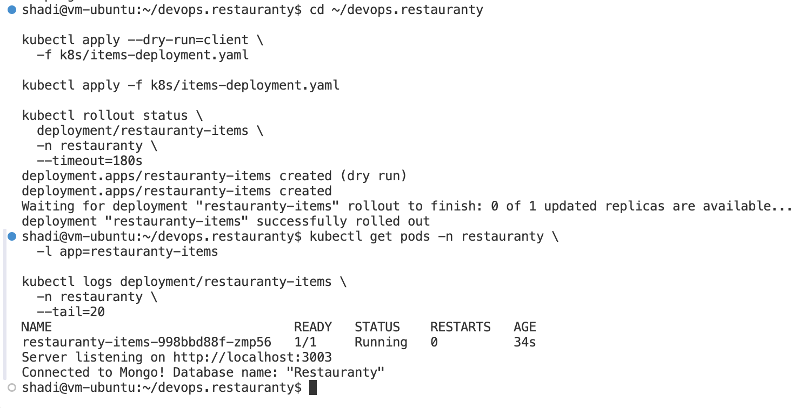

*Figure 60 — Items microservice running and connected to MongoDB.*

## 6.8 React Frontend Deployment

The React frontend was deployed using:

**Deployment:** `restauranty-frontend`

**Service:** `restauranty-frontend`

The initial container image was:

```text
shadshad/restauranty-frontend:v1
```

The frontend image contains the compiled React application, served by NGINX on port `80`.

The Deployment uses one replica, resource requests and limits, and an HTTP readiness probe against `/`.

The `restauranty-frontend` Service is a `ClusterIP` Service listening on port `80`.

### Verification

```bash
kubectl rollout status deployment/restauranty-frontend -n restauranty
kubectl get pods -n restauranty -l app=restauranty-frontend
kubectl get svc restauranty-frontend -n restauranty
```

The frontend Pod reached `1/1 Running`.

Its HTTP readiness probe returned `200 OK`.

### Evidence

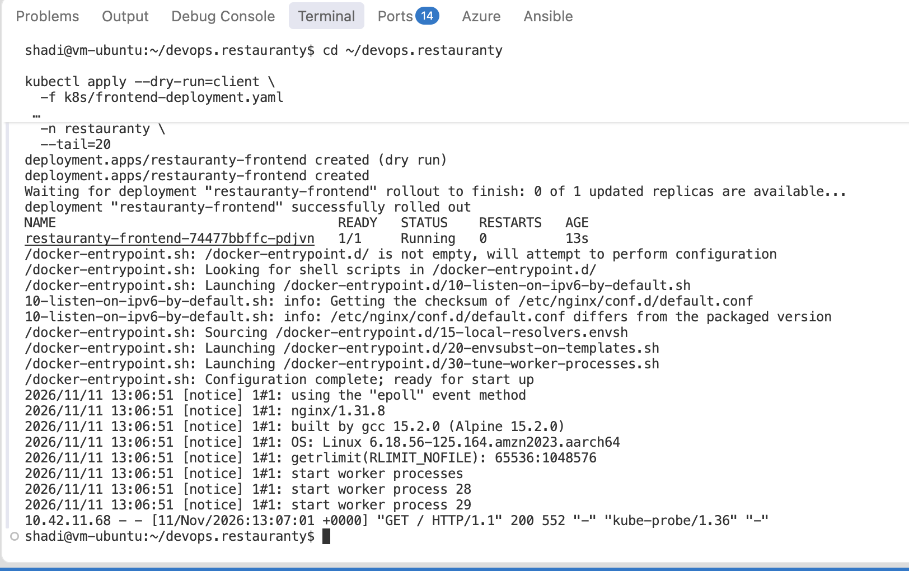

*Figure 61 — React frontend deployed successfully and served through NGINX.*

## 6.9 How Deployments and Services Work Together

Each application component has its own Kubernetes Deployment and Service.

The Deployment manages the application Pod. The Service provides a stable internal name and port for reaching that Pod, even if the Pod is recreated.

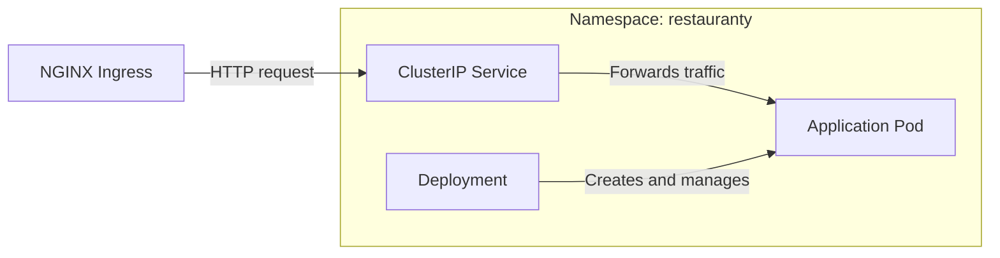

*Diagram 6.4 — Relationship between an Ingress Controller, Service, Deployment, and Pod.*

The application's initial Kubernetes configuration used one replica for each of the four Deployments.

The `v1` image tags shown in this chapter belong to the initial manual deployment. Later, GitHub Actions was configured to build new ARM64 images and update the running Deployments automatically.

## 6.10 NGINX Ingress Controller and AWS Load Balancer

### Ingress Controller Installation

The F5 NGINX Ingress Controller was installed using Helm.

The installation used:

| Setting | Value |
|---|---|
| Helm Release | `restauranty-nginx` |
| Namespace | `restauranty-ingress` |
| Helm Chart | `nginx-ingress` |
| Chart Version | `2.8.1` |
| Controller Replicas | 2 |
| Ingress Class | `restauranty-nginx` |
| Service Type | `LoadBalancer` |
| AWS Load Balancer | Internet-facing NLB |
| HTTP Port | 80 |
| HTTPS | Disabled |

The Helm values are stored in:

```text
k8s/nginx-ingress-values.yaml
```

### Installation Command

```bash
helm upgrade --install restauranty-nginx \
  oci://ghcr.io/nginx/charts/nginx-ingress \
  --version 2.8.1 \
  --namespace restauranty-ingress \
  --create-namespace \
  -f k8s/nginx-ingress-values.yaml \
  --wait --timeout 10m
```

### Verification

```bash
kubectl get pods,svc -n restauranty-ingress
kubectl get ingressclass
```

The checks confirmed:

- Two NGINX controller Pods running
- A LoadBalancer Service created
- An AWS Load Balancer DNS name assigned
- Ingress class `restauranty-nginx` available

### Evidence

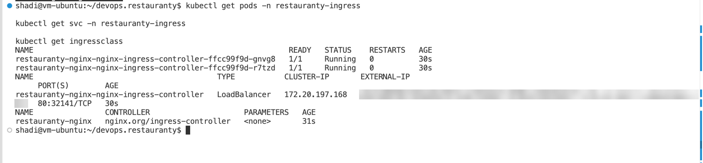

*Figure 62 — NGINX Ingress Controller, two running Pods, and the LoadBalancer Service.*

## 6.11 Ingress Routing Configuration

A single Kubernetes Ingress resource was created for Restauranty.

**Manifest:** `k8s/ingress.yaml`

**Ingress Name:** `restauranty-ingress`

**Namespace:** `restauranty`

**Ingress Class:** `restauranty-nginx`

The Ingress routes incoming requests to the four internal application Services.

| Request Path | Kubernetes Service | Port |
|---|---|---|
| `/` | `restauranty-frontend` | 80 |
| `/api/auth` | `restauranty-auth` | 3001 |
| `/api/discounts` | `restauranty-discounts` | 3002 |
| `/api/items` | `restauranty-items` | 3003 |

The request paths are forwarded without URL rewriting.

### Request Flow

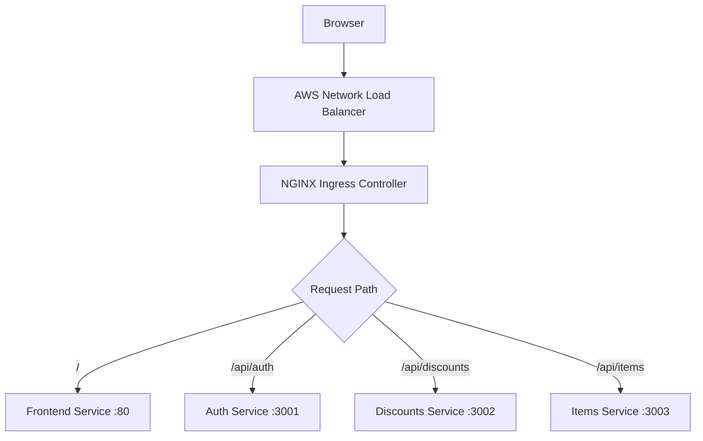

*Diagram 6.5 — Path-based request routing through the public Ingress.*

This configuration lets the React frontend use relative API URLs in both local and Kubernetes environments.

HAProxy performs the routing locally, while NGINX Ingress handles it on EKS.

### Verification Commands

```bash
kubectl get ingress -n restauranty
kubectl describe ingress restauranty-ingress -n restauranty
kubectl get svc -n restauranty
```

## 6.12 Troubleshooting Ingress Connectivity

Two main issues were encountered while configuring public access.

### Issue 1 — HTTP 404 Not Found

The NGINX controller initially rejected the Ingress rule because the `host` field was missing.

The controller did not accept the configuration as expected.

The manifest was updated to include the AWS Load Balancer DNS name in:

```text
spec.rules[0].host
```

After applying the updated manifest, the controller events included:

```text
AddedOrUpdated
```

The Ingress configuration was then accepted.

The hostname in the manifest refers to the Load Balancer created for this deployment. If that Load Balancer is replaced, the hostname may need to be updated.

### Issue 2 — HTTP 504 Gateway Timeout

After the Ingress configuration was accepted, the frontend still returned:

```http
HTTP/1.1 504 Gateway Timeout
```

The Auth API was responding with the expected `401 Unauthorized` result, but the frontend request timed out.

### Investigation

The following checks helped identify the problem:

1. Tested the frontend through the public Ingress.
2. Tested the Auth API to check whether Ingress routing was working.
3. Accessed the frontend through direct Service port forwarding.
4. Reviewed the NGINX Ingress controller logs.
5. Checked where the controller and frontend Pods were running.

The frontend responded with HTTP `200` through port forwarding.

However, the controller logs showed an upstream timeout when connecting to the frontend Pod at:

```text
10.42.11.76:80
```

The controller and frontend were running on different worker nodes.

These results pointed to a network connectivity problem between the worker nodes rather than an issue with the React application itself.

### Troubleshooting Flow

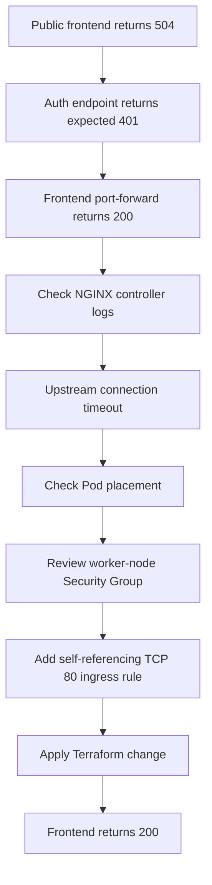

*Diagram 6.6 — Troubleshooting the frontend connection timeout.*

### Terraform Security Group Fix

The EKS Terraform configuration was updated with an additional rule allowing TCP traffic on port `80` between instances sharing the worker-node Security Group.

The relevant configuration is:

```hcl
node_security_group_additional_rules = {
  ingress_self_frontend_http = {
    description = "Allow frontend HTTP between EKS worker nodes"
    type        = "ingress"
    protocol    = "tcp"
    from_port   = 80
    to_port     = 80
    self        = true
  }
}
```

The Terraform plan showed:

```text
Plan: 1 to add, 0 to change, 0 to destroy
```

After applying the change, the public frontend became accessible.

The rule uses `self = true`, meaning the source is restricted to members of the same Security Group. It does not open worker-node port `80` directly to `0.0.0.0/0`.

### Result

| Test | Observed Result |
|---|---|
| Frontend through port forwarding | HTTP 200 |
| Frontend through public Ingress before fix | HTTP 504 |
| Frontend through public Ingress after fix | HTTP 200 |
| Protected Auth endpoint without JWT | HTTP 401 |

The Security Group change resolved the observed frontend timeout.

Additional details are included in [Terraform Setup](05-terraform-setup.md).

## 6.13 Public HTTP Verification

After the networking issues were resolved, the application was tested through the AWS Load Balancer.

The Load Balancer hostname was retrieved from the NGINX controller Service.

### Retrieve the Load Balancer Hostname

```bash
LB_HOST=$(kubectl get svc \
  restauranty-nginx-nginx-ingress-controller \
  -n restauranty-ingress \
  -o jsonpath='{.status.loadBalancer.ingress[0].hostname}')
```

### Test the Frontend

```bash
curl -s -o /dev/null \
  -w 'Frontend HTTP: %{http_code}\n' \
  "http://$LB_HOST/"
```

### Test the Auth Endpoint

```bash
curl -s -o /dev/null \
  -w 'Auth HTTP: %{http_code}\n' \
  "http://$LB_HOST/api/auth/verify"
```

### Observed Results

```text
Frontend HTTP: 200
Auth HTTP: 401
```

The frontend returned `200`, confirming that the application was accessible through the public Ingress.

The Auth verification endpoint returned `401` because the request did not include a JWT. This was the expected result for a protected endpoint.

Unauthorized requests to protected Items and Discounts endpoints were also rejected with `401`. Their security tests are documented separately.

### Evidence

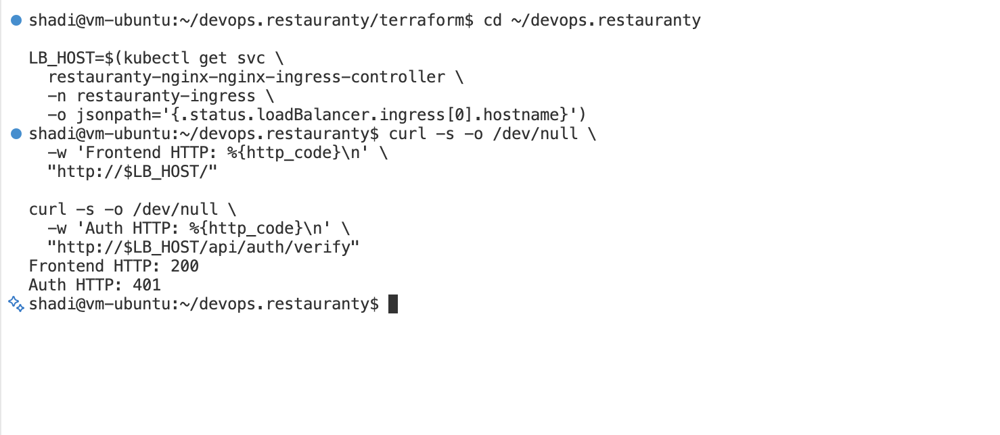

*Figure 63 — Public frontend returning HTTP 200 and protected Auth endpoint returning HTTP 401.*

## 6.14 Deployment Verification Summary

The initial Kubernetes deployment produced the following results:

| Component | Verification Result |
|---|---|
| EKS Worker Nodes | 2 Ready |
| MongoDB StatefulSet | 1/1 Ready |
| MongoDB Pod | 1/1 Running |
| MongoDB PVC | Bound |
| Auth Deployment | 1/1 Running |
| Discounts Deployment | 1/1 Running |
| Items Deployment | 1/1 Running |
| Frontend Deployment | 1/1 Running |
| NGINX Ingress Controller | 2 Pods Running |
| Frontend Public Access | HTTP 200 |
| Auth Without JWT | HTTP 401 |
| Cross-Node Frontend Connectivity | Fixed |

### Application Workload Summary

The application namespace contains five main workload Pods in the initial deployment:

- Auth
- Discounts
- Items
- Frontend
- MongoDB

The two NGINX controller Pods run separately in the `restauranty-ingress` namespace.

### Useful Verification Commands

```bash
kubectl get nodes
kubectl -n restauranty get deployments
kubectl -n restauranty get pods -o wide
kubectl -n restauranty get services
kubectl -n restauranty get statefulsets
kubectl -n restauranty get pvc
kubectl -n restauranty get ingress
kubectl -n restauranty-ingress get pods,svc
```

These commands provide a quick overview of the running application and its Kubernetes resources.

## 6.15 Later Improvements and Verification

The initial deployment established a working application on EKS.

Additional work was completed in later phases:

| Area | Later Work |
|---|---|
| Database | MongoDB migration and persistence testing |
| CI/CD | Automated ARM64 image builds and EKS deployment |
| Monitoring | Prometheus, Grafana, and backend metrics |
| Security | Kubernetes NetworkPolicies and connectivity testing |
| Recovery | Kubernetes deployment rollback demonstration |

These implementations are documented separately rather than being presented as part of the initial manual Kubernetes deployment.

The following improvements remain outside the verified scope:

- HTTPS/TLS for the public endpoint
- A separate staging deployment workflow
- Centralized logging with Loki and Alloy
- Additional monitoring alerts
- Further container hardening
- Network egress restrictions

The public application endpoint currently uses HTTP rather than HTTPS.

## 6.16 Cloudinary Image Upload — Later Integration

Cloudinary image uploads were completed **after** the initial EKS deployment. The working Items service already contained Multer and Cloudinary integration code, but its cloud credentials were missing from the Kubernetes Deployment configuration.

A Secret named `restauranty-cloudinary` was created in the `restauranty` namespace. The Items Deployment now references `CLOUD_NAME`, `CLOUD_API_KEY`, and `CLOUD_API_SECRET` using `secretKeyRef`. The credentials are not stored directly in the manifest.

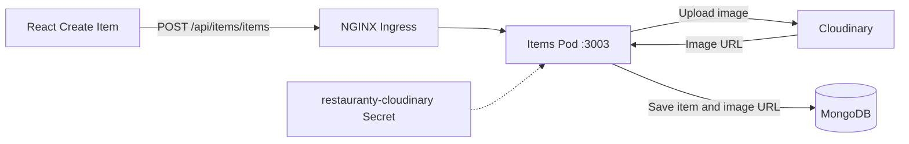

The first upload returned HTTP 500 because Cloudinary rejected the configured cloud name (`Invalid cloud_name`, HTTP 401). After correcting the value in the Secret and restarting the Items Deployment, three uploaded food images were visible in both the Cloudinary Media Library and Restauranty.

The local `k8s/items-deployment.yaml` was updated with the Secret references and its image tag was synchronized with the running Deployment. A client-side dry run validated the YAML. **The manifest was not applied to the live cluster during this synchronization**, avoiding an unintended downgrade to an old image.

For full commands, evidence screenshots and security notes, see [Cloudinary Integration](10-cloudinary-integration.md).

## Phase Summary

The four Restauranty application components and MongoDB were successfully deployed on Amazon EKS.

Kubernetes Deployments and Services were configured for the application, while MongoDB used a StatefulSet with persistent EBS storage.

The F5 NGINX Ingress Controller provided one public entry point for the frontend and backend APIs.

Two networking issues were identified and resolved:

- An Ingress configuration problem that caused HTTP 404 responses
- A cross-node connectivity problem that caused HTTP 504 responses

After the fixes, the frontend returned HTTP `200`, and the protected Auth endpoint correctly rejected requests without a JWT.

The deployment provided the foundation for the later database, CI/CD, monitoring, and security work.

## Related Documentation

- [Terraform and AWS Infrastructure](05-terraform-setup.md)
- [Database Migration and Persistence](07-database-migration.md)
- [Kubernetes Security](08-security.md)
- [Monitoring Configuration](09-monitoring.md)
- [Project README](../README.md)
