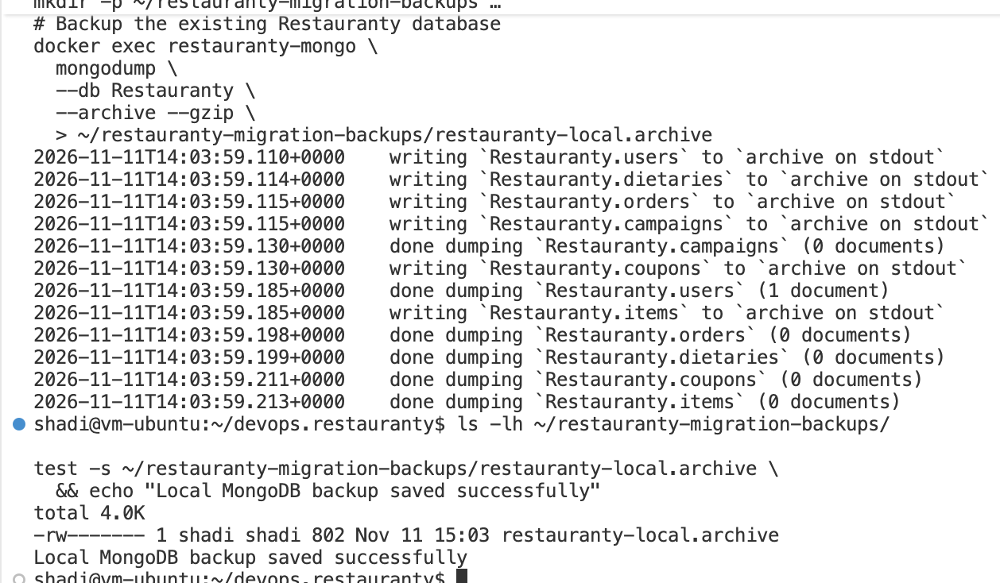
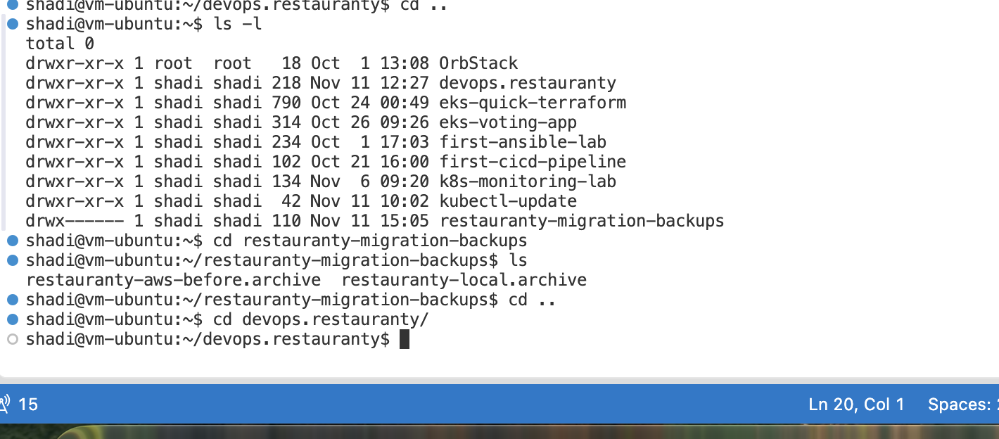
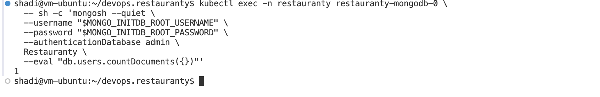
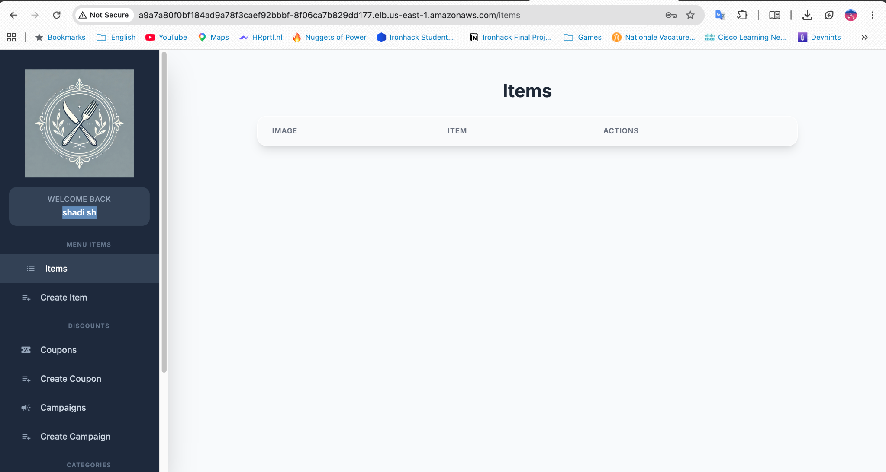

# 7. Database Migration: Local Docker to Amazon EKS

## Objective

Preserve Restauranty application data while moving from a local Docker deployment to **Amazon EKS**. The source was a MongoDB 7 container (`restauranty-mongo`) running in Ubuntu. The destination was MongoDB 7 running as the `restauranty-mongodb` StatefulSet in the `restauranty` namespace on the `restauranty-eks` cluster in `us-east-1`.

This is an **optional enhancement** to the deployment. Kubernetes application deployment alone does **not** migrate records from a separately hosted MongoDB database; a deliberate data migration is required.

## 7.1 Migration Architecture

```text
Local Ubuntu / Docker                                  AWS EKS (us-east-1)
restauranty-mongo (MongoDB 7)                          restauranty-mongodb-0
Database: Restauranty                                  Database: Restauranty
Users before migration: 1                              Users before migration: 0
         |                                                        ^
         | mongodump --archive --gzip                            |
         v                                                        |
Private archive outside Git repo  ---- mongorestore (users) ------+
                                                                  |
                                                   Encrypted GP3 EBS PVC (10 Gi)
                                                                  |
                                                      Cloud login verification
```

The source and destination databases had the same database name but independent data. The existing local user did not appear in the newly deployed AWS database until the migration.

## 7.2 Check MongoDB and Migration Tools

The local Docker MongoDB container was running, and `mongodump` / `mongorestore` were available in both the local and EKS MongoDB containers.

```bash
docker ps --filter 'name=restauranty-mongo' \
  --format 'table {{.Names}}\t{{.Status}}\t{{.Image}}'

docker exec restauranty-mongo sh -c \
  'command -v mongodump; command -v mongorestore'

kubectl exec -n restauranty restauranty-mongodb-0 -- sh -c \
  'command -v mongodump; command -v mongorestore'
```

## 7.3 Create a Private Backup of the Local Database

Backup files were stored **outside the Git repository**, with restricted directory permissions. This prevents accidental upload of personal data, credential hashes, or MongoDB collections to GitHub.

```bash
umask 077
mkdir -p ~/restauranty-migration-backups
chmod 700 ~/restauranty-migration-backups

docker exec restauranty-mongo \
  mongodump --db Restauranty --archive --gzip \
  > ~/restauranty-migration-backups/restauranty-local.archive

ls -lh ~/restauranty-migration-backups/restauranty-local.archive
test -s ~/restauranty-migration-backups/restauranty-local.archive \
  && echo 'Local MongoDB backup saved successfully'
```

The source backup output confirmed **one document in `Restauranty.users`**. The other collections listed in the dump, including items, orders, coupons, campaigns, and dietaries, contained zero documents at that time.



*Figure 64 — Local `mongodump` recording one user document and a non-empty archive.*

## 7.4 Back Up the EKS Database Before Importing

A separate pre-migration backup of the AWS database was created before any restore operation. The screenshots verified the presence of both archives in the private folder. A non-empty file check is useful, although a successful database restore is the stronger validation of archive contents.

```bash
umask 077
kubectl exec -n restauranty restauranty-mongodb-0 -- sh -c '
  exec mongodump \
    --username "$MONGO_INITDB_ROOT_USERNAME" \
    --password "$MONGO_INITDB_ROOT_PASSWORD" \
    --authenticationDatabase admin \
    --db Restauranty --archive --gzip
' > ~/restauranty-migration-backups/restauranty-aws-before.archive

ls -lh ~/restauranty-migration-backups/*.archive
```



*Figure 65 — Local and AWS pre-migration archives kept outside the project repository.*

## 7.5 Restore Only the Users Collection

The `users` collection was selected for this migration demonstration. The restore command read the existing local archive via standard input inside the AWS MongoDB Pod. It used `--nsInclude` to limit the operation to `Restauranty.users`, and did not use `--drop`.

```bash
kubectl exec -i -n restauranty restauranty-mongodb-0 -- sh -c '
  exec mongorestore \
    --username "$MONGO_INITDB_ROOT_USERNAME" \
    --password "$MONGO_INITDB_ROOT_PASSWORD" \
    --authenticationDatabase admin \
    --archive --gzip \
    --nsInclude="Restauranty.users"
' < ~/restauranty-migration-backups/restauranty-local.archive
```

**Operational precaution:** This is a **one-time migration**, not an automatic startup step. A second restore can encounter duplicate `_id` conflicts or unintended changes. Inspect the target collection and retain verified backups before any further restore. Omitting `--drop` avoids dropping the collection, but does not make arbitrary merges conflict-free or guarantee that all data is preserved.

## 7.6 Verify the Migrated User in AWS

The destination `Restauranty.users` collection was checked with a document count, without displaying private user fields:

```bash
kubectl exec -n restauranty restauranty-mongodb-0 -- sh -c '
  mongosh --quiet \
    --username "$MONGO_INITDB_ROOT_USERNAME" \
    --password "$MONGO_INITDB_ROOT_PASSWORD" \
    --authenticationDatabase admin Restauranty \
    --eval "db.users.countDocuments({})"
'
```

The observed result was **`1`**. This matched the one user in the source database and contrasted with the previously checked AWS value of zero.



*Figure 66 — One user record present in the AWS MongoDB database after the migration.*

## 7.7 Verify the Application Login

The public Restauranty application was opened through the AWS Network Load Balancer and the migrated account was tested in the browser. The resulting screenshot showed the signed-in Restauranty interface and the account welcome panel. This is stronger end-to-end evidence than a database count alone, assuming the same pre-existing credentials were used, as reported during the walkthrough.



*Figure 67 — Restauranty frontend on AWS EKS displaying the previously created account after migration.*

The `Items` table was empty, which was consistent with the source backup: the items collection contained no documents.

## 7.8 Verification Summary

| Verification | Observed result |
|---|---|
| Local Docker MongoDB | Running |
| Backup tools | Available in both environments |
| Local `Restauranty.users` | 1 document |
| AWS `Restauranty.users` before migration | 0 documents (checked earlier) |
| Local backup | Created; one user logged by `mongodump` |
| AWS pre-migration backup | Saved in private backup directory |
| AWS `Restauranty.users` after migration | **1 document** |
| Existing user in cloud app | Login flow verified in browser |
| EKS MongoDB storage | 10 Gi GP3 EBS PVC, previously confirmed Bound |

## 7.9 Security and Remaining Work

- Backup archives can include user information and password hashes. **Never commit or include `.archive` files in GitHub, screenshots, or presentation packages.**
- The database uses an internal-only Kubernetes Service and credentials sourced from Kubernetes Secrets. The EBS GP3 StorageClass is configured for encryption at rest.
- The deployed site was still served via **HTTP**, not HTTPS, at the time of the migration demonstration. TLS and final security hardening remain outstanding.
- The **data persistence after restarting MongoDB** is a separate test and is still pending; a successful migration alone does not prove restart persistence.
- Automated one-time migration (`scripts/migrate-db.sh`) and backup/restore safeguards are planned, not yet implemented.
- `down.sh` must distinguish application shutdown from deleting the PVC or Terraform infrastructure, because the current StorageClass has `reclaimPolicy: Delete`.

## Outcome

The project demonstrated a controlled migration of an existing Restauranty account from a local Docker-hosted MongoDB database to MongoDB on Amazon EKS, followed by a record-count check and a successful cloud application login. This optional enhancement provides evidence of **data migration and integrity verification** alongside application containerization and Kubernetes deployment.
