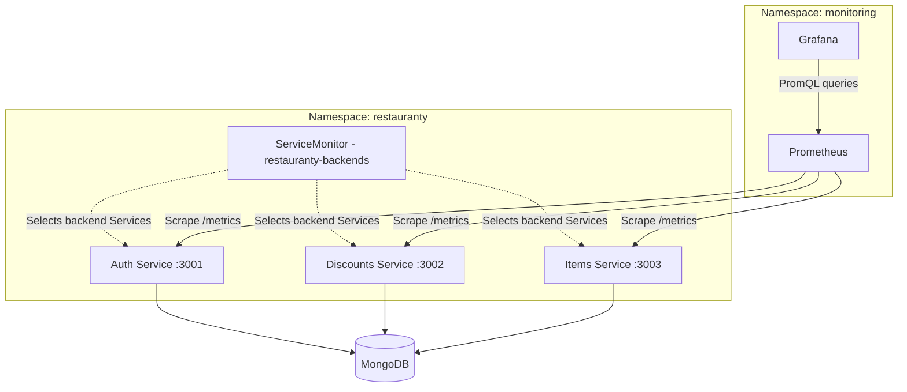
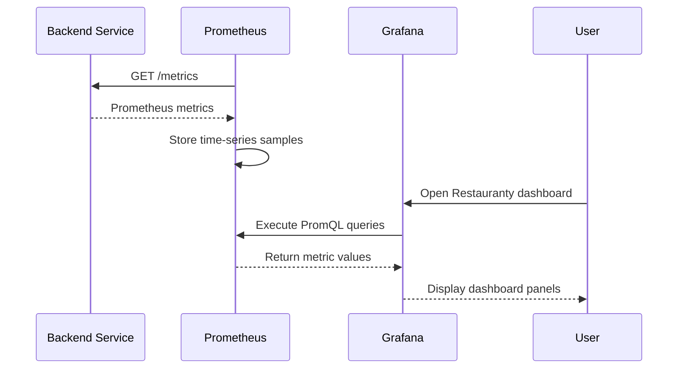
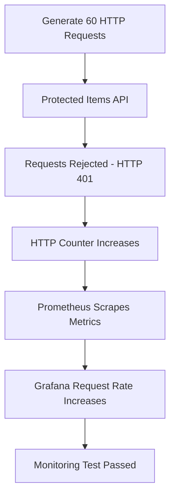

# Phase 9 — Application Monitoring on Amazon EKS

## Objective

The goal of this phase was to monitor the Restauranty backend services running on Amazon EKS.

Prometheus and Grafana were installed to collect and display application metrics. The setup was tested by checking the Prometheus targets, generating HTTP traffic, reviewing MongoDB connection metrics, and inspecting Kubernetes application logs.

This phase focuses on application monitoring. Centralized logging and alert notifications have not yet been configured.

## 9.1 Monitoring Overview

The monitoring stack runs in the `monitoring` namespace and collects metrics from the Restauranty backend services.

| Component | Purpose |
|---|---|
| Prometheus | Collects and stores application metrics |
| Grafana | Displays metrics in dashboards |
| ServiceMonitor | Configures discovery and scraping of backend metrics |
| Node.js `prom-client` | Exposes custom and default application metrics |
| Kubernetes logs | Provides application output for troubleshooting |

### Monitored Services

| Service | Port | Metrics Endpoint |
|---|---|---|
| `restauranty-auth` | 3001 | `/metrics` |
| `restauranty-discounts` | 3002 | `/metrics` |
| `restauranty-items` | 3003 | `/metrics` |

The React frontend and MongoDB are not configured as separate application-metrics targets in this ServiceMonitor.

MongoDB connectivity is monitored through metrics exposed by the backend services.

## 9.2 Monitoring Architecture

Prometheus collects metrics from the backend services through their internal Kubernetes Services.

Grafana uses Prometheus as a data source to display the collected metrics.



*Diagram 9.1 — Prometheus and Grafana monitoring architecture on EKS.*

The ServiceMonitor defines which Services Prometheus should scrape. It does not collect or store metrics itself.

## 9.3 Monitoring Configuration Files

The monitoring configuration is stored in the `monitoring/` directory.

| File | Purpose |
|---|---|
| `values.yaml` | Helm configuration for the monitoring stack |
| `servicemonitor.yaml` | Discovery and scraping of backend metrics |
| `grafana-dashboard.json` | Exported Grafana application dashboard |

These configuration files are kept separately from the project documentation.

## 9.4 Installing the Monitoring Stack

The `kube-prometheus-stack` Helm chart was used to install Prometheus and Grafana.

The Helm release is named:

```text
monitoring
```

The monitoring components run in the following namespace:

```text
monitoring
```

### Helm Values

The project uses the following configuration in `monitoring/values.yaml`:

```yaml
alertmanager:
  enabled: false

prometheus:
  prometheusSpec:
    serviceMonitorSelectorNilUsesHelmValues: false
    retention: 3d
```

This configuration:

- Disables Alertmanager.
- Configures a three-day Prometheus metrics retention period.
- Allows ServiceMonitor selection without restricting it to Helm release labels.

The configuration supports the ServiceMonitor created in the separate `restauranty` namespace.

### Installation Command

The monitoring stack can be installed or updated using:

```bash
helm repo add prometheus-community https://prometheus-community.github.io/helm-charts
helm repo update
helm upgrade --install monitoring prometheus-community/kube-prometheus-stack --namespace monitoring --create-namespace -f monitoring/values.yaml --wait --timeout 10m
```

The command is intended to be executed from the project root.

### Verification

```bash
helm list -n monitoring
kubectl get pods -n monitoring
kubectl get services -n monitoring
```

The monitoring stack was installed successfully, and Prometheus and Grafana were available in the cluster.

## 9.5 Exposing Application Metrics

The three Node.js backend services use the `prom-client` library to expose Prometheus metrics.

Each service has an HTTP `/metrics` endpoint.

The application collects default Node.js process metrics and additional application-specific metrics.

### HTTP Metrics

The application tracks HTTP requests using counters.

| Metric | Description |
|---|---|
| `http_requests_overall_total` | Total HTTP requests recorded by the service |
| `http_requests_total` | HTTP requests with method, route, and status-code labels |

The metric counters are updated after an HTTP response finishes.

The detailed HTTP counter uses these labels:

```text
method
route
statusCode
```

### MongoDB Connectivity Metric

Each backend also exposes:

```text
mongo_connection_status
```

This metric is a gauge representing the backend's MongoDB connection state.

| Value | Meaning |
|---|---|
| `1` | Backend reports a MongoDB connection |
| `0` | Backend reports a disconnected or failed connection |

The metric is updated using Mongoose connection events and connection results.

It reflects the connection state observed by the backend, not a complete independent database availability check.

### Application-Specific Metrics

The backend code also includes additional metrics.

| Service | Metric | Description |
|---|---|---|
| Auth | `users_total` | User document count |
| Discounts | `coupons_total` | Coupon document count |
| Discounts | `campaigns_total` | Campaign document count |
| Items | `items_total` | Item document count |
| Items | `dietaries_total` | Dietary category document count |

The document-count metrics are updated periodically, approximately once per minute.

These metrics are available in the application code, but they are not yet included as separate panels in the exported Grafana dashboard.

## 9.6 Configuring the ServiceMonitor

A ServiceMonitor named `restauranty-backends` was created in the `restauranty` namespace.

**Configuration file:**

```text
monitoring/servicemonitor.yaml
```

### ServiceMonitor Configuration

```yaml
apiVersion: monitoring.coreos.com/v1
kind: ServiceMonitor
metadata:
  name: restauranty-backends
  namespace: restauranty
spec:
  selector:
    matchExpressions:
      - key: app
        operator: In
        values:
          - restauranty-auth
          - restauranty-discounts
          - restauranty-items
  endpoints:
    - port: http
      path: /metrics
      interval: 15s
```

The ServiceMonitor selects the three backend Services using their `app` labels.

The endpoint configuration uses:

- Port name: `http`
- Metrics path: `/metrics`
- Scrape interval: `15s`

The backend Kubernetes Services expose a port named `http`, matching the ServiceMonitor configuration.

### Applying the Configuration

```bash
kubectl apply -f monitoring/servicemonitor.yaml
```

### Verification

```bash
kubectl get servicemonitor -n restauranty
kubectl describe servicemonitor restauranty-backends -n restauranty
```

The ServiceMonitor was created successfully.

## 9.7 Verifying Prometheus Targets

Prometheus was used to confirm that metrics could be collected from the three backend services.

### Accessing Prometheus

Port forwarding was configured from the Ubuntu environment:

```bash
kubectl -n monitoring port-forward svc/monitoring-kube-prometheus-prometheus 9090:9090
```

Prometheus was accessed at:

```text
http://localhost:9090
```

### Target Verification

The Prometheus Targets page was checked to verify the backend monitoring configuration.

All three Restauranty backend targets reported:

```text
UP
```

| Target | Result |
|---|---|
| Auth | UP |
| Discounts | UP |
| Items | UP |

This confirmed that Prometheus could reach and scrape the configured metrics endpoints.

### Useful PromQL Checks

```promql
up
```

```promql
http_requests_overall_total
```

```promql
mongo_connection_status
```

The first query displays scrape status for available Prometheus targets.

The other queries display HTTP request counts and MongoDB connection metrics collected from the application.

## 9.8 Grafana Dashboard

Grafana was used to visualize application metrics collected by Prometheus.

### Accessing Grafana

A port-forwarding session was started:

```bash
kubectl -n monitoring port-forward svc/monitoring-grafana 3100:80
```

Grafana was accessed at:

```text
http://localhost:3100
```

### Dashboard

The application dashboard is named:

```text
Restauranty — Application Monitoring
```

The exported dashboard is stored in:

```text
monitoring/grafana-dashboard.json
```

The export uses Grafana's newer dashboard resource JSON format.

### Panel 1 — HTTP Request Rate

The first panel displays the rate of HTTP requests recorded by the backend services.

**Panel title:**

```text
Restauranty - Request Rate
```

**PromQL query:**

```promql
sum(rate(http_requests_overall_total[1m])) by (job)
```

The query calculates the per-second rate of requests over a one-minute window and groups the results by Prometheus job.

Because the application counts requests to `/metrics` as HTTP requests, regular Prometheus scraping can also contribute to the request-rate metric.

### Panel 2 — MongoDB Connection Status

The second panel shows the connection status reported by each backend.

**Panel title:**

```text
Restauranty - MongoDB Connection Status
```

**PromQL query:**

```promql
max by (job) (mongo_connection_status)
```

A value of `1` indicates that the backend reports an active MongoDB connection.

The result is grouped by monitoring job.

### Metrics Visualization Flow



*Diagram 9.2 — Metrics collection and Grafana visualization.*

## 9.9 Testing HTTP Request Metrics

A traffic-generation test was performed to verify that application requests appeared in the monitoring dashboard.

### Test

The Items API received a test sequence of 60 HTTP requests.

The requests did not include authentication tokens.

The protected endpoint correctly rejected those requests with:

```text
HTTP 401 Unauthorized
```

The HTTP requests were still recorded by the application's metrics middleware.

### Verification

The Request Rate panel in Grafana was checked after generating the traffic.

An increase in the displayed request rate was observed.

This confirmed that:

1. The Items service recorded the requests.
2. Prometheus collected the metrics.
3. Grafana displayed the resulting change.

The test demonstrated that monitoring continued to work even when the application rejected unauthenticated requests.

### Verification Flow



*Diagram 9.3 — HTTP traffic-generation and monitoring verification.*

## 9.10 Verifying MongoDB Connectivity Metrics

MongoDB connectivity was also checked through Prometheus and Grafana.

The backend services exposed the following gauge:

```promql
mongo_connection_status
```

The observed metric value was:

```text
1
```

This indicated that the monitored backend services were reporting a healthy MongoDB connection.

The metric was also displayed in the Grafana MongoDB Connection Status panel.

The result provided a useful application-level database connectivity check, although it did not replace database persistence or backup verification.

The MongoDB migration and persistence tests are documented separately in:

[Database Migration](07-database-migration.md)

## 9.11 Kubernetes Application Logs

Application logs were inspected using `kubectl logs`.

### Auth Logs

```bash
kubectl -n restauranty logs deployment/restauranty-auth --tail=30
```

### Discounts Logs

```bash
kubectl -n restauranty logs deployment/restauranty-discounts --tail=30
```

### Items Logs

```bash
kubectl -n restauranty logs deployment/restauranty-items --tail=30
```

The logs were used to check application behavior and confirm that requests were reaching the backend services.

Observed log activity included metrics endpoint requests and unauthorized API requests.

Examples of the observed behavior included:

```text
GET /metrics -> 200
GET /api/items/items -> 401
```

These lines summarize the observed requests and status codes rather than reproducing complete raw log entries.

### Current Logging Approach

The project currently uses Kubernetes application logs for troubleshooting.

A centralized logging stack has not yet been deployed.

Loki and Alloy are planned improvements, rather than completed monitoring components.

## 9.12 Monitoring Verification Summary

| Check | Observed Result |
|---|---|
| Prometheus installation | Working |
| Grafana installation | Working |
| Backend ServiceMonitor | Configured |
| Auth target | UP |
| Discounts target | UP |
| Items target | UP |
| Scrape interval | 15 seconds |
| HTTP request metric | Available |
| MongoDB connection metric | Healthy (`1`) |
| Request traffic test | 60 HTTP requests generated |
| Grafana request-rate panel | Increase observed |
| Grafana MongoDB panel | Connection state displayed |
| Kubernetes application logs | Inspected |
| Unauthorized Items requests | HTTP 401 |
| Alertmanager | Disabled |
| Centralized logging | Not implemented |

## 9.13 Troubleshooting Checks

If monitoring data is missing, the following checks can help identify the problem.

### Check Monitoring Pods

```bash
kubectl get pods -n monitoring
```

### Check the ServiceMonitor

```bash
kubectl get servicemonitor -n restauranty
kubectl describe servicemonitor restauranty-backends -n restauranty
```

### Check Backend Services

```bash
kubectl get services -n restauranty
```

### Check Backend Pods

```bash
kubectl get pods -n restauranty
```

### Check Application Logs

```bash
kubectl -n restauranty logs deployment/restauranty-items --tail=30
```

### Check NetworkPolicies

```bash
kubectl get networkpolicy -n restauranty
```

The NetworkPolicies must allow Prometheus to reach the backend metrics endpoints.

During the later security-hardening phase, application connectivity and MongoDB connection monitoring continued working after the policies were applied.

## 9.14 Remaining Improvements

The current monitoring implementation provides a working foundation for observing the backend services.

Possible improvements include:

- Additional Grafana dashboard panels for application metrics.
- HTTP error-rate and response-time visualization.
- Prometheus or Grafana alerts for service failures.
- Centralized logs using Grafana Loki and Alloy.
- Amazon CloudWatch integration.
- Database-specific monitoring and alerting.
- Additional Kubernetes infrastructure metrics.
- Longer-term metrics retention where needed.

Alertmanager is currently disabled in the Helm values, and no completed alert-notification workflow is claimed in this documentation.

## Outcome

Prometheus and Grafana were successfully configured to monitor the three Restauranty backend microservices on Amazon EKS.

All three Prometheus targets were verified as UP.

The Grafana dashboard displayed HTTP request-rate and MongoDB connection-status metrics.

A 60-request traffic test produced a visible increase in the HTTP request-rate panel, and the monitored MongoDB connection metric reported a healthy state.

Kubernetes logs were also used to inspect backend requests and application behavior.

The monitoring stack provides useful visibility into the deployed application, while centralized logging, alert notifications, and additional dashboard panels remain future improvements.

## Related Documentation

- [Project README](../README.md)
- [Kubernetes Deployment](06-kubernetes-deployment.md)
- [Database Migration](07-database-migration.md)
- [Security Implementation](08-security.md)
- [Monitoring Configuration](../monitoring/)
