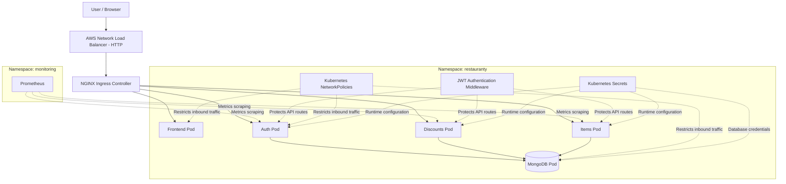
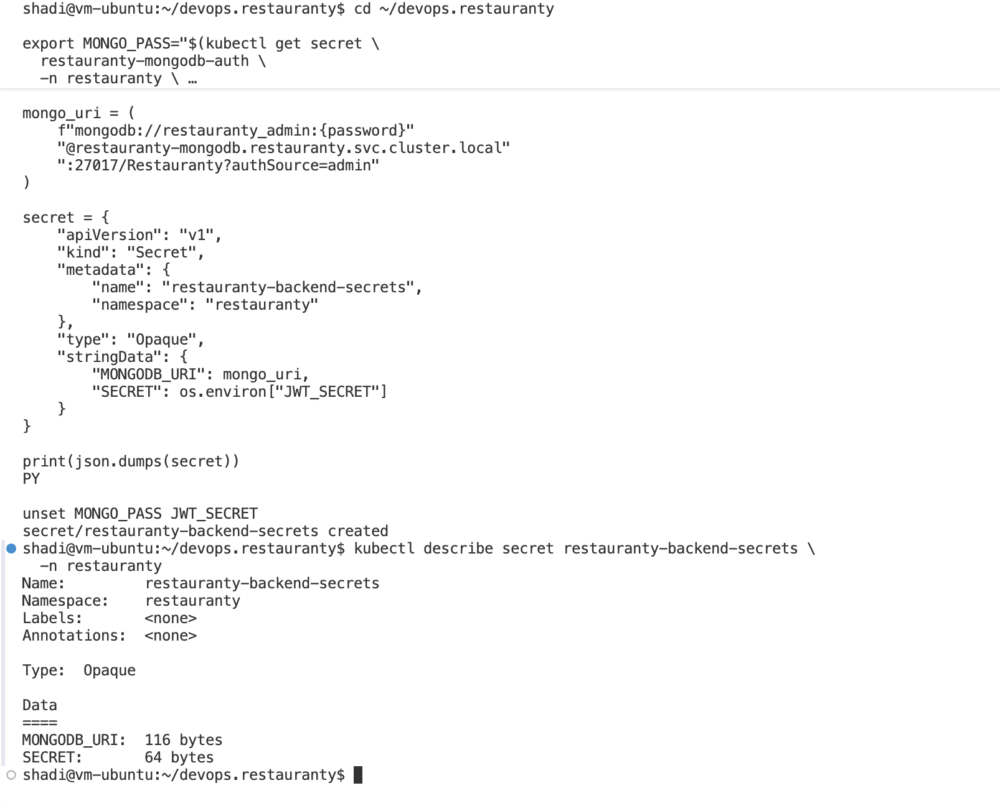
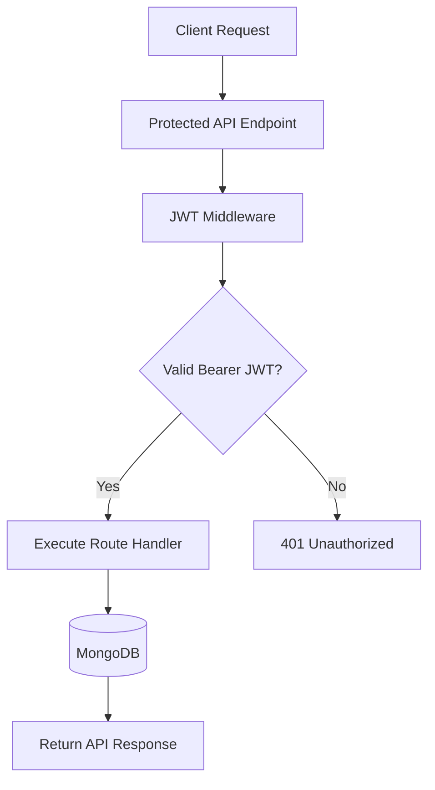
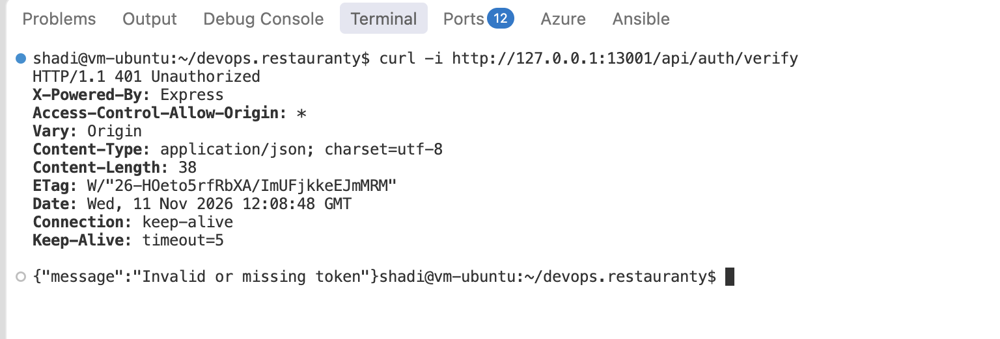
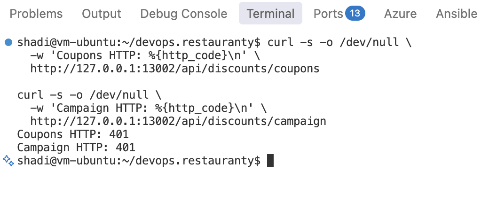
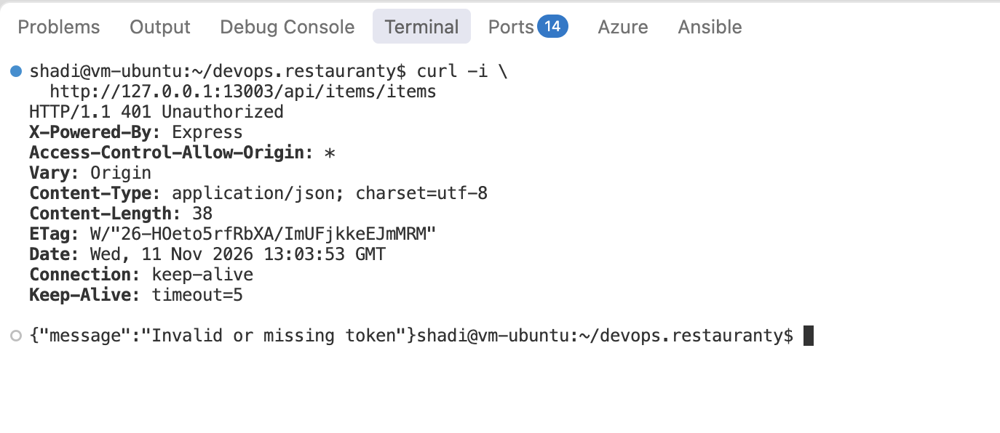
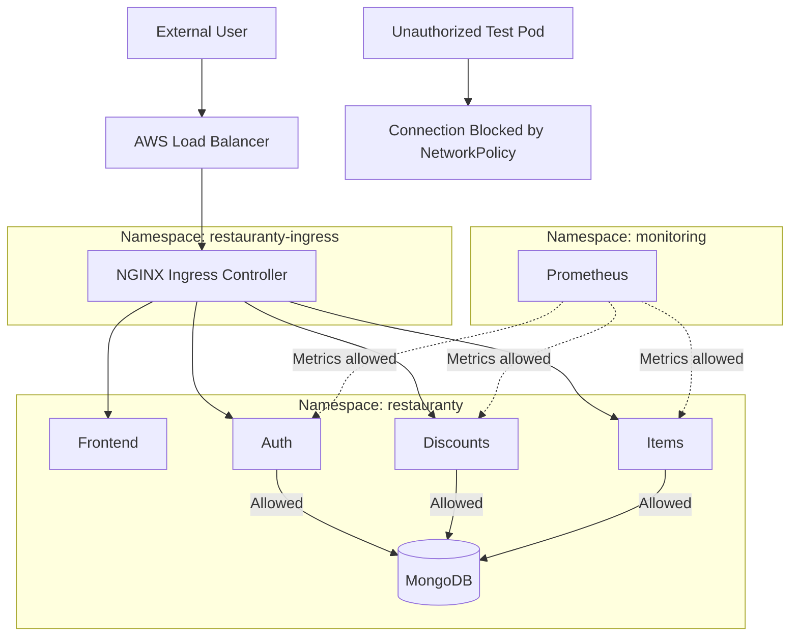
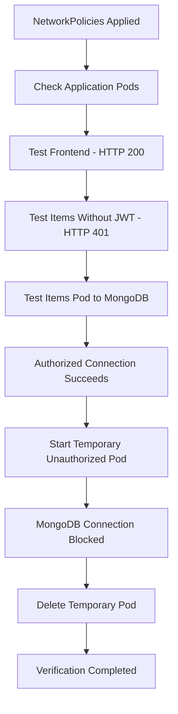

# Phase 8 — Security Implementation and Verification

## Objective

This phase focused on improving and verifying security in the Restauranty deployment on Amazon EKS.

The work covered application authentication, Kubernetes Secrets, AWS networking, container security, and Kubernetes NetworkPolicies.

The purpose was to reduce unnecessary access between services and verify that authorized application communication continued working after the security changes.

This document records the controls implemented and tested in the project. It does not claim that the application is fully production-ready or GDPR-compliant.

## 8.1 Security Overview

The project uses several security controls at different levels.

| Area | Implementation | Status |
|---|---|---|
| AWS IAM | Roles for EKS, worker nodes, and EBS CSI | Implemented |
| AWS IAM/OIDC | GitHub Actions deployment authentication | Implemented |
| Network placement | EKS worker nodes in private subnets | Verified |
| AWS Security Groups | Internal node-to-node TCP/80 rule | Implemented |
| Kubernetes Services | Internal ClusterIP and headless Services | Verified |
| Kubernetes Secrets | Database credentials and JWT secret | Implemented |
| Cloudinary credentials | `restauranty-cloudinary` Kubernetes Secret for image uploads | Implemented and tested |
| JWT authentication | Protected API routes and HTTP 401 handling | Verified through selected tests |
| Kubernetes NetworkPolicies | Four ingress policies | Implemented and tested |
| VPC CNI enforcement | NetworkPolicy support enabled | Verified |
| MongoDB storage | Encrypted gp3 StorageClass and bound PVC | Configured and verified |
| Container users | Non-root backend containers | Verified |
| HTTPS/TLS | Public endpoint currently uses HTTP | Pending |
| CORS restrictions | Current configuration allows all origins | Requires review |
| Network egress restrictions | Not configured | Pending |
| GDPR compliance | Formal assessment not completed | Not verified |

### Security Architecture



*Diagram 8.1 — Main security controls in the Restauranty EKS deployment.*

The diagram shows the main security layers. The NetworkPolicies are implemented as Kubernetes resources, not as separate network proxies.

## 8.2 AWS IAM and Network Security

### AWS Infrastructure

Terraform was used to provision the AWS infrastructure.

The EKS cluster runs in a dedicated VPC with two managed worker nodes located in private subnets.

The following AWS resources and security-related settings were configured:

- IAM roles for the EKS cluster and worker nodes.
- An IAM role for the EBS CSI Driver.
- EKS Pod Identity association for EBS operations.
- Security Groups controlling network traffic.
- Public and private subnets.
- An Internet-facing AWS Network Load Balancer.

The EBS CSI Driver uses the AWS-managed `AmazonEBSCSIDriverPolicyV2` policy.

A complete least-privilege audit of IAM permissions was not performed during this phase.

### Internal Services

The four application Services use the Kubernetes `ClusterIP` type.

MongoDB uses a headless Service and is not exposed directly through a public Kubernetes LoadBalancer.

The public entry point is the AWS Network Load Balancer connected to the NGINX Ingress Controller.

### AWS Security Group Fix

During the Kubernetes deployment, the frontend initially returned HTTP `504 Gateway Timeout` through the public Ingress.

The frontend responded through port forwarding, but the NGINX controller could not reach the frontend Pod across worker nodes.

A self-referencing TCP/80 ingress rule was added to the EKS worker-node Security Group using Terraform.

```hcl id="68uotk"
node_security_group_additional_rules = {
  ingress_self_frontend_http = {
    description = "Allow frontend HTTP between EKS worker nodes"
    type        = "ingress"
    protocol    = "tcp"
    from_port   = 80
    to_port     = 80
    self        = true
  }
}
```

The `self = true` setting limits the source to members of the same Security Group.

It does not expose worker-node port `80` directly to the entire internet.

After applying the change:

- The public frontend returned HTTP `200`.
- The protected Auth endpoint returned HTTP `401` without a token.
- NGINX Ingress routing was working.

This AWS Security Group rule and the Kubernetes NetworkPolicies serve different purposes.

Security Groups control network traffic at the AWS infrastructure level. Kubernetes NetworkPolicies restrict traffic to selected Pods using Kubernetes labels and policy rules.

More details are available in [Terraform Setup](05-terraform-setup.md).

## 8.3 Kubernetes Secrets Management

### Implemented Secrets

Two Kubernetes Secrets were created in the `restauranty` namespace.

| Secret | Purpose |
|---|---|
| `restauranty-mongodb-auth` | MongoDB root username and password |
| `restauranty-backend-secrets` | MongoDB connection URI and JWT signing secret |

The backend Deployments load the following values using `secretKeyRef`:

```text id="qhmq52"
MONGODB_URI
SECRET
```

The MongoDB StatefulSet loads the database username and password from `restauranty-mongodb-auth`.

The actual values were not stored directly in the committed Kubernetes Deployment files.

### Verification

The backend Secret was inspected without displaying its values.

```bash id="gd46g5"
kubectl describe secret restauranty-backend-secrets -n restauranty
```

The output confirmed that the expected keys existed.

### Evidence



*Figure 68 — Kubernetes Secret metadata and key sizes verified without displaying secret values.*

### Security Considerations

Using Kubernetes Secrets separates runtime credentials from application manifests.

However, Secret creation alone does not prove that encryption at rest, access restrictions, and credential rotation are correctly configured.

The following improvements remain relevant:

- Review Kubernetes RBAC permissions for reading Secrets.
- Verify the cluster's Secret encryption configuration.
- Rotate exposed credentials.
- Avoid storing real Secret values in Git.
- Use a dedicated MongoDB application user instead of the root account.
- Keep the JWT signing secret stable across routine deployments unless intentionally rotated.

## 8.4 JWT Authentication and API Protection

### Implementation

The Restauranty backend uses JWT authentication.

Protected routes use the `isAuthenticated` middleware to validate Bearer tokens before executing their route handlers.

The Auth, Discounts, and Items services were also updated to return HTTP `401 Unauthorized` for recognized authentication errors.

The middleware validates the token using the configured JWT signing secret.

### Authentication Flow



*Diagram 8.2 — JWT validation before access to protected backend routes.*

This middleware verifies authentication. Additional authorization rules are needed where users should have different permissions.

### Unauthorized Request Tests

Unauthenticated requests were sent to protected endpoints during Kubernetes verification.

| Endpoint | Observed Result |
|---|---|
| `GET /api/auth/verify` | HTTP 401 |
| `GET /api/discounts/coupons` | HTTP 401 |
| `GET /api/discounts/campaign` | HTTP 401 |
| `GET /api/items/items` | HTTP 401 |

The expected response for the tested missing-token requests was:

```json id="cg9r9k"
{
  "message": "Invalid or missing token"
}
```

### Auth Verification Evidence



*Figure 69 — Auth endpoint rejecting a request without a JWT.*

### Discounts Verification Evidence



*Figure 70 — Coupons and campaign endpoints rejecting unauthenticated requests.*

### Items Verification Evidence



*Figure 71 — Protected Items endpoint returning HTTP 401 without a JWT.*

### Result

The selected protected endpoints rejected requests without valid authentication.

Successful login and authenticated Items retrieval were also tested earlier in the local and Docker Compose environments.

These checks do not demonstrate that every endpoint or user permission has been fully tested in EKS.

More complete tests of authorization boundaries and token handling remain future security work.

## 8.5 MongoDB Storage and Backup Security

MongoDB runs as a one-replica StatefulSet with persistent storage.

The database uses:

- An internal headless Kubernetes Service.
- Credentials supplied through a Kubernetes Secret.
- A 10 GiB PersistentVolumeClaim.
- The `restauranty-gp3` StorageClass.
- Encryption enabled in the StorageClass configuration.

The StorageClass uses:

```yaml id="jtm5rq"
parameters:
  type: gp3
  encrypted: "true"
reclaimPolicy: Delete
```

The configuration requests encrypted EBS storage. A separate audit of the underlying EBS volume's encryption settings was not recorded in this phase.

### Migration Backup Handling

Database migration backups were created outside the Git repository.

The private backup directory was:

```text id="7h9vm7"
~/restauranty-migration-backups/
```

The migration transferred one existing user record from the local Docker database to the MongoDB instance on EKS.

The restored user was verified through a database record-count check and a successful application login.

The MongoDB restart-persistence test was completed separately after the migration.

### Storage Risks

Database archives may contain personal data and password hashes.

Backup files must not be committed to the repository or included in presentation packages.

The `Delete` reclaim policy also requires care when removing Kubernetes storage.

Deleting the relevant PVC and PersistentVolume can result in deletion of the underlying EBS volume and loss of database data.

See [Database Migration](07-database-migration.md).

## 8.6 Enabling Kubernetes NetworkPolicy Enforcement

### Objective

Kubernetes NetworkPolicies were added to restrict unnecessary inbound traffic between Pods.

The goal was to allow required application communication while blocking unauthorized connections to MongoDB.

### AWS VPC CNI Configuration

NetworkPolicy enforcement was enabled through the AWS VPC CNI add-on.

The following Terraform configuration was added in `terraform/eks.tf`:

```hcl id="orrm8w"
vpc-cni = {
  before_compute = true

  configuration_values = jsonencode({
    enableNetworkPolicy = "true"
  })
}
```

This configuration enabled NetworkPolicy support in the AWS VPC CNI add-on.

### Terraform Apply

The Terraform plan and apply showed:

```text id="0cwr01"
Plan: 0 to add, 1 to change, 0 to destroy
```

The change was applied successfully.

The AWS networking DaemonSet was then restarted or rolled out with NetworkPolicy support enabled.

### Verification

The `aws-node` DaemonSet was inspected to confirm that NetworkPolicy enforcement had been enabled.

The rollout completed successfully, and application Pods continued running.

Useful verification commands:

```bash id="8py4gn"
kubectl -n kube-system rollout status daemonset/aws-node
kubectl -n kube-system get daemonset aws-node
kubectl -n restauranty get pods
```

### Result

The EKS cluster was configured to enforce Kubernetes NetworkPolicies.

The next step was to apply the policies and test their effect on network traffic.

## 8.7 Implemented Kubernetes NetworkPolicies

Four NetworkPolicies were created in:

```text id="fkedp0"
k8s/network-policies.yaml
```

All four policies operate in the `restauranty` namespace.

### Policy Overview

| NetworkPolicy | Purpose |
|---|---|
| `default-deny-ingress` | Denies inbound traffic unless permitted by another policy |
| `allow-frontend-ingress` | Allows required traffic from NGINX Ingress to the frontend |
| `allow-backend-ingress` | Allows required backend access, monitoring, and backend-to-backend traffic |
| `allow-mongodb-ingress` | Allows MongoDB access from authorized backend Pods |

The policies use Kubernetes labels and namespace selectors to define allowed traffic.

They do not modify the application code.

### NetworkPolicy Architecture



*Diagram 8.3 — Allowed application traffic and blocked unauthorized MongoDB access.*

The diagram represents the intended and tested traffic flows. The exact label selectors and ports are defined in `k8s/network-policies.yaml`.

### Applying the Policies

From the project root:

```bash id="9vuo9v"
kubectl apply -f k8s/network-policies.yaml
```

### Verification

```bash id="lbsc6k"
kubectl -n restauranty get networkpolicy
kubectl -n restauranty describe networkpolicy
```

The cluster showed all four NetworkPolicy resources.

### Ingress and Egress Scope

These NetworkPolicies restrict inbound traffic.

Egress traffic is not restricted by the current policy set.

This means the current configuration provides ingress isolation, not complete two-way network isolation.

## 8.8 NetworkPolicy Connectivity Testing

### Test Objective

After applying the NetworkPolicies, connectivity was tested to check whether:

1. The frontend remained accessible.
2. Protected APIs continued responding correctly.
3. Authorized backend Pods could reach MongoDB.
4. An unauthorized Pod could not connect to MongoDB.

### Test Results

| Test | Observed Result | Status |
|---|---|---|
| Public frontend | HTTP 200 | Passed |
| Items API without JWT | HTTP 401 | Passed |
| Authorized Items-to-MongoDB connection | Connected | Passed |
| Unauthorized test Pod to MongoDB | Connection blocked or timed out | Passed |
| MongoDB connectivity metric | Healthy (`1`) | Passed |
| Application Pods | 5/5 Running | Passed |
| Temporary test Pod cleanup | Completed | Passed |

### Authorized Database Connection

A connection test was performed from the Items application Pod.

The backend was able to reach MongoDB through the internal Kubernetes network.

The test returned:

```text id="c6qxvz"
AUTHORIZED: CONNECTED
```

This showed that the required backend-to-database communication remained available after applying the policies.

### Unauthorized Database Connection

A temporary BusyBox Pod was created to test access from a source that was not included in the MongoDB allow policy.

The connection attempt failed or timed out.

The test returned:

```text id="28g4i8"
UNAUTHORIZED: CONNECTION BLOCKED
```

The unauthorized connection was also attempted directly against the MongoDB Pod IP.

This helped separate a NetworkPolicy connectivity result from a possible DNS-resolution issue.

The temporary test Pod was deleted after verification.

### Security Test Flow



*Diagram 8.4 — NetworkPolicy verification sequence.*

### Result

The tests showed that authorized application access continued working while the unauthorized MongoDB connection was blocked.

This provided practical evidence that NetworkPolicy enforcement was active for the tested traffic.

The tests did not cover every possible source Pod, port, protocol, or egress path.

### Recorded Demonstration

A screen recording was created showing the authorized and unauthorized MongoDB connection results.

[Watch the NetworkPolicy Security Test](../demos/networkpolicy-security-test.mp4)

## 8.9 Container User Security

The runtime user IDs of the application containers were checked.

### Verified Results

| Container | User ID | Result |
|---|---|---|
| Auth | 1000 | Non-root |
| Discounts | 1000 | Non-root |
| Items | 1000 | Non-root |
| Frontend | 0 | Root |

The three backend containers use a non-root runtime user.

The frontend uses the standard NGINX image and currently runs as root.

### Verification Commands

```bash id="sc8uft"
kubectl -n restauranty exec deployment/restauranty-auth -- id -u
kubectl -n restauranty exec deployment/restauranty-discounts -- id -u
kubectl -n restauranty exec deployment/restauranty-items -- id -u
kubectl -n restauranty exec deployment/restauranty-frontend -- id -u
```

### Result

Non-root execution was verified for the three backend containers.

Changing the frontend image and NGINX configuration to run as a non-root user remains a planned security improvement.

## 8.10 NetworkPolicy Rollback

### Purpose

If NetworkPolicies interrupt required application communication, the policy configuration must be reviewed and corrected.

Because Kubernetes NetworkPolicies are additive, deleting only one allow policy does not necessarily restore connectivity. Other policies may continue to restrict traffic.

### Emergency Rollback

To remove the policy set defined in the project file:

```bash id="jgux2m"
kubectl delete -f k8s/network-policies.yaml
```

This command removes the four NetworkPolicy resources defined in that file.

It should only be used intentionally during troubleshooting, because removing the restrictions reduces network isolation.

### Reapply Policies

After correcting the configuration:

```bash id="2ch7k0"
kubectl apply -f k8s/network-policies.yaml
```

### Post-Rollback Checks

```bash id="b1bt0s"
kubectl -n restauranty get networkpolicy
kubectl -n restauranty get pods
kubectl -n restauranty get deployments
```

Frontend connectivity, backend API responses, MongoDB access, and Prometheus scraping should be verified again after any policy change.

## 8.11 Remaining Security Improvements

The implemented controls cover selected application and infrastructure security requirements.

Several improvements remain relevant.

### HTTPS and TLS

The public application currently uses HTTP.

HTTPS/TLS should be configured before using the deployment for sensitive production traffic.

### CORS Configuration

The backend currently includes a permissive CORS configuration:

```javascript id="tcghye"
app.use(cors({
  origin: '*'
}));
```

The accepted origins should be reviewed and restricted where appropriate.

Authentication headers and any cookie-based behavior should be tested after changing CORS settings.

### Least-Privilege Database Access

The backend currently uses a MongoDB connection with root-level credentials.

A dedicated database user with the permissions required by the application would reduce the impact of credential misuse.

### Kubernetes and AWS Permissions

IAM roles, Kubernetes RBAC, and access to Secrets should be reviewed for least privilege.

### Network Egress

The current NetworkPolicies focus on inbound traffic.

Egress restrictions can be considered after mapping the external communication required by the application, DNS, and monitoring components.

### Container Hardening

The frontend should be changed to run as a non-root user where practical.

Other possible improvements include reviewing filesystem permissions, Linux capabilities, and container resource limits.

### Authentication Testing

Additional tests should cover:

- Valid and expired JWT tokens
- Invalid JWT signatures
- Different user permissions
- Token storage and session handling
- Additional protected API endpoints

### Data Protection

The project stores account information in MongoDB.

A production deployment would require further review of data retention, access control, deletion procedures, backups, and relevant GDPR obligations.

No formal GDPR compliance assessment was performed for this project.

### Git Repository Review

Before publishing project changes, review staged files for:

- `.env` files
- Private keys
- JWT tokens
- Terraform state and plan files
- Database archives
- AWS credentials
- Other sensitive information

## 8.12 Verification Commands

The following commands provide non-secret status information about the deployed security configuration.

### Application Status

```bash id="c53ok9"
kubectl -n restauranty get pods
kubectl -n restauranty get deployments
kubectl -n restauranty get services
kubectl -n restauranty get ingress
```

### NetworkPolicies

```bash id="3gjkjz"
kubectl -n restauranty get networkpolicy
kubectl -n restauranty describe networkpolicy
```

### Secrets Metadata

```bash id="kz89r3"
kubectl -n restauranty describe secret restauranty-backend-secrets
kubectl -n restauranty describe secret restauranty-mongodb-auth
```

These commands show Secret metadata and key information without printing Secret values.

### Persistent Storage

```bash id="7bd6mj"
kubectl -n restauranty get pvc
kubectl get storageclass restauranty-gp3
```

### NetworkPolicy Enforcement

```bash id="lqdirt"
kubectl -n kube-system rollout status daemonset/aws-node
kubectl -n kube-system get daemonset aws-node
```

### Monitoring Targets

Prometheus was configured to scrape the three backend application services.

After the NetworkPolicies were applied, the MongoDB connectivity metric remained healthy.

The monitoring setup is documented in [Monitoring Documentation](09-monitoring.md).

## 8.13 Security Verification Summary

| Control | Verified Result |
|---|---|
| Private EKS worker nodes | Configured |
| Internal Kubernetes Services | Verified |
| Public NGINX Ingress | HTTP routing working |
| AWS node Security Group | Internal TCP/80 rule applied |
| Kubernetes Secrets | Created and referenced |
| JWT unauthorized requests | HTTP 401 |
| AWS VPC CNI NetworkPolicy support | Enabled |
| Four NetworkPolicies | Applied |
| Authorized MongoDB connection | Connected |
| Unauthorized MongoDB connection | Blocked |
| Frontend availability | HTTP 200 |
| Application Pods | 5/5 Running |
| Backend non-root containers | Verified |
| Frontend non-root execution | Pending |
| HTTPS/TLS | Pending |
| Network egress restrictions | Pending |

## 8.14 Cloudinary Secret and Upload Security

The Items API uploads item images to Cloudinary. The upload route `POST /api/items/items` is protected by the existing JWT authentication middleware, and the multipart file field is named `imagem`.

A dedicated Kubernetes Secret, `restauranty-cloudinary`, stores the three Cloudinary settings required by the Items Deployment:

```text
CLOUD_NAME
CLOUD_API_KEY
CLOUD_API_SECRET
```

The Deployment uses `secretKeyRef` for these values. No actual Cloudinary API key or secret is embedded in Git-tracked Kubernetes YAML, documentation or screenshots.

The first upload failed with `Invalid cloud_name` (Cloudinary HTTP 401), indicating an incorrect configuration value. The cloud name was corrected in the Secret, and the Items Deployment was restarted so the application could read the new environment value. Three images were then uploaded and displayed in Restauranty.

A Kubernetes Secret is not equivalent to a full secrets-management solution: RBAC, encryption-at-rest settings and credential rotation still need review. The public application currently uses HTTP, so HTTPS/TLS is a high-priority improvement before handling real user data. File size limits, content validation and deletion of unused Cloudinary assets were not independently verified.

**Evidence and procedure:** [Phase 10 — Cloudinary Integration](10-cloudinary-integration.md).

## Outcome

The Restauranty project includes security controls at the application, Kubernetes, and AWS infrastructure levels.

JWT authentication was used to protect selected backend routes, Kubernetes Secrets provided runtime credentials, and AWS IAM roles supported infrastructure and deployment operations.

NetworkPolicy enforcement was enabled through the AWS VPC CNI add-on, and four ingress NetworkPolicies were applied.

Connectivity tests confirmed that the frontend and application APIs continued working, authorized backend access to MongoDB succeeded, and an unauthorized Pod could not establish a MongoDB connection.

The implementation provides a working security foundation for the project, while HTTPS, additional least-privilege controls, egress restrictions, and further security testing remain future improvements.

## Related Documentation

- [Project README](../README.md)
- [Local Application Security](03-security-fixes.md)
- [Terraform and AWS Infrastructure](05-terraform-setup.md)
- [Kubernetes Deployment](06-kubernetes-deployment.md)
- [Database Migration](07-database-migration.md)
- [Monitoring](09-monitoring.md)
- [Security Overview](../SECURITY.md)
