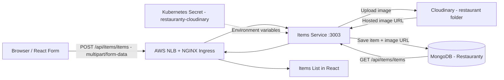
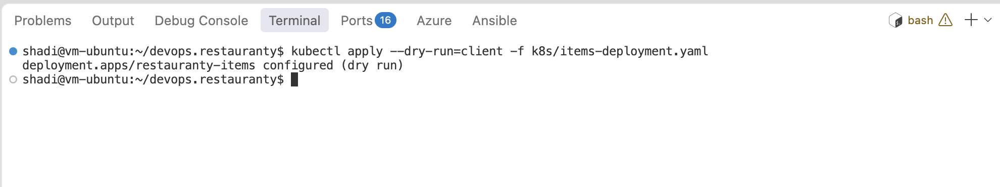
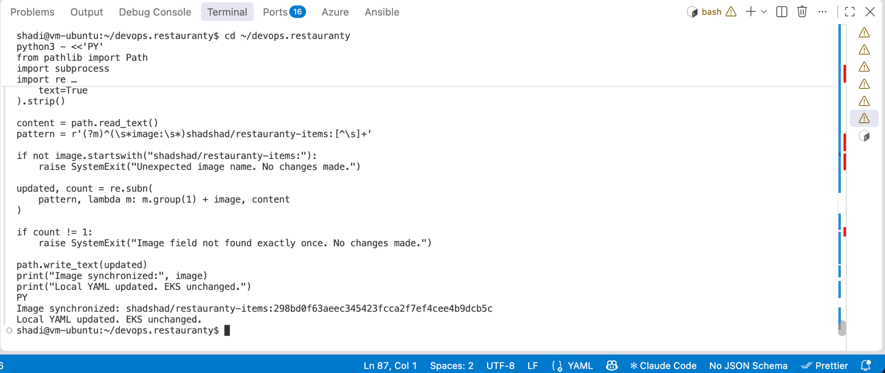
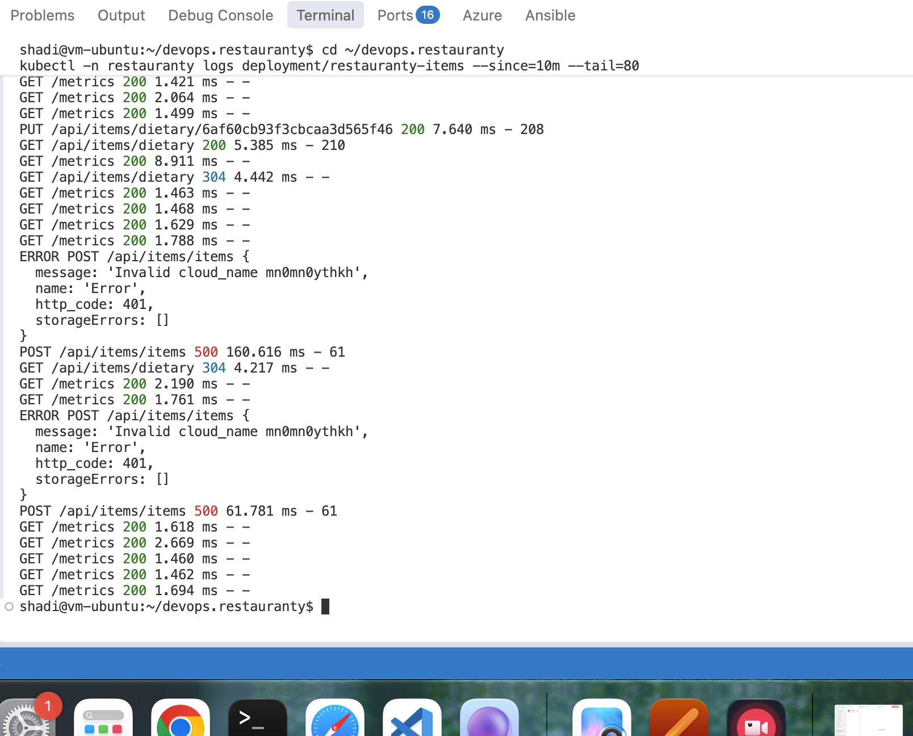
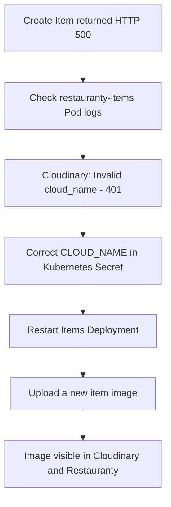
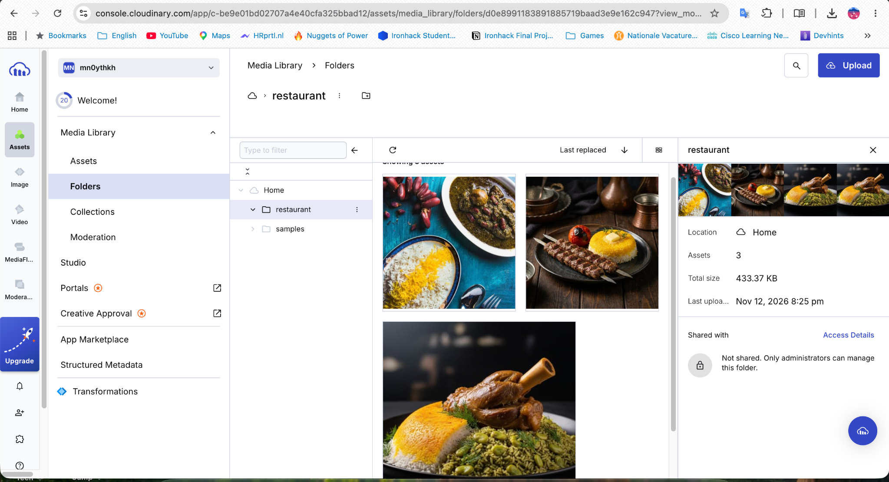
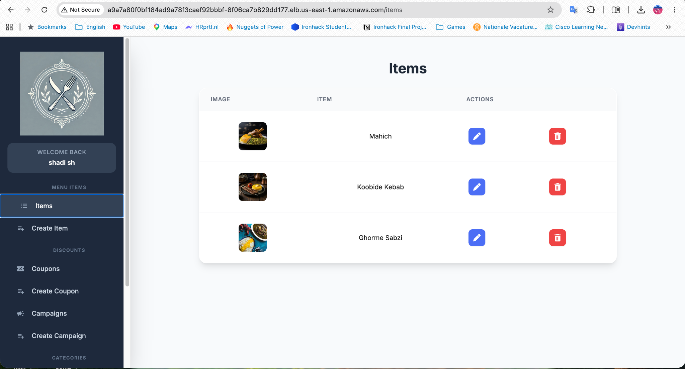
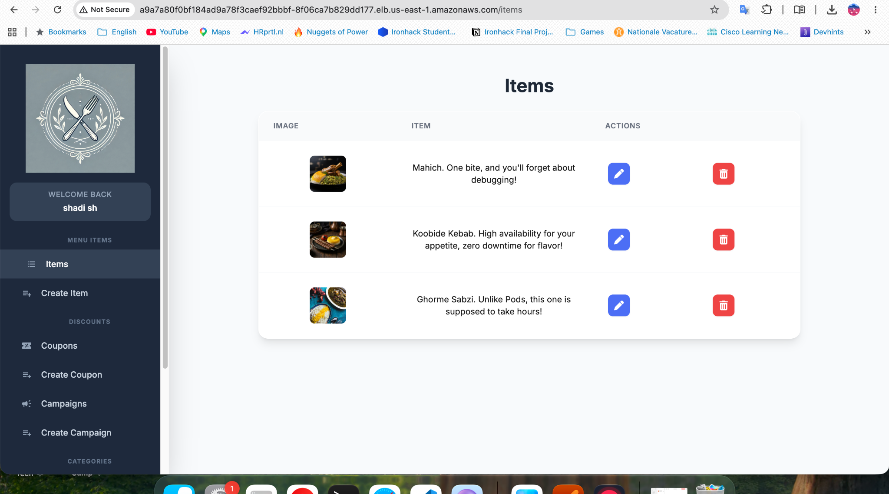
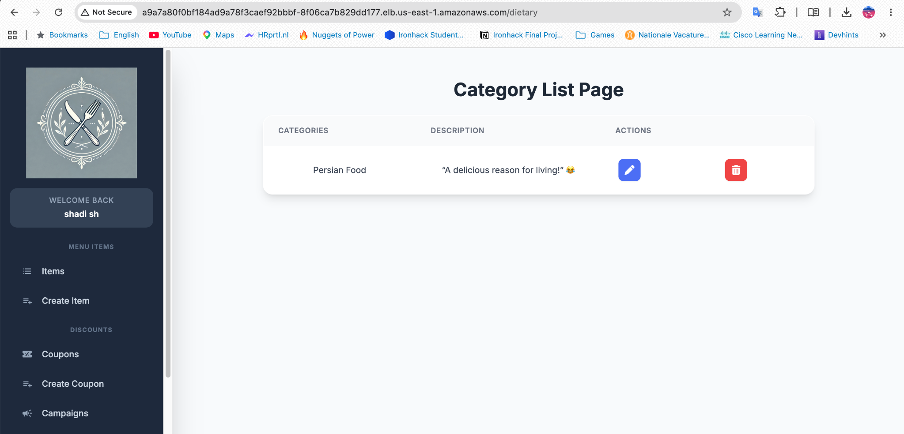

# Phase 10 — Cloudinary Image Upload Integration

## Objective

The goal of this phase was to finish and verify image uploads from the Restauranty application deployed on Amazon EKS.

The Items service already included Cloudinary integration code. The remaining work was to provide its Cloudinary credentials in Kubernetes, test the upload from the React interface, troubleshoot a failed attempt, and record the configuration in the Deployment manifest.

## 10.1 Implementation Overview

| Component | Implementation |
|---|---|
| Frontend | React Create Item form |
| Application backend | `restauranty-items` (Node.js / Express, port `3003`) |
| Upload middleware | Multer with `multer-storage-cloudinary` |
| Image storage | Cloudinary, folder `restaurant` |
| Database | MongoDB on EKS |
| Credential source | Kubernetes Secret `restauranty-cloudinary` |
| Kubernetes cluster | `restauranty-eks`, `us-east-1` |
| Status | Upload and application display verified |

## 10.2 Image Upload Architecture



*Diagram 10.1 — Image upload and display through the deployed application.*

The image is selected from the user's computer. The browser sends it to the Items API, which uploads it to Cloudinary. The application stores the image URL with the item data in MongoDB and retrieves it for display on the Items page.

## 10.3 Existing Application Code

The Items service contains its Cloudinary configuration in:

`backend/items/config/cloudinary.config.js`

The configuration reads these environment variables:

```text
CLOUD_NAME
CLOUD_API_KEY
CLOUD_API_SECRET
```

The upload middleware accepts JPG, JPEG, and PNG formats and uses the Cloudinary folder `restaurant`.

The item creation route is protected by JWT authentication:

```text
POST /api/items/items
```

The HTML file input and backend upload middleware use the same multipart form field name:

```text
imagem
```

The uploaded image is handled by `fileUploader.single("imagem")`. The route creates the item document and adds the uploaded Cloudinary URL to its `image` field.

## 10.4 Creating the Kubernetes Secret

A new Secret named `restauranty-cloudinary` was created in the `restauranty` namespace.

The three Cloudinary values were entered privately through a hidden terminal prompt and supplied to `kubectl` through standard input. They were not written into the project files or the shell command history.

Creation result:

```text
secret/restauranty-cloudinary created
```

The Secret can be checked without exposing its values:

```bash
kubectl -n restauranty describe secret restauranty-cloudinary
```

Only the Secret metadata and key names should be shared as documentation evidence. Actual API credentials must not be committed or included in screenshots.

## 10.5 Connecting Cloudinary to the Items Deployment

The running Items Deployment initially had three environment variables:

```text
PORT
MONGODB_URI
SECRET
```

Cloudinary variables were added to the running Deployment using:

```bash
kubectl -n restauranty set env deployment/restauranty-items --from=secret/restauranty-cloudinary
kubectl -n restauranty rollout status deployment/restauranty-items --timeout=180s
```

The rollout completed successfully. The Deployment's environment variable names were checked and included all six expected names.

The updated Items Pod was `1/1 Running`, with zero restarts at the time of verification.

### Persistent Manifest Configuration

The file `k8s/items-deployment.yaml` was also updated to reference the same Secret:

```yaml
- name: CLOUD_NAME
  valueFrom:
    secretKeyRef:
      name: restauranty-cloudinary
      key: CLOUD_NAME
- name: CLOUD_API_KEY
  valueFrom:
    secretKeyRef:
      name: restauranty-cloudinary
      key: CLOUD_API_KEY
- name: CLOUD_API_SECRET
  valueFrom:
    secretKeyRef:
      name: restauranty-cloudinary
      key: CLOUD_API_SECRET
```

This is an excerpt from the container's `env` list, not a complete Deployment manifest.

The Cloudinary environment-variable references were checked with a client-side Kubernetes dry run before the image-tag synchronization. The image tag in the local manifest was then aligned with the image used by the running EKS Deployment. This updated only the local YAML; no Kubernetes apply was performed as part of the synchronization. A second dry run after the tag update was not yet recorded.

The initial manifest check returned:

```text
deployment.apps/restauranty-items configured (dry run)
```



*Figure 10.1 — Client-side validation of the Items Deployment manifest.*



*Figure 10.2 — Local manifest image tag synchronized with the running Deployment.*

**Deployment note:** The Secret itself is managed in the live cluster and is not committed to Git. A new cluster must have the Secret created securely before deploying Items. The image tag recorded in the manifest reflects this verification point and may become outdated after later CI/CD deployments. The GitHub Actions image updates do not normally remove existing environment-variable references.

## 10.6 Troubleshooting the Initial Upload Failure

The first attempts to create a menu item with an image returned an internal server error in the React form.

The Items service logs showed:

```text
Invalid cloud_name
http_code: 401
POST /api/items/items 500
```



*Figure 10.3 — Items API logs showing the Cloudinary authentication/configuration error.*

The failure was traced to an incorrect `CLOUD_NAME` value supplied in the Kubernetes Secret. The Cloud Name was corrected using the value from the Cloudinary dashboard, and the Items Deployment was restarted to load the updated Secret.

The image file itself was not the problem. Images were supposed to be selected from the user's computer and uploaded automatically by the backend.

### Troubleshooting Flow



*Diagram 10.2 — Investigation and resolution of the failed image upload.*

## 10.7 End-to-End Verification

After correcting the Cloud Name, images were uploaded through the Restauranty Create Item form. The following results were observed:

| Test | Result |
|---|---|
| Select a local JPG/JPEG image in React | Passed |
| Submit item through the protected Items API | Passed |
| Find uploaded images in Cloudinary | Passed |
| Find created items with their images in Restauranty | Passed |
| View the Persian Food category | Passed |
| Verify persisted image URL directly with a MongoDB query | Not separately recorded |

### Cloudinary Media Library

Three uploaded food images were visible in the Cloudinary `restaurant` folder.



*Figure 10.4 — Three menu item images stored in Cloudinary.*

### Items in Restauranty

The deployed Items page displayed three created dishes and their images: Mahicheh, Koobideh Kebab, and Ghormeh Sabzi.



*Figure 10.5 — Restauranty Items page showing images returned by the application.*

The test was repeated by viewing the list with short descriptions containing DevOps humor, including debugging, Pods, and high availability.



*Figure 10.6 — Final Persian menu demo used for the presentation.*

The category `Persian Food` was also created and displayed successfully.



*Figure 10.7 — Persian Food category and its short description.*

This provided a simple and memorable demonstration of the Cloudinary integration while keeping the focus on the technical outcome.

## 10.8 Security and Operational Notes

- Cloudinary credentials are referenced through a Kubernetes Secret rather than placed in Git-tracked YAML.
- Kubernetes Secrets are base64-encoded by default. Their protection also depends on Kubernetes RBAC and cluster encryption settings.
- The upload endpoint is protected by the Items service's JWT middleware.
- Only the image formats defined in the upload configuration are allowed.
- The application currently serves user traffic over HTTP. HTTPS/TLS is a remaining improvement, especially for authenticated requests.
- Cloudinary files may remain in media storage even if a Restauranty database item is deleted. Automatic cleanup of Cloudinary assets was not verified.
- A direct MongoDB document inspection for the Cloudinary image URLs was not recorded in this phase; successful application display and Cloudinary storage were verified.

## Phase Summary

Cloudinary image upload integration was completed and verified through the deployed Restauranty application.

The Items Deployment was configured with the required credentials from Kubernetes Secrets. The initial `Invalid cloud_name` error was diagnosed from Pod logs and corrected without exposing the actual credentials.

Three food images were subsequently uploaded, appeared in the Cloudinary Media Library, and were displayed alongside their items in Restauranty. The results were saved as screenshots for the project presentation.

## Related Documentation

- [Project README](../README.md)
- [Kubernetes Deployment](06-kubernetes-deployment.md)
- [Security Implementation](08-security.md)
- [Monitoring](09-monitoring.md)
- [Application Manifests](../k8s/)
